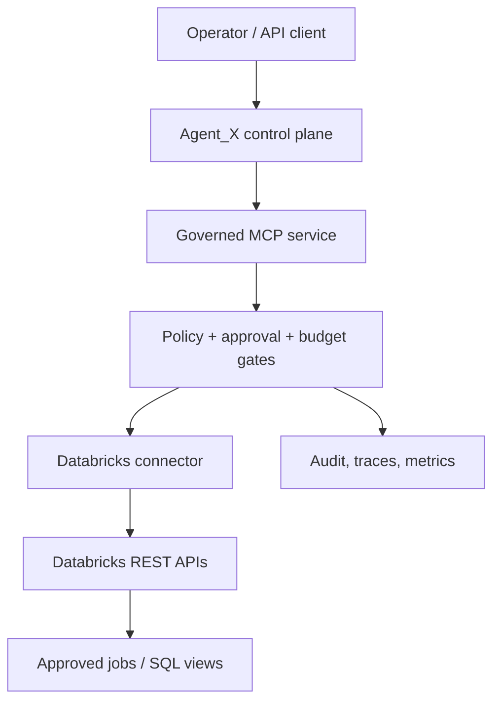
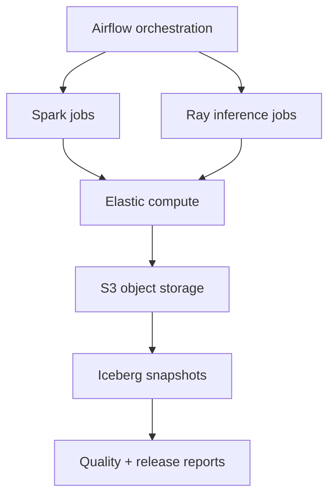
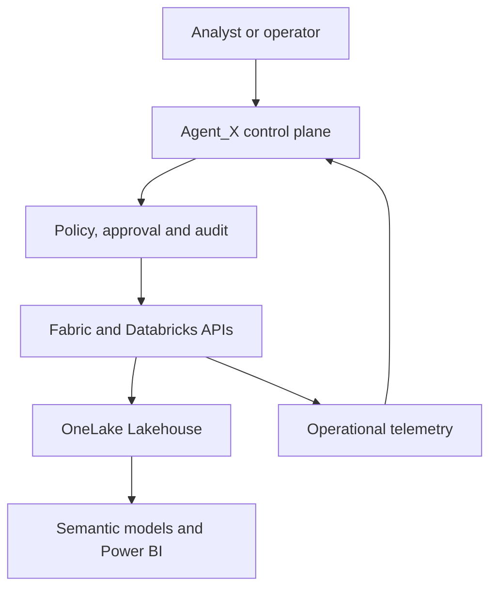
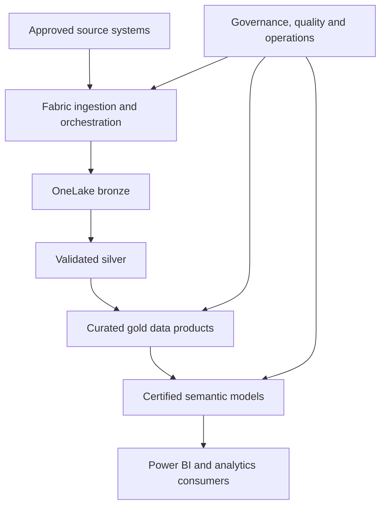
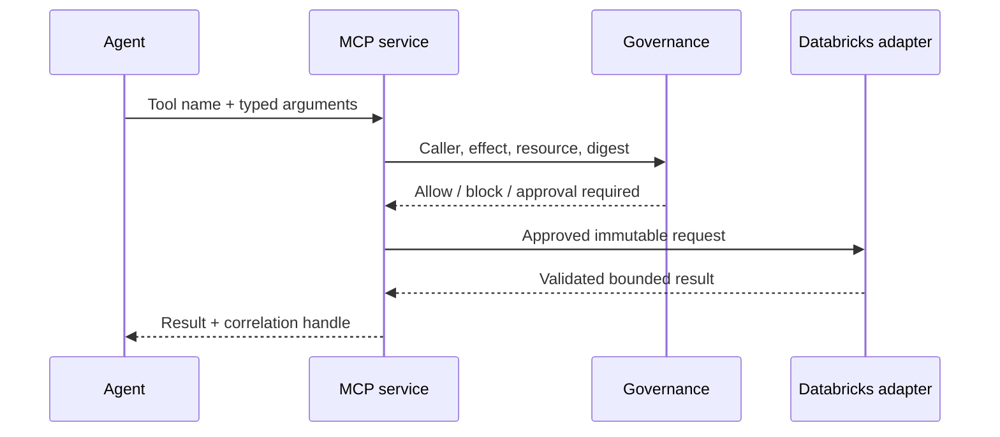
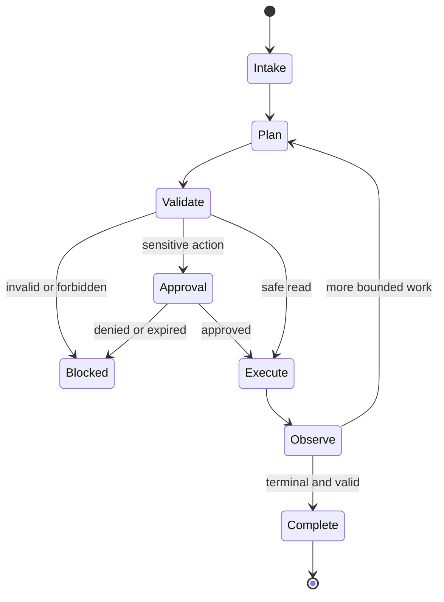
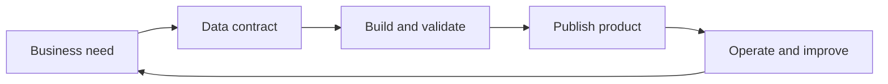
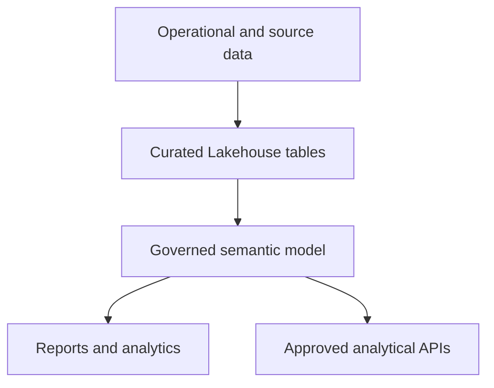
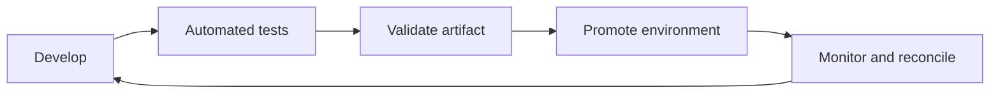
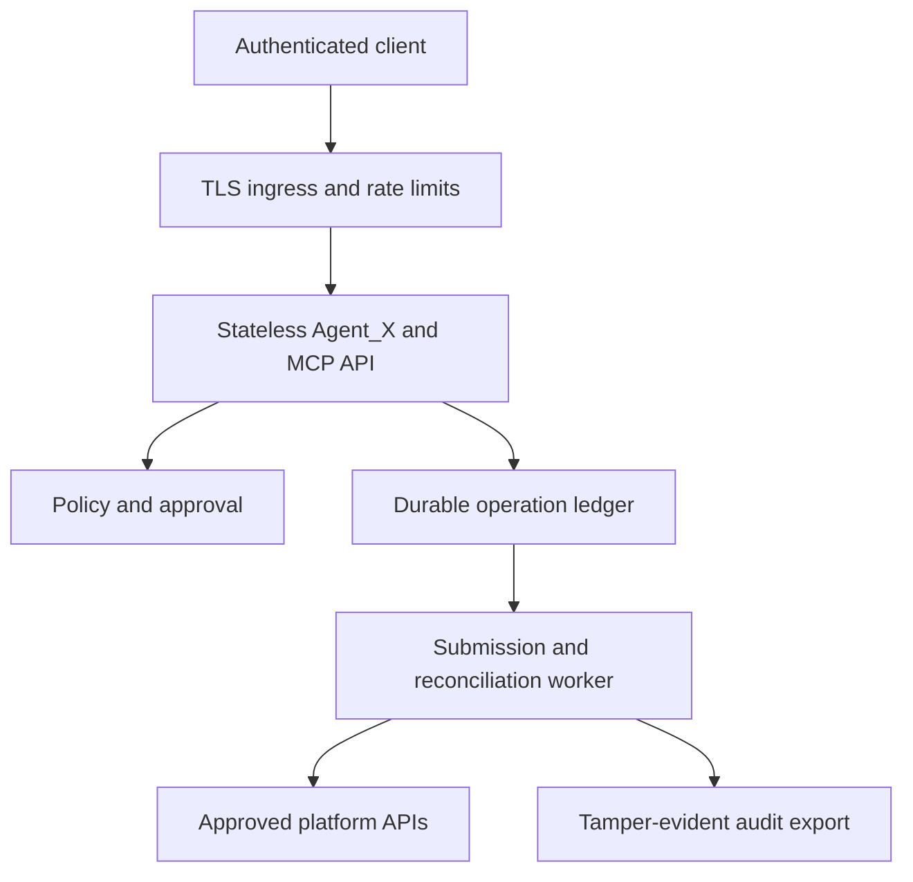

# Agent_X Enterprise Analytics and Governed Data Operations Platform

## Bank of Canada-aligned architecture and implementation manuscript

**Status:** Industry-reviewed target architecture - implementation evidence still required  
**Repository:** [Astrocytech/Agent_X](https://github.com/Astrocytech/Agent_X)  
**Repository baseline reviewed:** `main` at `fb1ab39bc7ecbd66a5572f3624b7916e5d0616b6` (July 27, 2026)  
**Prepared:** August 13, 2026  
**Revision:** 3.0 - exact job-description alignment review  
**Target role:** Bank of Canada Senior Platform Analytics Developer, requisition 11583, grade 17  
**Document purpose:** Architecture source of truth, implementation roadmap, interview study guide, and future textbook manuscript  
**Architecture review:** 10/10 design-document completeness after the production-hardening review in Section 25  
**Job-description alignment:** 10/10 coverage and prioritization after the role-alignment review in Section 31  
**Implementation maturity:** Not production-ready until the phase gates and evidence requirements in Sections 15, 16, and 30 pass  

### How to read this document

This manuscript describes one architecture through two deployment profiles:

- **Startup implementation:** open-source and AWS-oriented components that a small company can adopt incrementally.
- **Bank reference deployment:** the same architectural principles mapped to Microsoft Fabric, OneLake, Azure, Databricks, semantic models, Power BI, DataOps, and enterprise operating controls.

The startup profile is the realistic implementation path for Astrocytech. The Bank profile demonstrates that the design can be adapted to the target institution's established analytics ecosystem. The two profiles share contracts, controls, lineage, testing, and operational principles; they do not pretend that Astrocytech historically used Microsoft Fabric.

The 10/10 rating applies to the completeness and realism of the architecture specification. It does not rate unimplemented code as production-ready. Production approval still depends on measured service objectives, security review, load and recovery tests, operational ownership, and implementation evidence.

---

## 1. Executive decision

The right upgrade is **not** to turn Agent_X into Spark, Ray, Airflow, Microsoft Fabric, Databricks, or a 412-terabyte data processor. Agent_X should become the **governed control plane** for an enterprise analytics platform while the existing data systems remain the **execution and data plane**.

For the **Bank role**, the first priority is the enterprise analytics platform and its data products: scalable Fabric/Lakehouse architecture, ingestion and transformation, semantic models, governed BI consumption, quality and service objectives, platform administration, operational support, and controlled delivery. Agent_X is a secure operational extension to that platform, not the centre of the role.

For the **Agent_X repository**, the first production-shaped code capability should still be a small set of typed Databricks tools exposed through a real MCP service. The service uses durable operation records and Databricks idempotency tokens so that a lost HTTP response cannot create duplicate runs:

1. Inspect approved Databricks jobs and recent runs.
2. Start only pre-registered workflows with schema-validated parameters.
3. Monitor a run and retrieve a bounded, structured result.
4. Query approved operational views for dataset versions and quality summaries.
5. Require human approval for sensitive actions such as starting a production workflow or cancelling a run.
6. Record the caller, policy decision, approval, Databricks request, result, latency, and correlation identifiers without recording secrets or raw sensitive data.

The main 412 TB pipeline remains separate:

- Airflow orchestrates pipeline stages.
- Spark performs large table operations.
- Ray performs Python-heavy distributed inference.
- EKS supplies elastic container compute where that scale is justified.
- S3 stores the files.
- Apache Iceberg publishes versioned analytical tables and snapshots.

Agent_X should interact with this environment through **small control messages and metadata**, never by moving the corpus through the language model or MCP server.

For the Bank reference deployment, the same control plane sits above Fabric and Databricks capabilities. Fabric pipelines handle ingestion and orchestration, Fabric Spark or an approved Azure Databricks workload handles transformation, OneLake Delta tables provide the Fabric-first analytical foundation, semantic models publish reusable business meaning, and Power BI delivers controlled consumption. Agent_X invokes only approved operational capabilities through MCP; it does not replace the analytics platform. A Databricks-first ADLS/Unity Catalog variant requires its own system-of-record ADR.

This gives a credible startup architecture and an exact Bank of Canada role story: the candidate can design, build, administer, support, govern, improve, and explain an enterprise analytics platform from source ingestion through certified semantic consumption, while also adding tightly governed AI-assisted operations.

---

## 2. Source requirements distilled

The supplied PDFs, the requested Astrocytech scenario, and the recovered Bank of Canada job description imply the following combined requirements:

- Multi-step reason-act-observe behavior rather than a one-shot prompt.
- Typed and narrowly scoped tools.
- Knowledge separated from dynamic memory.
- Deterministic guardrails before model-based judgment.
- Human review for high-impact or irreversible actions.
- Component-level and end-to-end evaluation.
- Run traces, operational metrics, cost measurement, and failure recovery.
- Protection from prompt injection, data leakage, resource exhaustion, and unsafe execution.
- Reproducible data processing with versioned inputs, outputs, code, models, and dataset snapshots.
- Loosely coupled components and reversible architectural decisions.
- Security, reliability, scalability, observability, and FinOps treated as design inputs rather than later additions.
- End-to-end ownership from ingestion through reusable analytical and semantic data products.
- Batch and real-time processing paths with explicit service objectives.
- Advanced SQL, Python, and Spark engineering practices.
- Lakehouse architecture, workspace/capacity administration, security, and performance optimization.
- Semantic and dimensional modelling that supports governed BI consumption.
- DataOps/DevOps, automated testing, CI/CD, deployment promotion, rollback, and operational support.
- Architecture standards, roadmap decisions, stakeholder translation, coaching, and technical leadership.
- A Bank reference mapping for Microsoft Fabric, OneLake, Azure/Databricks, Power BI, Power Automate, and Fabric Activator (named Data Activator in the recovered job description).

The startup profile satisfies the requirements without forcing a small company to purchase a Microsoft-heavy platform. The Bank reference profile maps the same contracts and controls to Microsoft Fabric, OneLake, Entra ID, Azure/Databricks, and Power BI. This is a deliberate deployment choice, not a claim that the platforms are identical.

---

## 3. Current Agent_X reality check

Agent_X has many useful governance building blocks, but the Databricks capability does not currently exist.

### 3.1 What can be reused

| Existing area | Reusable capability |
|---|---|
| `tools/agentx_evolve/tools/` | Typed tool definitions, trust tiers, roles, effects, policy decisions, audit models |
| `tools/agentx_evolve/human_review/` | Approval request, decision, expiry, scope validation, revocation, review queue |
| `tools/agentx_evolve/external_connector_governance/` | Connector registration, route decisions, dispatcher abstraction, reconciliation models |
| `tools/agentx_evolve/sensitive_config_governance/` | One-shot secret handles and adapter-local resolution |
| `tools/agentx_evolve/runtime_adapter_enforcement/` | Bounded adapters and pre-effect governance checks |
| `tools/agentx_evolve/monitoring/` | Local events, metrics, health, alerts, traces, redaction, retention |
| `tools/agentx_evolve/prompt_context_governance/` | Trust classification, injection detection, sanitization, message construction |
| `tools/agentx_evolve/resource_budget_enforcement/` | Per-run limits and consumption accounting |
| `tools/agentx_evolve/concurrency_locks/` | Run-level locking and ownership checks |
| `tools/agentx_evolve/model_provider_routing/` | Governed model/provider selection independent from the data connector |
| `api_server.py` and React UI | Existing operator surface, sessions, streamed events, questions, and permission prompts |

### 3.2 What is incomplete or unsafe for this use case

| Current behavior | Consequence |
|---|---|
| `mcp/mcp_server.py` only builds a manifest and returns a list of tools. | It is not a functioning MCP transport server. |
| `mcp/mcp_adapter.py` blocks every tool that uses a network, subprocess, or source write. | A Databricks API tool can never execute. |
| A successful MCP policy check returns `ALLOWED` with the original arguments. | No real backend call, result validation, or reconciliation occurs. |
| `docs/mcp.md` is still `TBD`. | The public MCP contract is not documented. |
| The default tool registry has no Databricks tools. | The model cannot request governed Databricks operations. |
| The connector registry has Jira, GitHub, Slack, email, filesystem, PostgreSQL, and a broad custom HTTPS route, but no Databricks route. | Using the generic HTTPS connector would be too permissive and would weaken audit semantics. |
| The generic connector dispatcher creates synthetic effect metadata, including a fixed success status, rather than deriving it from a real HTTP response. | Current reconciliation cannot prove what the remote service actually did. |
| `secrets_credential_manager` is explicitly `SCAFFOLD_ONLY`. | It cannot be presented as a production secret store. |
| `api_auth/auth.py` hashes any non-empty input and later considers any non-empty token valid. | It is not authentication and must not protect a remote MCP service. |
| `network_egress_guard/guard.py` reports configuration but does not enforce actual egress. | A production connector needs hostname pinning and network-level restrictions. |
| Root dependencies contain only PyYAML and JSON Schema by default. | The MCP SDK and Databricks SDK are not installed or pinned. |

**Architectural conclusion:** this is a governed implementation project, not a configuration exercise. The existing policy, approval, evidence, and orchestration components should be reused, while the MCP transport, Databricks connector, real authentication, network enforcement, and remote-effect reconciliation must be added.

---

## 4. Scope and non-goals

### In scope for the first release

- One Databricks workspace per deployment environment.
- Native Databricks service principal with OAuth machine-to-machine authentication.
- A real MCP server with local stdio mode and remote Streamable HTTP mode.
- Approved job discovery, run status, run output, job start, and run cancellation.
- Approved read-only dataset-quality and release-status queries.
- Human approval for production-impacting actions.
- Full audit and bounded observability.
- Mock server and contract tests that do not require paid Databricks usage.
- One small live integration environment for end-to-end proof.

### Explicit non-goals for the first release

- Passing raw SQL written by the model to Databricks.
- Letting the model create, update, or delete jobs, clusters, warehouses, users, permissions, secrets, catalogs, schemas, or tables.
- Letting the model choose an arbitrary workspace hostname, REST path, job ID, notebook path, warehouse ID, S3 path, or URL.
- Sending corpus documents, PII, credentials, or large query results into the model context.
- Replacing Airflow, Databricks Jobs, Spark, Ray, EKS, S3, or Iceberg.
- Claiming that the local demonstration can process 412 TB.
- Depending on Databricks preview-only MCP features for the core integration.
- Adding multi-agent coordination merely because Agent_X supports it. A single governed operations agent is sufficient initially.

---

## 5. Target logical architecture



**Figure 5-1. Governed agent control plane.** The agent selects a bounded tool, while authentication, policy, approval, connector execution, and evidence remain outside model reasoning. Alt text: Agent_X reaches approved Databricks jobs and views only through MCP, governance, and a dedicated connector.

The data plane remains independent:



**Figure 5-2. Historical AWS data plane.** Airflow coordinates Spark and Ray jobs on elastic compute, S3 stores the results, and Iceberg publishes validated snapshots. Alt text: The bulk data pipeline is independent from Agent_X and ends in versioned quality and release reports.

The connection between the two planes is deliberately narrow. Agent_X reads operational status and requests approved actions. It does not become part of Spark task execution and does not carry dataset rows.

### Responsibility boundaries

| Component | Owns | Must not own |
|---|---|---|
| Agent_X | Goal interpretation, bounded planning, tool selection, user interaction | Databricks credentials, arbitrary API construction, bulk data processing |
| MCP service | Tool schemas, caller authentication, correlation, policy handoff | Business logic hidden from governance, arbitrary proxying |
| Policy and approval layer | Role/effect decisions, approval scope, expiry, budgets | Remote API execution |
| Databricks connector | OAuth, SDK/REST calls, retries, pagination, response mapping | Agent reasoning or user approval decisions |
| Workflow tracker | Run handles, state transitions, polling/backoff, idempotency | Dataset transformation logic |
| Databricks jobs / Airflow | Workflow execution and dependency ordering | Natural-language authorization decisions |
| Spark/Ray | Distributed processing and inference | Publishing an unvalidated dataset release |
| Iceberg/S3 | Versioned data and immutable release evidence | Agent session state |
| Audit store | Append-only decisions and effects | Credentials, raw PII, entire model prompts |

---

## 6. Deployment profiles

The architecture needs two honest profiles rather than one expensive design presented as universally necessary.

### 6.1 Startup / interview demonstration profile

| Layer | Choice |
|---|---|
| Agent_X | One Python service/container on a developer machine or small Linux VM |
| MCP transport | stdio locally; localhost-only Streamable HTTP for UI integration |
| State | SQLite for a single-user demonstration, with append-only JSONL evidence retained from Agent_X |
| Databricks | Trial, development, or paid workspace with one narrowly permissioned service principal |
| Compute | One small approved Databricks job or serverless job; auto-termination enabled |
| SQL | One small SQL warehouse with auto-stop, only if quality-summary queries are demonstrated |
| Data | Synthetic documents and generated metadata; no real personal or confidential data |
| Object storage | A small S3 bucket or MinIO for local data-plane demonstrations |
| Processing fallback | DuckDB/Polars for small tabular steps; optional local Ray for parallel inference demonstration |
| Orchestration | Databricks Jobs for the demo; no Airflow cluster required |
| Monitoring | Structured logs, Agent_X JSONL metrics, run ledger, local dashboards if useful |

Databricks Free Edition can support learning and prototyping, but Databricks states that it is not a commercial production service and has no reliability guarantee or SLA. The interview demo should therefore be described as a prototype unless it runs in a trial or paid workspace with service-principal access.

### 6.2 Scale / production profile

| Layer | Choice |
|---|---|
| Agent_X and MCP | Separate containers on ECS/Fargate or EKS only when traffic or isolation requires it |
| Inbound identity | Organization OIDC/OAuth provider, audience-bound access tokens, TLS |
| State | Managed PostgreSQL with encrypted storage, backups, migrations, and retention policy |
| Secrets | AWS Secrets Manager or another approved external secret manager; adapter-local retrieval only |
| Databricks | Production workspace, separate service principals by environment and responsibility |
| Data pipeline | Airflow submits Spark jobs through one selected EKS execution mechanism and Ray jobs through KubeRay; Airflow passes references, never dataset payloads |
| Storage | S3 with encryption, bucket policies, lifecycle rules, access logs, and exactly one authoritative Iceberg catalog per environment |
| Network | Private connectivity when available; otherwise explicit egress allowlist to the exact workspace hostname |
| Observability | OpenTelemetry-compatible traces and centralized metrics/logs, while retaining Agent_X evidence records |
| Delivery | Source-controlled job definitions and Databricks Declarative Automation Bundles where appropriate |

**Cost rule:** do not deploy EKS, Airflow, Spark, Ray, PostgreSQL, and a remote MCP service solely to make the diagram look enterprise-grade. Add each managed component when the workload, concurrency, availability, or control requirement justifies it.

### 6.3 Bank of Canada reference profile

This profile is an architectural mapping for the target role. It is not a claim about the historical Astrocytech deployment.

| Capability | Bank reference choice | Agent_X relationship |
|---|---|---|
| Ingestion and orchestration | Fabric Data Pipelines, Data Factory capabilities, or approved Databricks Workflows | Observe and start registered workflows through bounded tools |
| Lakehouse storage | OneLake with governed Delta Lakehouse tables and separate development, test, and production workspaces | Read release metadata and quality summaries, not raw business data |
| Transformation | Fabric Spark, Azure Databricks, Python, and advanced SQL | Execute reviewed code through platform jobs |
| Batch processing | Scheduled pipelines with incremental, idempotent loads | Monitor freshness, completion, retries, and SLA status |
| Real-time processing | Fabric Eventstreams/Real-Time Intelligence where the business requirement justifies it | Inspect lag, checkpoint health, and alert state |
| Semantic layer | Version-controlled dimensional models, shared measures, row-level security, certified datasets | Retrieve only approved model health and refresh information |
| BI consumption | Power BI reports and governed self-service analytics | Explain data-product status without generating unrestricted queries |
| Automation | Power Automate for business workflows; Fabric Activator for approved event-driven actions | Trigger only registered automations with policy and approval evidence |
| Identity | Entra workload identity or managed identity where supported; service-principal secret only as a controlled fallback | Separate inbound Agent_X identity from outbound platform identity |
| Governance | Named ownership, classifications, lineage, retention, access review, and release evidence | Add decision and tool-use lineage to platform lineage |
| Delivery | Git-based development, automated validation, CI/CD, environment promotion, and rollback | Enforce evidence gates before remote effects |
| Operations | Capacity monitoring, cost controls, incident response, SLO/SLA dashboards, runbooks | Correlate user intent, platform action, outcome, and recovery |

#### Reference topology



**Figure 6-1. Bank reference deployment.** Agent_X governs actions and explanations while the enterprise analytics platform owns data movement, processing, storage, semantic meaning, and BI delivery. Alt text: An operator reaches Fabric and Databricks through Agent_X policy and audit controls; Lakehouse data feeds semantic models and Power BI, while telemetry returns to Agent_X.

#### Primary architecture for the Bank role

The role is primarily responsible for the following flow; the agent-control diagram is a secondary operational extension.



**Figure 6-2. Bank enterprise analytics product flow.** The platform turns approved sources into validated, reusable analytical products and certified business meaning. Alt text: Fabric ingestion moves data through bronze, silver, and gold layers into semantic models and Power BI, with governance, quality, and operations applied across the lifecycle.

| Platform area | Senior Platform Analytics Developer responsibility |
|---|---|
| Tenant, capacity, domains, and workspaces | Establish environment topology, naming, ownership, capacity placement, isolation, access model, and lifecycle standards with platform administrators |
| Connections, gateways, and identities | Standardize approved connectivity, workload identity, credential ownership, refresh paths, private connectivity, and failure diagnosis |
| Ingestion and orchestration | Select pipelines, dataflows, notebooks, shortcuts, or Databricks workflows according to source, scale, latency, and support needs |
| Lakehouse/Warehouse | Select the correct analytical store, design bronze/silver/gold products, control schema evolution, optimize Delta tables, and prevent competing publication paths |
| Spark, SQL, and Python | Establish engineering standards, reusable libraries, performance practices, tests, and troubleshooting methods |
| Semantic models and BI | Define star-schema, measure, security, endorsement, refresh, performance, and reuse standards; prevent report-specific metric drift |
| Real-Time Intelligence | Use Eventstreams, Eventhouse/KQL, and Fabric Activator only when the consumer's freshness requirement justifies continuous processing |
| Governance and quality | Define ownership, classifications, contracts, lineage, validation, certification, retention, and service objectives |
| Operations | Monitor capacity, throttling, refresh, pipeline health, quality, cost, incidents, recovery, and consumer impact |
| Lifecycle management | Maintain Git, deployment, supported-item, configuration, testing, release, rollback, and evidence standards across environments |

#### Bank platform ownership decision

The Bank reference profile is **Fabric-first** because the target role explicitly emphasizes Fabric. OneLake Delta tables are the analytical system of record, Fabric owns the published bronze/silver/gold path, and certified semantic models read from governed gold products. Azure Databricks may perform an approved transformation or specialized workload, but it must not concurrently publish to the same tables as Fabric.

If organizational standards instead require Azure Databricks with ADLS and Unity Catalog as the system of record, that is a separate ADR-backed deployment variant. The design must select one catalog and one publication owner per data product. “Fabric plus Databricks” is not permission for dual writers, competing catalogs, or undefined ownership.

### 6.4 Portability rule

Business contracts must remain platform-neutral even when adapters are platform-specific. A contract such as `dataset_release_status_get` should expose release state, quality status, freshness, owner, and evidence identifiers. The AWS adapter may resolve those fields from Airflow and Iceberg; the Bank adapter may resolve them from Fabric, OneLake, or Databricks. This prevents the agent's reasoning layer from becoming a collection of vendor-specific API assumptions.

---

## 7. Databricks integration design

### 7.1 Authentication

Use a Databricks service principal with OAuth. Prefer **workload identity federation** from the runtime or CI platform because it avoids a long-lived Databricks client secret. Use OAuth machine-to-machine with a client secret only when federation is unavailable, and treat the secret as a rotated fallback credential rather than the preferred steady state.

Required configuration references:

- `workspace_host`
- `client_id_ref`
- `federation_policy_ref` or `client_secret_ref`
- `environment`
- `workspace_id` or deployment identifier
- exact allowlisted hostname

Only opaque identity or secret references enter Agent_X configuration. When the fallback client-secret flow is used, the raw client secret is resolved inside the connector adapter and must never appear in:

- an LLM prompt;
- an MCP argument or result;
- an audit record;
- an exception shown to the user;
- a trace attribute;
- a committed configuration file.

The Databricks SDK should perform unified authentication and token refresh. The language model never receives the subject token, client secret, or Databricks access token. A token for the Agent_X MCP service, if the service is remote, is a separate credential with a separate audience; it must never be forwarded to Databricks.

### 7.2 Least-privilege identities

Use separate service principals when the environment becomes real:

| Principal | Permissions |
|---|---|
| `agentx-observer` | View approved jobs/runs, read approved operational views |
| `agentx-runner-dev` | Observer permissions plus run permission on named development jobs |
| `agentx-runner-prod` | Run permission only on named production jobs; used only after approval |

Do not give any of these principals workspace-admin or account-admin privileges. Do not grant cluster creation, permission administration, user administration, secret administration, or unrestricted catalog access.

### 7.3 Client implementation

Prefer the official Databricks SDK for Python over hand-written OAuth and REST code. Keep a small internal protocol so the rest of Agent_X is not coupled to SDK response types:

```python
class DatabricksClientProtocol(Protocol):
    def health(self) -> WorkspaceHealth: ...
    def get_approved_job(self, job_alias: str) -> JobSummary: ...
    def list_recent_runs(self, job_alias: str, limit: int) -> list[RunSummary]: ...
    def get_run(self, run_handle: str) -> RunSummary: ...
    def get_run_output(self, run_handle: str) -> BoundedRunOutput: ...
    def start_run(self, job_alias: str, parameters: dict, idempotency_key: str) -> RunHandle: ...
    def cancel_run(self, run_handle: str) -> RunSummary: ...
    def get_quality_summary(self, dataset_alias: str, version: str) -> QualitySummary: ...
    def compare_dataset_versions(self, dataset_alias: str, left: str, right: str) -> VersionComparison: ...
```

All SDK responses are mapped to Agent_X-owned immutable records. This prevents an SDK upgrade from changing the public tool contract.

### 7.4 Approved resource registry

The model must never supply raw Databricks identifiers. A versioned configuration maps stable aliases to remote resources:

```yaml
schema_version: "1.0"
workspace: astrocytech-dev
jobs:
  corpus_quality_scan_v1:
    job_id: "<resolved outside model context>"
    environment: dev
    allowed_parameters:
      dataset_alias:
        type: string
        enum: [synthetic_corpus]
      sample_size:
        type: integer
        minimum: 100
        maximum: 100000
      dry_run:
        type: boolean
    max_runtime_seconds: 3600
    approval: automatic_if_dry_run_else_human
    output_schema: quality_run_output_v1
```

The registry is reviewed, digest-bound, and loaded at service startup. Tool calls refer to `corpus_quality_scan_v1`, never the numeric job ID.

### 7.5 Asynchronous run model

Starting a job should return quickly:

```json
{
  "status": "ACCEPTED",
  "run_handle": "opaque-handle",
  "job_alias": "corpus_quality_scan_v1",
  "correlation_id": "...",
  "state": "PENDING"
}
```

The workflow tracker maps the opaque handle to the Databricks run ID outside model-visible state. It polls with bounded exponential backoff, respects a maximum runtime, and stops after terminal states. The agent can call `databricks_run_get` using the opaque handle.

Every start request uses the Databricks Jobs API `idempotency_token`, deterministically derived from the immutable governed operation ID and constrained to the API limit. The operation ledger writes the intent before making the remote call and places a unique database constraint on the governed operation ID and token.

Network delivery is at least once; the remote effect is effectively once because every retry reuses the same Databricks idempotency token. A timeout means `SUBMISSION_UNKNOWN`, not failure. The reconciler repeats the same idempotent request or resolves the existing remote run, records the run ID, and only then moves the operation to `SUBMITTED`. The design never claims generic exactly-once distributed execution.

The durable state machine is:

```text
RECEIVED -> VALIDATED -> APPROVAL_PENDING -> READY
READY -> SUBMITTING -> SUBMITTED -> RUNNING -> SUCCEEDED | FAILED | CANCELLED
SUBMITTING -> SUBMISSION_UNKNOWN -> SUBMITTED | RECONCILIATION_REQUIRED
any non-terminal state -> EXPIRED | BLOCKED where policy permits
```

State transitions use compare-and-set updates. Polling runs in a separate worker, not inside the request thread. After a bounded number of failures, the operation enters `RECONCILIATION_REQUIRED` and produces an operator alert instead of silently retrying forever.

### 7.6 SQL and result access

Do not expose `execute_sql(sql_text)` in the first release. Instead, implement named read models using parameterized statements against approved views:

- `ops.dataset_release_status_v1`
- `ops.dataset_quality_summary_v1`
- `ops.source_quality_summary_v1`
- `ops.pipeline_run_summary_v1`

The connector constructs the SQL from fixed templates. Parameters are validated and bound separately. Results are subject to:

- a tool-specific default row limit of 100 and hard ceiling of 1,000;
- a default response ceiling of 256 KiB and hard ceiling of 1 MiB before model-context summarization;
- column allowlist;
- timeout;
- PII scan/redaction;
- schema validation;
- summary conversion before returning to the model.

Databricks provides the Statement Execution API for running SQL on a SQL warehouse and retrieving results. It should be used only behind these fixed read models, not as an arbitrary agent tool.

---

## 8. MCP tool contract

MCP is the standardized tool interface, not the security boundary by itself. Security comes from caller authentication, exact schemas, policy, approval, constrained resource registries, least-privilege Databricks permissions, network controls, and audited execution.

### 8.1 Initial tool set

| Tool | Effect | Default risk | Approval | Notes |
|---|---|---:|---|---|
| `databricks_health_get` | Read | Low | No | Confirms configured workspace and API reachability; returns no secrets |
| `databricks_jobs_list_approved` | Read | Low | No | Lists Agent_X aliases, not all workspace jobs |
| `databricks_job_get` | Read | Low | No | Accepts `job_alias` only |
| `databricks_runs_list` | Read | Low | No | Bounded time window and result count |
| `databricks_run_get` | Read | Low | No | Accepts opaque run handle only |
| `databricks_run_output_get` | Read | Medium | No | Bounded structured output; redaction and result schema required |
| `dataset_quality_summary_get` | Read | Medium | No | Fixed view and parameters; no arbitrary SQL |
| `dataset_versions_compare` | Read | Medium | No | Returns aggregate deltas and release identifiers |
| `databricks_run_start` | Execute | High in production | Yes in production | Only approved job alias and allowed parameters; supports safe dev dry-run policy |
| `databricks_run_cancel` | Execute | High | Yes | Only a run created or adopted by this Agent_X deployment |

### 8.2 Tools that remain blocked

- Arbitrary REST request.
- Arbitrary SQL execution.
- Notebook execution by path.
- Create/update/delete job.
- Create/update/delete cluster or warehouse.
- Upload/download arbitrary workspace or volume files.
- Secret operations.
- SCIM, identity, group, permission, catalog, or grant administration.
- Direct S3 object access.
- Direct Iceberg metadata mutation.

### 8.3 Tool call sequence



**Figure 8-1. Governed tool-call sequence.** A remote effect can occur only after the request has been typed, authorized, policy-checked, and bound to an immutable approved request. Alt text: The agent never communicates directly with the Databricks adapter.

For an approval-required action, the MCP call returns a pending approval handle instead of holding an HTTP connection open. After a human approves the exact action, resource, parameters, environment, and expiry, a new call consumes that decision and performs the operation.

### 8.4 Transport

- **Local developer mode:** stdio is the lowest-cost and smallest attack surface.
- **Local UI mode:** Streamable HTTP bound to `127.0.0.1`, with Origin validation.
- **Remote production mode:** Streamable HTTP behind TLS and a real OAuth/OIDC protected resource. Publish protected-resource metadata, use authorization-server discovery, require the OAuth `resource` parameter, and validate signature, issuer, audience/resource, expiry, scopes, and caller identity on every request.

The MCP specification forbids token passthrough and requires resource-bound authorization. The inbound MCP access token and the outbound Databricks OAuth token must remain completely separate. Authorization is evaluated again at the tool/resource/environment level after token validation; possession of a valid MCP token is not permission to run every tool.

For browser-based clients, validate `Origin`, protect against DNS rebinding, and use the approved OAuth authorization-code flow with PKCE. For every transport, set request-size, concurrency, rate, and idle-time limits; return structured errors without stack traces or credentials.

---

## 9. Agent behavior

The first release should be one semi-autonomous operations agent with deterministic workflow states:



**Figure 9-1. Agent execution state machine.** Invalid, forbidden, denied, and expired actions terminate without execution; safe or approved actions execute and then enter an observed terminal state. Alt text: Every Agent_X action moves through validation and, when required, approval before execution.

### Required controls

- Maximum planning steps per request.
- Maximum tool calls per request.
- Maximum Databricks starts per request and per hour.
- Maximum status polls and total wait time.
- No recursive sub-agent spawning for operational actions.
- No tool request generated from untrusted document instructions.
- Every plan step tied to the user goal and an allowed capability.
- Fail closed when identity, registry, policy, approval, result schema, or audit persistence is unavailable.

### Knowledge and memory

**Knowledge** may include architecture documents, job descriptions, runbooks, dataset contracts, model cards, and quality rules. It is read-only reference material.

**Memory** stores small operational facts such as a prior run handle, a resolved job alias, a user-approved preference, and a failure lesson. Memory must not store client secrets, access tokens, raw corpus content, raw PII, or unbounded Databricks results.

---

## 10. Data pipeline and dataset-release model

### 10.1 Main processing stages

The large-scale pipeline can remain consistent with the Astrocytech scenario:

1. Register approved source and raw object manifest.
2. Normalize and clean text.
3. Compute exact hashes and remove exact duplicates.
4. Compute near-duplicate signatures and cluster or filter duplicates.
5. Classify language from multiple document regions and flag mixed/uncertain cases.
6. Apply quality rules and model-based quality scoring.
7. Detect and redact or quarantine PII.
8. Score harmful-content categories with contextual models.
9. Route uncertain or high-risk cases to human review.
10. Write accepted, rejected, and quarantined outputs separately.
11. Validate counts, distributions, quality thresholds, and lineage completeness.
12. Publish one new Iceberg snapshot only after all release gates pass.

### 10.2 Publication safety

No consumer should see a half-written release. Jobs follow write-audit-publish: write to an unpublished staging branch or isolated release target, validate it, and then perform one catalog-mediated atomic commit or fast-forward to the published reference. A failed run leaves the last accepted snapshot unchanged.

For the AWS profile, select exactly one authoritative Iceberg catalog per environment. The default recommendation is AWS Glue Data Catalog when the platform is AWS-native; a standards-based REST catalog is a valid alternative when cross-cloud portability is a stated requirement. All writers commit through that catalog. Directly editing S3 table metadata, using multiple independent catalogs for one table, or allowing two publication owners is prohibited.

Iceberg uses optimistic concurrency, so a commit conflict is revalidated against the new current snapshot before retry. A transformation is not blindly replayed when its input assumptions no longer hold. Release tags retain the snapshots required for reproducibility, rollback, legal hold, or model evidence.

Every experiment or model run records the exact dataset snapshot identifier. Reproducing an experiment therefore means resolving the same:

- source manifest;
- transformation code revision;
- configuration digest;
- classifier/model versions;
- quality-rule version;
- Iceberg snapshot ID;
- release decision.

Table maintenance is scheduled and observed as production work: compact small data files, rewrite manifests when metadata growth affects planning, expire snapshots only after retention checks, and remove orphan files only with a safety interval that exceeds the longest possible writer. Maintenance must never delete a snapshot or file still referenced by a release tag, branch, legal hold, or reproducibility requirement.

### 10.3 Per-document metadata

Recommended fields include:

```text
document_id
source_id
source_record_id_hash
content_hash
ingest_batch_id
pipeline_run_id
language_code
language_confidence
mixed_language_flag
quality_score
quality_rule_version
duplicate_cluster_id
pii_status
pii_category_counts
toxicity_category_scores
review_status
decision
reason_codes
code_revision
model_versions
dataset_release_id
iceberg_snapshot_id
processed_at_utc
```

Do not place raw PII or secret source credentials in analytical metadata. When a rejected document needs explanation, store stable reason codes and protected evidence references rather than copying sensitive text into logs.

### 10.4 Agent-facing summaries

Agent_X should receive aggregates such as:

- total documents and tokens processed;
- acceptance, rejection, quarantine, and review rates;
- exact and near-duplicate removal rates;
- language distribution and uncertain/mixed-language rate;
- PII category counts;
- toxicity category distributions;
- quality-score percentiles;
- source-level drift from the previous release;
- code, model, and snapshot identifiers;
- failed stage and reason code when applicable.

It should not receive the 412 TB corpus or large samples of rejected documents.

### 10.5 End-to-end data-product lifecycle

The Bank role is broader than pipeline execution. A production data product must have an identified consumer, owner, contract, service objective, support model, and retirement path.



**Figure 10-1. Data-product lifecycle.** The feedback loop is part of the architecture: operational and stakeholder evidence changes the next version of the contract. Alt text: A business need becomes a data contract, is built and validated, published, operated, and then improved through feedback.

Each data product should define:

- accountable business owner and technical owner;
- intended decisions and authorized consumers;
- source systems, classifications, lawful/approved use, and retention rules;
- schema, keys, grain, history strategy, and compatibility policy;
- quality rules, freshness objective, availability target, and escalation path;
- transformation code, test suite, model/measure definitions, and release version;
- lineage from source through analytical table, semantic model, and report;
- runbook, support tier, recovery objective, known limitations, and deprecation plan.

### 10.6 Semantic and dimensional modelling

The Lakehouse should not expose raw engineering structures as the final user experience. Curated analytical tables feed a governed semantic layer that gives measures one consistent meaning.

For an operational quality product, a simple star schema could contain:

- `FactPipelineRun`: one row per stage execution, including duration, status, processed counts, failed counts, cost, and release identifiers;
- `FactDatasetQuality`: measurements by dataset release, source, language, rule, and observation time;
- `DimDataset`, `DimSource`, `DimLanguage`, `DimQualityRule`, `DimEnvironment`, and `DimDate`;
- conformed identifiers linking the same dataset release across orchestration, Lakehouse, model, and report layers;
- centrally defined measures such as acceptance rate, freshness delay, quality-pass rate, review backlog, and release-to-release drift.

The semantic model must include explicit relationships, reusable measures, display metadata, data classifications, row-level security where required, refresh policy, ownership, certification status, and automated validation. Business logic that must be consistent across reports belongs in governed measures or curated transformations, not in isolated report visuals.



**Figure 10-2. Analytical consumption path.** Engineering tables become reusable data products only after their meaning, security, quality, and refresh behavior are made explicit. Alt text: Source and operational data flows into curated Lakehouse tables, then into a governed semantic model used by reports and approved analytical APIs.

### 10.7 Batch and real-time paths

The 412 TB corpus is fundamentally batch-oriented. Real-time processing should be introduced only for a business requirement such as operational alerts, event-driven risk signals, or freshness-sensitive reporting.

| Concern | Batch path | Real-time path |
|---|---|---|
| Trigger | Schedule, dependency, or approved manual start | Event arrival or continuous source |
| State | Dataset snapshot and partition checkpoint | Offset, watermark, and stream checkpoint |
| Correctness | Idempotent rerun and atomic publication | Deduplication, late-event policy, replay, and an idempotent observable end state |
| Quality | Pre-publication validation gates | Inline validation plus quarantine and delayed reconciliation |
| Operations | Completion time, freshness, retry, backfill | Consumer lag, event delay, checkpoint health, dropped/late events |
| Bank mapping | Fabric Data Pipelines or Databricks Workflows | Fabric Eventstreams/Real-Time Intelligence and Fabric Activator where approved |

Agent_X may report stream health or acknowledge an alert, but it must not rewrite offsets, suppress alerts, or change streaming topology through an unrestricted tool.

### 10.8 SQL, Python, and Spark engineering standard

- Use SQL for transparent relational transformations, dimensional models, validation queries, and governed analytical views.
- Use Python for connectors, classification logic, orchestration utilities, contract validation, and tests.
- Use Spark for distributed joins, deduplication, aggregation, large-table transformations, and scalable feature or document processing.
- Avoid Python row-by-row processing when a vectorized SQL or Spark transformation is clearer and more scalable.
- Design incremental loads around stable keys, watermarks, merge semantics, partition pruning, and safe backfills.
- Review query plans, shuffles, skew, spill, file sizes, caching, and cluster/capacity use before scaling hardware.
- Require deterministic fixtures and reconciliation tests for transformations that affect published measures.

### 10.9 Classifier and human-review lifecycle

Language, quality, PII, and toxicity classifiers are governed production components, not unversioned helper scripts. Each release records the training or evaluation data, model artifact digest, code revision, configuration, threshold set, supported languages, known limitations, approval, and rollback target.

Before promotion, evaluate precision, recall, false-positive and false-negative cost, calibration, abstention rate, and performance by relevant language/source segments. A new model or threshold runs in shadow or canary mode against a fixed regression set and a recent representative sample. Drift monitoring triggers investigation; it does not automatically retrain or promote a model.

Human review uses a protected queue with least-privilege access, reason codes, reviewer identity, timestamps, disagreement sampling, adjudication, and quality checks. Review text is minimized and masked where possible. Reviewer decisions improve future evaluation sets only through an approved data-governance process; they do not flow directly into an automatic online-training loop.

### 10.10 Retraction, deletion, and legal hold

Versioning does not remove the obligation to correct or retract data. A source-level withdrawal or approved deletion request must resolve every affected document hash and release, produce a tombstone or delete plan appropriate to the table format, rebuild affected derived products, invalidate or annotate downstream semantic/model artifacts, and preserve only the audit evidence allowed by retention policy.

Legal hold overrides ordinary snapshot expiration and orphan cleanup. Retention, deletion, source-license, residency, and cross-border processing rules are configuration and governance inputs, not decisions delegated to the language model.

---

## 11. Airflow, Spark, Ray, EKS, S3, Iceberg, and Databricks relationship

These technologies have distinct roles and should not be blurred in the interview.

| Technology | Role | Relationship to Agent_X |
|---|---|---|
| Airflow | Cross-stage workflow orchestration and scheduling | Optional later connector; Agent_X does not replace it |
| Spark | Large distributed filters, joins, aggregations, table transformations | Executed by approved jobs; no Spark driver inside Agent_X |
| Ray | Distributed Python and model inference | Executed by approved jobs; no Ray cluster managed by the LLM |
| EKS | Elastic container runtime for independent Spark/Ray workloads | Data-plane infrastructure, added only at required scale |
| S3 | Durable object storage | Accessed by compute roles, not exposed to the agent |
| Iceberg | Table metadata, snapshots, atomic publication, time travel | Agent reads release identifiers and summaries only |
| Databricks | Separate analytics/workflow platform reached through a governed connector | First external platform integrated into Agent_X |

For a small startup, the first Agent_X release can use Databricks Jobs as its only demonstrated workflow engine. Airflow, EKS, and a separate Ray cluster become relevant when there are multiple platforms, truly large volume, specialized inference infrastructure, or portability requirements.

### 11.1 Actual AWS execution pattern

- Airflow stores orchestration metadata and small references only. Large documents, manifests, model artifacts, and job outputs remain in S3 or the analytical store; they never travel through XCom or scheduler memory.
- Select one Spark submission mechanism per environment: a managed path such as EMR on EKS when operational simplicity is the priority, or an approved Spark-on-Kubernetes operator/native submission path when portability and platform ownership justify it.
- Airflow submits the Spark resource, records the external job identifier, and uses a deferrable trigger or sensor to observe completion. An Airflow worker must not remain occupied merely to poll a multi-hour job.
- Python-heavy batch inference uses a KubeRay `RayJob` with an ephemeral `RayCluster` by default. `RayService` is reserved for continuously available online serving, not batch work.
- Spark and Ray use separate node pools where CPU, memory, GPU, or interruption characteristics differ. Workload identities provide S3/catalog access; no static cloud keys are placed in pods.
- Enforce namespaces, resource quotas, limits/requests, pod security, network policy, image allowlists, disruption budgets where needed, and autoscaling bounds. Scale from queued work and measured utilization, not from the 412 TB headline alone.
- Container images are immutable and digest-pinned. Dataset inputs are manifests and snapshot identifiers, making retries and backfills reproducible.

### 11.2 Large-table physical design

Partition by common filtering and lifecycle dimensions with bounded cardinality; do not partition by document ID or another near-unique field. Target file sizes and shuffle partitions are workload-tested configuration, not universal constants. Monitor small files, manifest growth, partition skew, S3 request rate, scan amplification, and commit contention.

Raw objects are immutable and registered in a source manifest. Normalized and curated layers use explicit schemas and evolution rules. Backfills write a new release rather than mutating the currently published release in place.

---

## 12. Security architecture

### 12.1 Primary threats and controls

| Threat | Control |
|---|---|
| Prompt injection in documents or run output | Treat external text as data, not instructions; structured schemas; prompt-context trust labels; no tool arguments derived from uncontrolled text without validation |
| Arbitrary API proxy / SSRF | Workspace host and API paths fixed in deployment configuration; aliases instead of URLs; exact hostname validation; egress allowlist |
| Credential leakage | Secret references only; adapter-local resolution; redaction before persistence; no tokens in MCP or model context |
| Excessive Databricks privilege | Separate service principals; named-resource permissions; no admin entitlements |
| Duplicate expensive runs | Idempotency key, run ledger, concurrency lock, per-job quota |
| Runaway loops and cost | Step/tool/time/token budgets, rate limits, circuit breaker, maximum polling |
| Unsafe production action | Exact human approval scope with expiry and single consumption |
| Tampered approval or registry | Canonical digest binding and revalidation immediately before effect |
| Oversized or sensitive result | Response byte/row limits, column allowlist, PII scan, schema validation, summarization |
| False success after partial failure | Remote response reconciliation, terminal-state check, output validation, append-only evidence |
| Cross-environment action | Environment-bound identity, distinct principals, separate registries, production approval |
| Stolen MCP token | TLS, short lifetime, audience validation, scopes, rotation, no token passthrough |

### 12.2 Approval policy

- Safe reads can be automatic.
- A development dry run on synthetic data can be automatic if budgets and parameter bounds pass.
- An interactive agent-requested production start requires human approval in the initial release. Scheduled production runs operate under an approved deployment/change policy and do not require a person to approve each occurrence.
- Cancellation requires human approval unless a pre-approved automated circuit-breaker policy explicitly owns that run.
- Job, cluster, identity, permission, secret, catalog, and destructive data administration remain blocked.

### 12.3 Network policy

Application validation alone is insufficient. In production, combine:

- exact configured Databricks hostname;
- TLS certificate validation;
- DNS and redirect restrictions;
- no model-supplied URL;
- container/security-group egress rules;
- private connectivity where supported;
- proxy logs or VPC flow logs;
- timeouts and response-size limits.

### 12.4 Identity, authorization, and separation of duties

Authenticate the human or workload first, then authorize the exact tool, resource alias, environment, parameter envelope, and effect. Use role-based permissions for stable job functions and policy attributes for environment, data classification, ownership, and risk. Default deny applies when any required attribute is absent.

The requester cannot approve the same high-risk production action unless an explicitly documented emergency policy permits it. Platform administrators manage identities, catalogs, and infrastructure outside Agent_X. Data-product owners approve business publication; security owners approve exceptional access; operators execute recovery under runbooks. Break-glass access is time-bound, strongly authenticated, separately logged, and reviewed after use.

### 12.5 Data protection and cryptographic controls

- Classify source data, document text, derived metadata, model outputs, prompts, telemetry, and audit events before selecting storage or model providers.
- Encrypt data in transit and at rest with organization-approved key management; separate key administration from data administration and test rotation/recovery.
- Enforce residency, cross-border transfer, retention, legal hold, and approved-purpose rules at ingestion and egress boundaries.
- Send only the minimum bounded operational fields to the language model. Provider contracts and configuration must prohibit training on submitted data where organizational policy requires it.
- Tokenize or hash identifiers only when the transformation still satisfies the threat model; an unsalted document hash can remain sensitive when the source text is guessable.
- Export security-relevant events to the organizational SIEM with retention and access controls. Production audit copies use object lock/WORM or another tamper-evident store where policy requires immutability.

### 12.6 Software supply-chain and runtime hardening

- Pin dependencies and container bases; generate an SBOM; scan source, dependencies, infrastructure definitions, and images.
- Sign release artifacts and verify signatures at deployment. Promote the same digest through environments.
- Run containers as non-root with read-only filesystems, dropped capabilities, seccomp/AppArmor or equivalent controls, bounded writable volumes, and no host-path mounts.
- Separate build and runtime identities. CI federation is repository, branch/environment, audience, and subject bound.
- Patch against a defined vulnerability SLA. An exception requires owner, expiry, compensating control, and evidence.

### 12.7 AI-specific governance

The language model proposes; deterministic policy authorizes. The LLM cannot grant itself a capability, construct a new endpoint, change its own limits, approve a production effect, or convert retrieved text into trusted instructions.

Model/version changes require an evaluation gate covering tool selection, refusal, prompt injection, data leakage, unsupported claims, excessive autonomy, and recovery from malformed tool results. A canary or shadow period precedes promotion when behavior could change operational actions. Retain the prompt template, model identifier, policy version, evaluation set, results, approval, and rollback target. These controls align the agent lifecycle with NIST AI RMF concepts without treating the framework as a certification.

---

## 13. Reliability, observability, and cost

### 13.1 Correlation model

Every action carries these identifiers:

```text
agentx_request_id
session_id
tool_call_id
policy_decision_id
approval_id (when required)
connector_operation_id
databricks_request_id (when returned)
run_handle
remote_run_id (protected internal field)
dataset_release_id (when applicable)
```

This allows an operator to answer: who requested the action, why it was permitted, what Databricks operation occurred, what it cost, what data release it affected, and what result was returned.

### 13.2 Metrics

Agent and connector metrics:

- tool calls by name, status, role, and environment;
- blocked, approval-required, denied, expired, and executed actions;
- OAuth failures and token-refresh failures;
- Databricks latency, rate-limit responses, server errors, and retry counts;
- run start-to-terminal duration;
- duplicate-run prevention count;
- approval latency;
- result truncation and redaction count;
- agent steps, model tokens, model cost, and tool cost per request;
- circuit-breaker state and budget exhaustion.

Data-platform metrics:

- bytes, documents, and tokens processed;
- throughput by stage;
- stage failure and retry rates;
- source-level acceptance/rejection distributions;
- data-quality rule failures;
- PII/toxicity review volumes;
- Spark shuffle, skew, spill, executor failure, and task retry indicators where applicable;
- Ray worker failure and inference throughput where applicable;
- dataset version and snapshot publication status;
- estimated compute and storage cost by run and source.

### 13.3 Retry policy

- Retry only known transient failures such as connection resets, service-unavailable responses, and rate limiting.
- Use bounded exponential backoff with jitter.
- Never retry permission, schema, approval, or policy failures automatically.
- Do not retry a start request unless idempotency is guaranteed.
- Open a circuit breaker after a configured failure threshold.
- Preserve the remote request and run identifiers before reporting a local timeout.

### 13.4 Audit storage

For the demo, Agent_X JSONL evidence is acceptable. For a multi-user service, write append-only audit events to PostgreSQL and export durable, tamper-evident copies to object storage or the organizational audit platform. Store hashes, identifiers, decisions, timings, and bounded summaries. Do not store raw credentials, access tokens, arbitrary prompts, raw PII, or unbounded API results. Audit-write failure blocks new high-risk effects; it does not erase or misreport an already submitted remote operation.

### 13.5 Service levels and operational support

Every production data product needs measurable service objectives and an owned response process.

| Objective | Example measurement | Failure response |
|---|---|---|
| Freshness | Accepted release available by the agreed business time | Alert owner, identify delayed stage, publish status, recover or invoke backfill runbook |
| Availability | Certified semantic model and operational views respond during support hours | Fail over or restore service; communicate affected products |
| Quality | Mandatory release rules pass and reconciled counts remain within thresholds | Stop publication, quarantine output, retain last accepted version |
| Recoverability | Rerun or rollback completes within the recovery objective | Invoke tested recovery procedure and preserve evidence |
| Performance | Pipeline, SQL, semantic refresh, and report latency remain within targets | Analyze capacity, query plan, partitioning, model design, and workload contention |
| Cost | Compute and storage stay inside product budget | Attribute cost, optimize workload, and require approval for material increases |

The operational model must name support hours, severity levels, paging thresholds, incident commander, technical and business owners, communication channel, recovery decision authority, and post-incident review expectations. Agent_X may assemble evidence and recommend a runbook step; a person remains accountable for production incident decisions.

### 13.6 DataOps, DevOps, CI/CD, and environment promotion



**Figure 13-1. Controlled delivery loop.** The deployed artifact and its evidence move through environments; developers do not rebuild a different artifact for production. Alt text: Development is followed by automated tests, artifact validation, environment promotion, monitoring, reconciliation, and feedback into development.

The delivery pipeline should include:

1. formatting, linting, static analysis, dependency and secret scanning;
2. unit tests for transformation and policy logic;
3. schema, data-contract, semantic-model, and measure tests;
4. representative Spark/SQL integration tests and reconciliation fixtures;
5. MCP and Databricks mock contract tests;
6. infrastructure and deployment validation;
7. immutable versioned artifacts with source revision and configuration digest;
8. controlled promotion from development to test and production;
9. approval gates for production effects and breaking contract changes;
10. smoke tests, observability checks, remote-effect reconciliation, and rollback criteria.

For the startup profile, GitHub Actions and Databricks Declarative Automation Bundles can provide a compact implementation. For the Bank profile, the same stages should integrate with the organization's approved Fabric/Azure/Databricks source-control and release process. Fabric Git integration and deployment pipelines are used only for item types and features supported in the deployed tenant; preview status and limitations are checked during release design. Unsupported items require a tested REST/API, export/import, or separately governed deployment path. Deployment pipelines provide only part of CI/CD, so automated build and validation remain external release responsibilities. The architecture depends on the controls, not on a particular CI vendor.

### 13.7 Platform administration and optimization

The platform owner reviews workspace separation, capacity utilization, compute policies, workload concurrency, storage layout, table maintenance, semantic refresh, gateway/connectivity health, access assignments, service-principal use, and cost attribution. Administration remains outside unrestricted Agent_X tools, but the agent may expose approved read-only health summaries.

Optimization follows evidence:

- measure queue time, execution time, shuffle, spill, file count, query duration, refresh duration, and capacity saturation;
- correct data model, partitioning, incremental strategy, skew, and concurrency before increasing capacity;
- separate development and production workloads;
- use auto-stop, workload limits, retention, and storage lifecycle policies;
- verify that an optimization does not change reconciled business results;
- record the before/after evidence and rollback point.

### 13.8 High availability and disaster recovery

The control plane is decomposed into stateless API/MCP replicas, durable PostgreSQL state, an asynchronous operation/reconciliation worker, and durable audit export. In a production AWS deployment, replicas run across failure zones behind a health-checked load balancer; the database uses managed high availability, point-in-time recovery, encrypted backups, and tested restore procedures. The equivalent Bank deployment uses organization-approved Fabric/Azure availability and recovery controls.

Recovery targets are business decisions and must be approved before production. Recommended starting targets for this internal operations service are:

| Component | Proposed RPO | Proposed RTO | Required proof |
|---|---:|---:|---|
| Operation ledger and approvals | 5 minutes or better | 60 minutes | Point-in-time restore plus reconciliation of in-flight remote operations |
| Audit evidence | No acknowledged high-risk event lost | 4 hours for query access | Dual durable write/export and restore/query test |
| Agent_X API/MCP service | Stateless | 30 minutes | Recreate from immutable artifacts and configuration |
| Dataset releases | Last accepted snapshot remains readable | Product-specific | Catalog restore, snapshot resolution, and consumer validation |
| Semantic/BI product | Product-specific | Product-specific | Rebind/refresh and reconciled measure test |

These are defaults for planning, not Bank commitments. The product owner and operations/security teams must approve or replace them. Backups alone do not satisfy recovery: restore exercises, dependency-loss game days, and reconciliation of unknown remote effects are release gates.

### 13.9 Dependency failure and degraded modes

| Failed dependency | Safe behavior |
|---|---|
| Model provider | Existing remote runs continue; no new model-planned action; deterministic status endpoints may remain available if policy allows |
| Policy or approval store | Fail closed for new effects; reads may continue only from a valid cached policy with explicit short expiry |
| Audit store | Block new high-risk effects; preserve local emergency evidence and reconcile after recovery |
| Databricks/Fabric API | Return unavailable or unknown; never report failure as cancellation or success; retry only through the durable reconciler |
| PostgreSQL | Stop accepting state-changing requests; already running remote work is not assumed stopped |
| Airflow/Spark/Ray | Preserve last accepted release; surface the external job identifier and runbook |
| Iceberg/Fabric catalog | Block publication and maintenance; readers stay on the last validated release where possible |
| Semantic model/Power BI | Data pipeline may continue, but the data product reports consumption impairment and freshness status |

### 13.10 Observability implementation rules

Propagate W3C trace context across Agent_X, MCP, connector, worker, and supported downstream calls. Correlate traces, metrics, and logs using the identifiers in Section 13.1 without placing secrets, raw documents, high-cardinality user content, or arbitrary prompts in attributes.

Use service-level indicators for successful bounded reads, accepted governed effects, reconciliation delay, and status freshness. Alert on user-visible symptoms, sustained error-budget burn, stuck operations, approval backlog, catalog publication failure, and data-product freshness—not on every transient retry. Sampling must retain errors and high-risk effect traces while controlling cost and sensitive-data exposure.

### 13.11 Fabric administration and operational cadence

The senior platform role includes sustained administration, not only solution design.

| Cadence | Activities |
|---|---|
| Continuous | Detect capacity throttling, pipeline/refresh failures, gateway or connection errors, data-quality breaches, security alerts, and missed product objectives |
| Daily | Review failed and long-running workloads, semantic refresh state, incident queue, release activity, and unresolved consumer impact |
| Weekly | Analyze capacity utilization, Spark/SQL/semantic performance, cost attribution, retry patterns, workspace drift, and recurring operational debt |
| Monthly | Review access and service principals, ownership, unused items, retention, capacity forecast, SLO/error budget, vulnerabilities, and roadmap progress |
| Per release | Check supported-item lifecycle behavior, configuration binding, tests, lineage, security, rollback, support readiness, and consumer communication |
| Per incident | Establish impact, protect last accepted data, diagnose across pipeline/Lakehouse/semantic layers, recover, reconcile, communicate, and record follow-up actions |

Common troubleshooting begins with evidence rather than random changes: correlate the consumer symptom with semantic refresh, model query, SQL/Spark execution, pipeline run, connection/gateway, capacity, and source status. Correct modelling, partitioning, concurrency, refresh design, or workload scheduling before increasing capacity.

### 13.12 Capability evaluation and platform roadmap

New Fabric, Databricks, BI, automation, or AI capabilities enter the roadmap through a controlled evaluation:

1. document the stakeholder problem and measurable outcome;
2. confirm whether an existing supported capability already meets it;
3. evaluate security, privacy, residency, accessibility, reliability, performance, cost, supportability, licensing, preview status, and exit path;
4. build a bounded proof with synthetic or appropriately classified data;
5. compare against the current approach using agreed measures;
6. record an ADR, adoption prerequisites, training, migration, rollback, and operational ownership;
7. promote only after architecture, security, data-governance, operations, and product-owner acceptance.

The roadmap separates mandatory reliability/security work, data-product demand, platform simplification, technical debt, capability experiments, and decommissioning. It is reviewed with stakeholders and adjusted when evidence or institutional priorities change.

---

## 14. Repository implementation map

Agent_X's layer rules should be respected rather than bypassed.

### 14.1 L2 specialization package

Create the selected specialization as specification first:

```text
L2/profiles/data_platform_operations_agent.yaml
L2/blueprints/data_platform_operations_agent_blueprint.md
L2/evaluation_specs/data_platform_operations_agent_eval.md
L2/integration_specs/databricks_integration.md
L2/integration_specs/fabric_reference_adapter.md
L2/data_product_specs/quality_and_release_product.md
L2/semantic_specs/operations_semantic_model.md
L2/extension_specs/data_platform_tool_access_policy.md
```

This package defines the role, allowed capabilities, non-goals, evaluation set, integration boundary, and handoff request. It does not contain runtime implementation.

### 14.2 L1-governed implementation units

After L2 readiness, create bounded FIC units rather than one broad rewrite:

```text
FIC-DBX-001  Databricks contracts and resource registry
FIC-DBX-002  Federated OAuth and controlled client-secret fallback
FIC-DBX-003  Read-only Databricks client
FIC-DBX-004  Governed job-start and cancellation client
FIC-MCP-001  Real MCP transport and tool schema publication
FIC-MCP-002  MCP-to-tool-dispatch integration
FIC-APR-001  Databricks approval policy and UI lifecycle
FIC-AUD-001  Remote-effect audit and reconciliation
FIC-E2E-001  Mock, contract, and live integration proof
FIC-DP-001   Data-product contract and ownership metadata
FIC-SEM-001  Semantic-model health and refresh contracts
FIC-CICD-001 Automated validation and environment promotion evidence
FIC-SLO-001  Freshness, quality, availability, and recovery objectives
FIC-FAB-001  Optional Fabric reference adapter after Databricks vertical slice
FIC-OPS-001  Durable operation ledger, idempotent submission, and reconciliation worker
FIC-ICE-001  Iceberg catalog, write-audit-publish, retention, and maintenance controls
FIC-DR-001   Backup, restore, RPO/RTO, and dependency-failure proof
FIC-SEC-001  Workload federation, MCP resource authorization, and supply-chain hardening
FIC-AIG-001  Agent/model evaluation, canary, approval, and rollback governance
```

Each FIC should name exact allowed files, public interfaces, tests, stop conditions, rollback expectations, and evidence.

### 14.3 Runtime package

Recommended new package:

```text
tools/agentx_evolve/databricks_connector/
  __init__.py
  client_protocol.py
  sdk_client.py
  auth.py
  config.py
  models.py
  resource_registry.py
  job_service.py
  run_tracker.py
  quality_read_models.py
  result_mapper.py
  redaction.py
  errors.py
  health.py
```

Durable remote-effect coordination belongs in a separate package rather than inside request handlers:

```text
tools/agentx_evolve/operation_ledger/
  models.py
  repository.py
  state_machine.py
  idempotency.py
  submission_worker.py
  reconciliation_worker.py
  leases.py
  migrations/
```

Recommended tests:

```text
tools/agentx_evolve/tests/databricks_connector/
  test_config.py
  test_resource_registry.py
  test_auth_boundary.py
  test_read_tools.py
  test_start_run.py
  test_cancel_run.py
  test_idempotency.py
  test_retry_policy.py
  test_response_limits.py
  test_redaction.py
  test_result_schema.py
  test_mock_integration.py
  test_live_integration.py
  test_lost_response_reconciliation.py
  test_duplicate_delivery_same_token.py
  test_process_crash_after_remote_accept.py
  test_audit_failure_blocks_effect.py
  test_workload_identity_federation.py
  test_mcp_resource_audience.py
```

Platform-neutral contracts should live outside a vendor adapter:

```text
tools/agentx_evolve/data_product_contracts/
  models.py
  ownership.py
  quality.py
  freshness.py
  release_status.py
  semantic_health.py
  service_levels.py
```

The optional Fabric adapter must implement these contracts rather than duplicate agent logic. It remains a reference or later implementation until the startup has access to an approved Fabric environment.

### 14.4 Existing files to change carefully

| File/area | Required change |
|---|---|
| `tools/agentx_evolve/mcp/mcp_server.py` | Replace manifest-only behavior with the official MCP SDK and real tool registration |
| `tools/agentx_evolve/mcp/mcp_adapter.py` | Remove unconditional network rejection; route eligible network tools through governance and adapter enforcement |
| `tools/agentx_evolve/mcp/mcp_models.py` | Add versioned tool/result/error/correlation contracts |
| `tools/agentx_evolve/tools/tool_registry.py` | Register named Databricks tools with network trust tier and exact effects |
| `tools/agentx_evolve/tools/tool_policy.py` | Require connector, egress, capability, budget, and approval evidence for Databricks effects |
| `tools/agentx_evolve/external_connector_governance/connector_registry.py` | Add exact Databricks routes; do not use the generic custom HTTPS route |
| `tools/agentx_evolve/external_connector_governance/dispatcher.py` | Record real status, bytes, duration, request ID, and mapped effects from the adapter |
| `tools/agentx_evolve/human_review/` | Add exact Databricks resource and parameter scope to approvals |
| `tools/agentx_evolve/monitoring/` | Add Databricks metrics, health, and trace fields |
| `api_server.py` | Add authenticated approval/run endpoints or bridge existing permission events to the Databricks approval lifecycle |
| `ui/` | Show pending action, environment, job alias, parameters, risk, expiry, approve/deny, and run status |
| `pyproject.toml` | Add optional `mcp` and `databricks` dependency groups with controlled version policy |
| `.env.example` | Document only development variable names and secret references; never include usable values |
| `docs/mcp.md` | Replace `TBD` with transport, auth, tool, error, and security contracts |

Do not change the L0 seed kernel merely to add Databricks. The integration belongs in the governed evolution/runtime package and is reached through stable ports.

---

## 15. Delivery phases and acceptance gates

### Phase 0 - Architecture and threat model

Deliver:

- L2 profile, blueprint, evaluation spec, and Databricks integration spec.
- Trust-boundary diagram.
- Threat model and data-classification decision.
- Context and data-flow diagrams with trust boundaries.
- Approved NFR/SLO, capacity envelope, RPO/RTO, residency, retention, and support assumptions.
- ADR selecting the Iceberg catalog/publication owner and the Fabric-versus-Databricks system of record.
- Tool list and blocked-capability list.
- One selected startup profile and one production profile.

Exit gate:

- No ambiguity about whether Agent_X or Databricks owns each operation.
- No arbitrary proxy, SQL, job ID, URL, or notebook capability.
- Every mutating action has an approval rule.
- Every unresolved production decision has an owner, due gate, and safe default.

### Phase 1 - Read-only vertical slice

Deliver:

- Real MCP stdio server.
- Databricks SDK client and OAuth M2M boundary.
- `health`, approved-job list, job get, recent runs, and run get.
- Mock Databricks server and deterministic contract tests.
- Audit, trace, response limits, and redaction.

Exit gate:

- A model can discover and call only approved read tools.
- A simulated prompt injection cannot change the target host, endpoint, job, or effect.
- Secrets are absent from logs, traces, results, exceptions, and model context.
- Network is never called after a policy denial.

### Phase 2 - Approved job execution

Deliver:

- Versioned job-alias registry.
- Parameter schemas and environment binding.
- Start-run tool with idempotency.
- Durable operation ledger and separate submission/reconciliation worker using the Databricks idempotency token.
- Opaque run handles and bounded polling.
- Human approval lifecycle for production.
- Cancel-run tool with approval.

Exit gate:

- Denied or expired approvals cause zero Databricks calls.
- Duplicate start requests create at most one run.
- A process crash or lost response after remote acceptance reconciles to the original run.
- A production job cannot start with a development approval.
- A parameter change invalidates the prior approval.
- The final audit record reconciles requested and observed remote effects.

### Phase 3 - Dataset quality and release views

Deliver:

- Fixed, parameterized quality and release queries.
- Result schemas, PII scanning, truncation, and summarization.
- Dataset-version comparison.
- Links between Agent_X request, Databricks run, and Iceberg snapshot/release ID.

Exit gate:

- No arbitrary SQL reaches Databricks.
- Only approved columns and bounded rows return.
- Dataset release can be traced to code, model, rules, run, and snapshot.

### Phase 4 - Operational hardening

Deliver:

- Remote Streamable HTTP with real OAuth/OIDC validation.
- PostgreSQL state/audit store.
- External secret manager.
- Network-level egress enforcement.
- Load, chaos, recovery, cost, and security tests.
- Multi-zone service topology, database point-in-time recovery, and tamper-evident audit export.
- Deployment and rollback runbooks.

Exit gate:

- Recovery from process restart does not duplicate remote actions.
- Token, connector, and Databricks failures produce safe terminal states.
- Audit records survive restart and correlate end to end.
- Service-level objectives and cost budgets are measured.
- Restore and dependency-failure exercises meet approved RPO/RTO targets.

### Phase 5 - Optional Airflow control adapter

Only after the Databricks vertical slice is stable, add similarly constrained Airflow tools:

- list approved DAGs;
- get DAG-run status;
- trigger an approved DAG with schema-validated configuration;
- cancel or mark a run only under explicit policy.

Do not expose a general Airflow REST proxy. Spark, Ray, EKS, S3, and Iceberg remain behind the workflow and compute identities.

### Phase 6 - Data-product and semantic layer

Deliver:

- versioned data-product contract with owners, consumers, grain, schema, classifications, quality, freshness, and support expectations;
- curated operational fact and dimension tables;
- governed measures and semantic-model specification;
- refresh, relationship, row-level security, and measure validation;
- lineage from source and pipeline through semantic model and report;
- read-only Agent_X tools for product status and semantic refresh health.

Exit gate:

- two reports cannot define conflicting versions of a certified measure;
- a breaking schema or measure change is detected before production promotion;
- every certified report element resolves to a governed measure and published data product;
- product ownership, freshness, quality, and support status are visible.

### Phase 7 - CI/CD and enterprise operating model

Deliver:

- automated build, security, data, contract, semantic, integration, and smoke tests;
- immutable artifact creation and controlled environment promotion;
- production approval, rollback, incident, recovery, and communication runbooks;
- operational dashboards for freshness, availability, quality, performance, capacity, and cost;
- architecture decision records and a prioritized platform roadmap.
- an item-by-item Fabric Git/deployment support matrix with an API/export fallback for unsupported or preview-only lifecycle operations.

Exit gate:

- the same validated artifact is promoted rather than rebuilt for each environment;
- rollback and recovery are exercised with measured results;
- failed quality, security, or approval gates prevent deployment;
- service ownership and escalation are unambiguous.

### Phase 8 - Optional Bank reference adapters

When an approved Microsoft environment is available, implement thin adapters for Fabric pipeline status, OneLake/Lakehouse release metadata, semantic-model refresh health, and approved Power Automate or Fabric Activator operations. Keep the business contracts identical to the startup profile and require the same policy, audit, approval, testing, and result-boundary controls.

This phase proves platform translation. It is not required for the initial Astrocytech implementation and must never be presented as historical Astrocytech production experience.

### Bank platform workstream - role-centred delivery

The Agent_X phases above describe the repository upgrade. The Bank role would normally prioritize a parallel platform/data-product workstream:

| Stage | Principal work | Exit evidence |
|---|---|---|
| B0 - Discover and baseline | Inventory workspaces, capacities, sources, products, owners, consumers, quality, lineage, deployments, incidents, costs, and technical debt | Agreed current-state map, risks, service baseline, and prioritized outcomes |
| B1 - Platform foundation | Define domain/workspace topology, identities, connections, standards, environment strategy, governance, monitoring, and lifecycle controls | Architecture decisions, ownership, access, supported-item matrix, and operational baseline approved |
| B2 - End-to-end data product | Build one representative ingestion-to-gold product using contracts, incremental processing, quality, lineage, SLA/SLO, and support metadata | Reconciled product accepted by owner and consumers with repeatable deployment |
| B3 - Semantic and BI product | Create star schema, governed measures, security, refresh mode, performance tests, endorsement, and certified report usage | Measures reconcile to source; security and performance tests pass; duplicate report logic is removed |
| B4 - Operationalize and scale | Add CI/CD, automated tests, capacity/cost controls, runbooks, recovery, incident process, coaching, and reusable templates | Production-readiness review passes and another team can use the standards successfully |
| B5 - Real-time and automation | Add Eventstreams, Eventhouse, Fabric Activator, or Power Automate only for approved event-driven outcomes | Latency benefit, action safety, support ownership, cost, and rollback are proven |

This sequence directly reflects the job's lifecycle ownership: architecture, implementation, semantic consumption, administration, operational support, standards, roadmap, and coaching.

---

## 16. Evaluation plan

### 16.1 Component tests

- Correct tool selection for natural-language operational questions.
- JSON Schema validation for every argument and result.
- Job-alias lookup and unknown-alias rejection.
- Host, redirect, and endpoint pinning.
- OAuth success, expiry, refresh, and failure handling.
- Role/effect policy decisions.
- Approval binding to caller, environment, job, parameters, and expiry.
- Idempotency and concurrency behavior.
- Retry classification and circuit breaking.
- PII/secret redaction.
- Response row/byte/time limits.
- Audit integrity and reconciliation.

### 16.2 End-to-end scenarios

1. **Safe inspection:** "Show the last five runs of the corpus quality scan." The agent uses only read tools and returns a sourced summary.
2. **Development dry run:** "Run the quality scan on 10,000 synthetic documents." The request passes parameter and budget checks and returns a run handle.
3. **Production approval:** "Run the production release workflow." The system creates a human review item and performs zero remote calls until exact approval is consumed.
4. **Changed request after approval:** The sample size or job alias changes. The old approval is rejected.
5. **Prompt injection:** A retrieved run log says to call an arbitrary URL or delete a job. The content is treated as untrusted data and the action is blocked.
6. **Network timeout after start:** The idempotency key and run ledger prevent a duplicate run.
7. **Oversized output:** The connector truncates or summarizes the result and records this fact.
8. **Secret exposure attempt:** A user asks for the access token or client secret. No tool can return it and the event is logged safely.
9. **Dataset release comparison:** The agent returns aggregate changes and exact version identifiers without retrieving raw documents.
10. **Restart recovery:** Agent_X restarts while a job is running, reloads the handle, and resumes status tracking without a new start call.
11. **Semantic consistency:** Two reports request the same certified measure and receive the same governed definition and reconciled result.
12. **Breaking contract:** A proposed table or measure change breaks a consumer contract; CI blocks promotion and identifies affected products.
13. **Freshness breach:** A batch product misses its objective; the alert identifies the delayed stage, owner, affected product, and approved recovery action.
14. **Real-time lag:** Stream lag exceeds threshold; Agent_X reports evidence but cannot reset checkpoints or suppress the alert.
15. **Environment promotion:** A tested artifact moves from development to test and production with the same digest and complete approval evidence.
16. **Platform portability:** AWS and Fabric reference adapters return the same versioned `dataset_release_status` contract for equivalent fixtures.
17. **Lost submission response:** Databricks accepts a run, the process crashes before persisting the run ID, and recovery resolves the original run through the same idempotency token.
18. **Catalog conflict:** Two writers attempt publication; the losing writer revalidates and cannot overwrite the accepted release blindly.
19. **Maintenance safety:** Snapshot expiration and orphan cleanup preserve tagged releases, legal holds, and files visible to a long-running writer.
20. **Identity confusion:** A valid token for another audience, environment, or caller cannot invoke the MCP resource or production tool.
21. **Audit dependency loss:** A high-risk action is blocked before submission when durable audit evidence cannot be written.
22. **Restore exercise:** Database and configuration are restored in an isolated environment, in-flight operations are reconciled, and measured recovery meets the approved objectives.
23. **Model regression:** A new model selects an unsafe or unsupported tool in the evaluation suite; promotion fails and the prior version remains active.
24. **Retraction:** A source withdrawal identifies affected releases and downstream products without deleting protected audit or legal-hold evidence.

### 16.3 Success measures

- 100% rejection across the maintained negative test corpus for unknown tools, hosts, jobs, warehouses, parameters, audiences, environments, and schemas.
- Zero downstream calls in denial-path integration tests and production monitoring after policy or approval denial.
- Zero detected secrets or prohibited raw PII across prompts, results, logs, traces, and durable evidence fixtures; scanners and manual review remain defense in depth rather than a proof of mathematical absence.
- One remote Databricks run for any number of deliveries of the same governed operation, proven with the platform idempotency token and crash/timeout tests.
- Complete correlation chain for every executed action.
- Bounded tool calls, latency, result size, and cost per agent request.
- Accurate terminal run state and explicit partial/unknown states when certainty is unavailable.
- 100% of published data products have named owners, consumers, contracts, quality rules, freshness objectives, and support metadata.
- 100% of certified measures have one governed definition, automated validation, and traceable lineage.
- Zero production promotions when required CI, security, quality, or approval evidence is missing.
- Measured recovery and rollback meet the declared service objectives.
- No production release until the approved NFR, data-classification, residency, retention, RPO/RTO, catalog, platform-ownership, and support decisions are recorded.

---

## 17. Important architectural trade-offs

### Why not let the agent call Databricks directly?

Direct model-to-API access would mix reasoning, authentication, authorization, retries, and remote effects. The MCP and connector layers keep credentials and API mechanics out of the model and provide enforceable schemas and audit points.

### Why not expose the entire Databricks SDK as MCP tools?

It would create a very large permission surface and make prompt injection far more dangerous. The first release should expose business-level operations such as "start approved quality scan," not infrastructure-level administration.

### Why MCP if a direct internal Python interface is simpler?

An internal interface is simpler for one process. MCP is justified here because the stated requirement is a controlled agent-tool boundary that can later support different agent hosts. The implementation should still keep the Databricks client behind an ordinary Python protocol so MCP is an adapter, not the core business architecture.

### Why not use Databricks-managed MCP as the foundation?

Managed MCP capabilities are evolving and some are preview features. They may become an optional adapter later, but the core Bank of Canada design should rely on stable service-principal authentication and documented Jobs/SQL APIs rather than a preview dependency.

### Why not put Airflow in the first startup deployment?

Databricks Jobs can orchestrate the small demonstration workflow. Airflow becomes valuable when Agent_X must coordinate Databricks with EKS, Ray, external ingestion, and other platforms. Adding it earlier increases operational cost without improving the first proof.

### Why keep Iceberg if Databricks often uses Delta Lake?

The described main corpus platform uses Iceberg on S3 and the Databricks integration is separate. Preserving this distinction avoids rewriting history and prevents unnecessary coupling. Agent_X can correlate Databricks run results with an Iceberg release ID without forcing the main data platform into a Databricks-native table format.

### Why include Microsoft Fabric if a startup may not be able to afford it?

The startup implementation and the Bank reference deployment answer different constraints. Astrocytech needs a buildable solution with low fixed cost; the Bank role requires the ability to design and operate inside an established Microsoft analytics ecosystem. The manuscript therefore preserves platform-neutral contracts and supplies a Fabric mapping without making Fabric a prerequisite for the first release or rewriting the historical experience.

### Why add a semantic layer when the source problem is data processing?

A technically correct table is not yet a complete enterprise data product. Consumers need stable definitions, consistent measures, appropriate security, predictable refresh behavior, and traceability to source. The semantic layer closes the gap between engineering output and BI decision-making, which is central to the target role.

### Why not make everything real time?

Real time adds state, replay, late-event, checkpoint, observability, and cost complexity. The corpus pipeline gains little from continuous processing, while operational alerts may benefit from it. The architecture supports both patterns and chooses between them according to the business freshness requirement.

---

## 18. Bank of Canada presentation framing

### One-minute architecture explanation

> I would treat the solution as an end-to-end data-product platform with a separate governed agent control plane. At Astrocytech, Airflow, Spark, Ray, EKS, S3, and Iceberg would continue to process and version the 412-terabyte corpus; the language model would never carry that data. Curated outputs would be published through explicit data contracts, quality gates, lineage, service objectives, and operational summaries. Agent_X would expose only approved Databricks operations through MCP, using a least-privilege service principal and OAuth machine-to-machine authentication. For a Bank deployment, I would map the same contracts to Fabric pipelines, OneLake Lakehouse tables, Fabric Spark or Azure Databricks, governed semantic models, Power BI, and optional real-time capabilities. CI/CD would validate and promote immutable artifacts across environments, and every production action would remain traceable to the caller, approval, run, data-product version, semantic model, and operational result.

### What makes the design credible

- It does not pretend that an LLM can process hundreds of terabytes in its context.
- It does not confuse MCP with authorization.
- It does not confuse Agent_X orchestration with Airflow or Databricks workflow orchestration.
- It uses least privilege and separates read-only observation from production execution.
- It supports human approval without making every harmless read manual.
- It treats versioned data, lineage, quality, failure recovery, and cost as first-class requirements.
- It has a low-cost implementation path and a clear scale-out path.
- It covers the complete path from ingestion to semantic models and BI consumption.
- It distinguishes batch and real-time requirements instead of applying one pattern everywhere.
- It includes platform administration, service objectives, CI/CD, support, and recovery.
- It translates the startup architecture into the Bank's Fabric/Azure/Databricks context without rewriting historical experience.

### Direct role-alignment explanation

The design demonstrates the role's required abilities in four connected areas:

1. **Architecture:** select and explain Lakehouse, pipeline, Spark, semantic, security, and operating boundaries.
2. **Engineering:** implement SQL/Python/Spark transformations, contracts, tests, versioned releases, and controlled integrations.
3. **Operations:** administer environments, monitor capacity and freshness, handle incidents, meet service objectives, and control cost.
4. **Leadership:** translate stakeholder needs into owned data products, establish standards, document decisions, review designs, coach contributors, and maintain a roadmap.

### Claims to avoid until implementation evidence exists

- "Agent_X is already connected to Databricks."
- "The current MCP server securely executes remote tools."
- "The current secret manager is production-ready."
- "The demo processes 412 TB."
- "The agent can safely run arbitrary SQL."
- "All Agent_X modules are production implementations because their proof reports say accepted."
- "Astrocytech used Microsoft Fabric for the historical 412 TB pipeline."
- "A reference Fabric mapping proves hands-on production administration."

The accurate claim is: **Agent_X already contains reusable governance concepts. This plan turns them into a real, narrowly scoped Databricks operations integration, places that integration inside an end-to-end data-product operating model, and shows how the same contracts map to a Bank of Canada Fabric environment.**

---

## 19. Final recommendation

Start with a **read-only Databricks vertical slice**, but govern the work through the broader data-product architecture from the beginning:

1. Add the L2 data-platform-operations specialization.
2. Create bounded L1 FICs.
3. Implement a real MCP stdio server.
4. Implement OAuth M2M through the official Databricks SDK.
5. Expose health, approved jobs, and run-status tools.
6. Prove schema enforcement, secret isolation, zero calls after denial, and full audit correlation.
7. Add approved job execution and human review only after the read path is reliable.
8. Add product ownership, quality, freshness, release, and semantic-health contracts.
9. Add quality/release views and then optional Airflow integration.
10. Build CI/CD validation, environment promotion, SLO dashboards, runbooks, and tested recovery.
11. Add the semantic-model and BI consumption layer with certified measures and lineage.
12. Implement a real-time path only for a justified freshness requirement.
13. Add optional Fabric reference adapters when an approved environment is available.
14. Deploy EKS-scale infrastructure only when actual volume and availability justify it.

This sequence is the smallest credible path from the current repository to the described Astrocytech experience while covering the Bank role's wider expectations for enterprise data products, Fabric/Lakehouse architecture, semantic modelling, BI, DataOps/DevOps, reliability, administration, and technical leadership.

---

## 20. Primary technical references

- [Microsoft Fabric overview](https://learn.microsoft.com/en-us/fabric/fundamentals/microsoft-fabric-overview)
- [Microsoft Fabric Lakehouse overview](https://learn.microsoft.com/en-us/fabric/data-engineering/lakehouse-overview)
- [OneLake overview](https://learn.microsoft.com/en-us/fabric/onelake/onelake-overview)
- [Fabric Lakehouse and Delta Lake tables](https://learn.microsoft.com/en-us/fabric/data-engineering/lakehouse-and-delta-tables)
- [Fabric SQL analytics endpoint](https://learn.microsoft.com/en-us/fabric/data-engineering/lakehouse-sql-analytics-endpoint)
- [Direct Lake overview](https://learn.microsoft.com/en-us/fabric/fundamentals/direct-lake-overview)
- [Microsoft Fabric CI/CD overview](https://learn.microsoft.com/en-us/fabric/cicd/cicd-overview)
- [Fabric Git integration](https://learn.microsoft.com/en-us/fabric/cicd/git-integration/intro-to-git-integration)
- [Fabric deployment pipelines](https://learn.microsoft.com/en-us/fabric/cicd/deployment-pipelines/intro-to-deployment-pipelines)
- [Fabric Eventstreams overview](https://learn.microsoft.com/en-us/fabric/real-time-intelligence/event-streams/overview)
- [Fabric Activator overview](https://learn.microsoft.com/en-us/fabric/real-time-intelligence/data-activator/activator-introduction)
- [Microsoft Fabric Well-Architected guidance](https://learn.microsoft.com/en-us/azure/well-architected/microsoft-fabric/)
- [Power BI star-schema guidance](https://learn.microsoft.com/en-us/power-bi/guidance/star-schema)
- [Databricks OAuth machine-to-machine authorization](https://docs.databricks.com/aws/en/dev-tools/auth/oauth-m2m)
- [Databricks workload identity federation](https://docs.databricks.com/aws/en/dev-tools/auth/oauth-federation)
- [Databricks service principals](https://docs.databricks.com/aws/en/admin/users-groups/service-principals)
- [Databricks SDK for Python](https://docs.databricks.com/aws/en/dev-tools/sdk-python)
- [Databricks Jobs API](https://docs.databricks.com/api/workspace/jobs)
- [Databricks Run Now API](https://docs.databricks.com/api/workspace/jobs/runnow)
- [Databricks Get Run API](https://docs.databricks.com/api/workspace/jobs/getrun)
- [Databricks Statement Execution API](https://docs.databricks.com/api/workspace/statementexecution)
- [Databricks Declarative Automation Bundles](https://docs.databricks.com/aws/en/dev-tools/bundles/)
- [Databricks Free Edition limitations](https://docs.databricks.com/aws/en/getting-started/free-edition-limitations)
- [Model Context Protocol architecture](https://modelcontextprotocol.io/docs/2026-07-28/learn/architecture)
- [MCP authorization guidance](https://modelcontextprotocol.io/docs/2026-07-28/tutorials/security/authorization)
- [MCP Streamable HTTP transport](https://modelcontextprotocol.io/specification/2026-07-28/basic/transports)
- [MCP authorization security considerations](https://modelcontextprotocol.io/specification/2026-07-28/basic/authorization/security-considerations)
- [Apache Airflow architecture](https://airflow.apache.org/docs/apache-airflow/stable/core-concepts/overview.html)
- [Airflow Kubernetes Executor](https://airflow.apache.org/docs/apache-airflow-providers-cncf-kubernetes/stable/kubernetes_executor.html)
- [Apache Spark on Kubernetes](https://spark.apache.org/docs/latest/running-on-kubernetes.html)
- [KubeRay documentation](https://ray-project.github.io/kuberay/)
- [Apache Iceberg specification and optimistic concurrency](https://iceberg.apache.org/spec/)
- [Apache Iceberg maintenance](https://iceberg.apache.org/docs/latest/maintenance/)
- [NIST SP 800-207 Zero Trust Architecture](https://csrc.nist.gov/pubs/sp/800/207/final)
- [NIST AI Risk Management Framework](https://www.nist.gov/itl/ai-risk-management-framework)
- [AWS Well-Architected disaster-recovery objectives](https://docs.aws.amazon.com/wellarchitected/latest/reliability-pillar/disaster-recovery-dr-objectives.html)
- [Azure Well-Architected Framework](https://learn.microsoft.com/en-us/azure/well-architected/)
- [OpenTelemetry context propagation](https://opentelemetry.io/docs/concepts/context-propagation/)

---

## 21. Bank of Canada job-description traceability

This matrix makes role alignment explicit. “Covered” means the manuscript defines the capability. It does not automatically mean the current repository has implemented it.

| Job requirement | Architecture evidence | Delivery evidence | Status |
|---|---|---|---|
| Microsoft Fabric architecture | Sections 1, 2, and 6.3 | Phase 8 reference adapters | Covered as target architecture; not historical Astrocytech use |
| Lakehouse design and administration | Sections 6.3, 10.5-10.8, and 13.7 | Phases 6-8 | Covered |
| End-to-end enterprise data products | Sections 10.5 and 10.6 | Phase 6 | Covered |
| Batch pipelines | Sections 10.1 and 10.7 | Phases 3 and 5 | Strong |
| Real-time pipelines | Sections 6.3 and 10.7 | Phase 8 when justified | Covered by design |
| Spark | Sections 1, 10.8, and 11 | Existing data plane plus tests | Strong |
| Azure/Databricks | Sections 6.3-8 | Phases 1-4 and 8 | Strong Databricks; Azure mapping explicit |
| Advanced SQL and Python | Sections 7.3, 7.6, and 10.8 | Transformation, contract, and integration tests | Covered; implementation evidence still required |
| Semantic/dimensional modelling | Section 10.6 | Phase 6 | Covered |
| BI and analytical consumption | Sections 6.3 and 10.6 | Phase 6 | Covered |
| Governance and standards | Sections 2, 10.5, 12, 13, and 21 | Policy gates, contracts, ADRs | Strong |
| Validation and quality | Sections 10 and 16 | Phases 3, 6, and 7 | Strong |
| SLAs and operational support | Sections 13.5 and 13.7 | Phase 7 | Covered |
| DataOps and DevOps | Section 13.6 | Phase 7 | Covered |
| CI/CD, testing, and deployment | Sections 13.6, 15, and 16 | Phases 1-8 | Strong plan |
| Platform administration and optimization | Sections 6.3 and 13.7 | Phase 7 | Covered; kept outside unrestricted agent tools |
| Power Automate and Data Activator/Fabric Activator | Sections 6.3 and 10.7 | Phase 8 | Covered as approved optional automation |
| Roadmap and architecture decisions | Sections 15, 17, and 19 | ADRs and phased roadmap | Covered |
| Coaching and technical leadership | Sections 18 and 22 | Review standards, decision records, teaching outputs | Covered as operating responsibility |
| Stakeholder translation | Sections 10.5 and 18 | Data-product contract and ownership review | Covered |

### 21.1 Experience-to-role translation

| Astrocytech evidence | Bank-relevant capability | Honest interview interpretation |
|---|---|---|
| Airflow controlled multi-stage processing | Workflow orchestration and operational dependency management | The orchestration principles transfer to Fabric pipelines or Databricks Workflows |
| Spark processed large distributed tables | Enterprise-scale transformation and performance reasoning | Directly relevant; platform configuration differs |
| Ray distributed Python inference | Parallel model execution and specialized compute selection | Demonstrates choosing the appropriate execution engine |
| EKS scaled containerized jobs | Cloud platform scalability and workload isolation | Transferable to managed capacity and compute governance |
| S3 and Iceberg published versioned datasets | Lakehouse publication, reproducibility, and rollback | Maps conceptually to OneLake/Delta while preserving the actual historical stack |
| Quality, language, PII, toxicity, and human review | Data quality, governance, risk control, and explainable disposition | Directly relevant in a regulated organization |
| Per-document metadata and hashes | Lineage, traceability, reconciliation, and auditability | Directly relevant |
| MCP-controlled Databricks API tools | Secure automation, least privilege, and auditable platform operations | Relevant extension of the role, not a substitute for platform engineering |
| OAuth M2M service principal | Non-human identity and secret isolation | Directly relevant security design |

### 21.2 Evidence labels

Future documents generated from this manuscript must preserve these labels:

- **Historical evidence:** work explicitly stated in the Astrocytech narrative.
- **Repository evidence:** behavior verified in the reviewed Agent_X baseline.
- **Proposed implementation:** work described by this plan but not yet proven in the repository.
- **Bank reference architecture:** a target-platform mapping, not historical Astrocytech experience.
- **Interview explanation:** concise language for communicating the design; it must not upgrade a proposal into a completed claim.

---

## 22. Textbook-generation contract

This section makes the Markdown a reliable source for future PDF, DOCX, HTML, slide, and study-guide generation.

### 22.1 Canonical-source rules

1. Treat this Markdown as the architectural source of truth.
2. Preserve the separation between historical experience, current repository state, proposed work, and Bank reference architecture.
3. Do not invent completed implementation, scale tests, platform access, production incidents, performance numbers, or security approvals.
4. Use the job traceability matrix to decide which role requirement each chapter supports.
5. Keep technical terms consistent with the glossary.
6. Retain citations near claims that depend on external platform behavior.
7. Generate diagrams from the Mermaid sources or redraw them faithfully; do not infer a different topology.
8. Explain why a component exists, what boundary it owns, how failure is handled, and what trade-off was accepted.
9. For Bank job-facing outputs, lead with Figure 6-2 and the end-to-end Fabric data-product lifecycle. Present Agent_X/MCP as a governed extension, not as the primary responsibility of the role.
10. Preserve the leadership, stakeholder, coaching, platform-administration, and operational material; do not generate a technology-only textbook that loses the senior-role expectations.

### 22.2 Required textbook chapter pattern

Every generated chapter should use this order when the material supports it:

1. **Chapter purpose:** what practical problem the chapter solves.
2. **Learning objectives:** three to six observable outcomes.
3. **Plain-language explanation:** a human explanation before specialized terminology.
4. **Architecture or process diagram:** numbered, captioned, and discussed in the prose.
5. **Component walkthrough:** responsibility, inputs, outputs, state, trust boundary, and failure behavior.
6. **Worked example:** use the synthetic corpus-quality or dataset-release scenario.
7. **Operational example:** monitoring, incident, recovery, or deployment behavior.
8. **Security and governance considerations:** identity, authorization, audit, data sensitivity, and approval.
9. **Trade-offs and alternatives:** explain why the chosen design is reasonable and when another choice is better.
10. **Bank of Canada mapping:** connect the concept to Fabric/Azure/Databricks and the job requirement.
11. **Implementation status:** historical, verified, proposed, or reference-only.
12. **Key takeaways:** concise factual summary.
13. **Review questions:** explanation and scenario questions, not trivia.

### 22.3 Human-explanation standard

Generated prose should sound like a senior engineer teaching a capable colleague:

- begin with the real problem and its consequence;
- introduce one new concept at a time;
- prefer concrete nouns and active verbs;
- define an acronym on first use in each standalone document;
- use short examples before edge cases;
- connect a design choice to scale, reliability, security, cost, or maintainability;
- distinguish what the system does from what the operator or business owner decides;
- avoid inflated claims, marketing language, unnecessary metaphors, and unexplained jargon;
- do not reduce the content to interview slogans; preserve causal explanations;
- use paragraphs for reasoning, tables for exact comparisons, and diagrams for topology or sequence.

### 22.4 Diagram standard

Every figure must have:

- a stable figure identifier;
- a descriptive title;
- source diagram code or a precise redraw specification;
- alt text that states the important relationship;
- a caption explaining why the relationship matters;
- a nearby paragraph that references the figure and explains it;
- no decorative components that are absent from the architecture;
- no more than five nodes on one horizontal row;
- consistent names and boundaries across figures.

Future rendering may add visual styling, icons, callouts, page numbers, and a legend, but it must not change the technical meaning.

### 22.5 Reusable explanation blocks

The following labels may be used when converting this source into a textbook:

```text
CONCEPT      Plain-language explanation of one architectural idea
EXAMPLE      Concrete application to the corpus, Agent_X, or a Bank data product
DECISION     Selected option and the reason for choosing it
TRADE-OFF    Benefit, cost, alternative, and condition for revisiting the choice
CONTROL      Threat or failure paired with a preventive or detective control
OPERATIONS   Monitoring, ownership, incident, recovery, and cost behavior
EVIDENCE     Historical, repository-verified, proposed, or reference-only status
INTERVIEW    Short accurate explanation suitable for speaking
```

### 22.6 Output profiles

| Output | Expected treatment |
|---|---|
| Interview study guide | Condense explanations but retain evidence labels, job mapping, key diagrams, trade-offs, and speaking summaries |
| Technical design document | Emphasize interfaces, states, controls, failure modes, deployment, acceptance gates, and repository changes |
| Textbook chapter | Expand plain-language explanations, worked examples, diagrams, operations, review questions, and glossary links |
| Executive architecture brief | Focus on outcomes, boundaries, risk, cost, roadmap, and role alignment |
| Implementation backlog | Convert phases and FICs into bounded work items with dependencies, tests, evidence, and exit gates |
| Presentation deck | One message per slide, limited diagram density, explicit captions, and speaker notes grounded in this manuscript |

### 22.7 Document-generation manifest

```yaml
document_id: agentx-bank-platform-architecture
source_type: canonical_architecture_manuscript
primary_story: bank_enterprise_analytics_data_product_platform
secondary_story: governed_agent_extension_for_databricks_operations
target_role:
  organization: Bank of Canada
  title: Senior Platform Analytics Developer
  requisition: "11583"
profiles:
  - startup_aws_open_source
  - bank_fabric_azure_databricks
evidence_classes:
  - historical
  - repository_verified
  - proposed
  - bank_reference
required_outputs:
  preserve_claim_status: true
  preserve_citations: true
  number_figures: true
  generate_alt_text: true
  include_glossary: true
  include_traceability: true
  explain_tradeoffs: true
  prohibit_invented_implementation: true
```

---

## 23. Figure catalogue

| Figure | Topic | Source section | Teaching purpose |
|---|---|---|---|
| Figure 5-1 | Agent control plane | Section 5 | Show why the agent does not process or transport the corpus |
| Figure 5-2 | Historical AWS data plane | Section 5 | Show Airflow, Spark/Ray, EKS, S3, Iceberg, and release reports |
| Figure 6-1 | Bank reference deployment | Section 6.3 | Map governed agent operations to Fabric/Databricks and BI consumption |
| Figure 6-2 | Bank enterprise analytics product flow | Section 6.3 | Show the role's primary ingestion-to-semantic-consumption responsibility |
| Figure 8-1 | Governed tool-call sequence | Section 8.3 | Explain validation, policy, approval, execution, and reconciliation order |
| Figure 9-1 | Agent execution state machine | Section 9 | Explain safe, blocked, approval-required, executing, and observed states |
| Figure 10-1 | Data-product lifecycle | Section 10.5 | Explain ownership from business need through operation and improvement |
| Figure 10-2 | Analytical consumption path | Section 10.6 | Explain why curated data and a semantic layer precede BI |
| Figure 13-1 | Controlled delivery loop | Section 13.6 | Explain testing, immutable promotion, monitoring, and feedback |
| Figure 26-1 | Production control-plane topology | Section 26.4 | Explain stateless request handling, durable state, asynchronous effects, and audit export |

When a future document needs an additional figure, it should first define the missing teaching relationship in this catalogue and then add the corresponding Mermaid or redraw specification to the relevant source section.

---

## 24. Glossary

| Term | Meaning in this architecture |
|---|---|
| Agent control plane | Agent_X reasoning, tool selection, policy, approval, and evidence functions; it does not perform bulk data processing |
| Data plane | Systems that ingest, transform, store, and publish data, such as Airflow, Spark, Ray, Fabric, Databricks, S3, OneLake, Iceberg, and Delta |
| Data product | An owned, documented, quality-controlled and supported dataset or analytical interface created for defined consumers and decisions |
| Data contract | Versioned agreement covering schema, grain, keys, meaning, quality, freshness, compatibility, ownership, and use |
| Lakehouse | Analytical architecture combining low-cost lake storage with reliable table, SQL, engineering, and governance capabilities |
| Iceberg snapshot | Immutable table-version reference used by the historical AWS data platform for reproducibility and atomic publication |
| Delta Lake | Table format used natively by Fabric Lakehouse and commonly by Databricks for reliable versioned analytical tables |
| OneLake | Microsoft Fabric's unified organizational data lake |
| Semantic model | Governed relationships, measures, security, metadata, and refresh behavior that provide consistent analytical meaning |
| MCP | Model Context Protocol; a standardized interface for exposing tools and context to an AI host, not an authorization system by itself |
| Service principal | Non-human application identity used for automated access under explicitly granted permissions |
| OAuth M2M | OAuth machine-to-machine flow used by a service identity to obtain short-lived access without an employee login |
| Human in the loop | Required human decision before a sensitive or high-impact action can execute |
| Idempotency | Property that repeated delivery of the same governed request does not create duplicate remote effects |
| Reconciliation | Comparison of the requested action with the remote platform's observed result and final state |
| Lineage | Trace from source, code, configuration, run, transformation, release, semantic model, and consuming output |
| SLO | Service-level objective: a measurable reliability target such as freshness, availability, quality, or recovery time |
| SLA | Service-level agreement: a formal commitment based on one or more service objectives and an agreed response model |
| DataOps | Engineering and operating practices that make data changes testable, observable, reproducible, and supportable |
| DevOps | Collaborative development and operations practices for automated, controlled, and recoverable software delivery |
| CI/CD | Continuous integration and continuous delivery/deployment through automated validation and environment promotion |
| Fabric Activator | Fabric capability for detecting conditions in data and initiating approved actions |
| Eventstream | Managed path for ingesting, transforming, and routing real-time events in Fabric |
| ADR | Architecture decision record describing a decision, context, alternatives, consequences, and revisit condition |
| Workload identity federation | Exchange of a runtime-issued identity token for downstream access without storing a long-lived downstream secret |
| Operation ledger | Durable record of governed intent, approval, submission state, remote identifiers, reconciliation, and terminal outcome |
| Write-audit-publish | Pattern that writes an isolated candidate, validates it, and atomically promotes only an accepted release |
| System of record | Authoritative platform and catalog that owns the accepted state of a data product |
| WORM | Write once, read many storage control used where audit evidence must resist alteration or deletion |
| RPO | Recovery point objective: maximum acceptable data loss measured backward from a disruption |
| RTO | Recovery time objective: maximum acceptable time to restore a required service after disruption |

---

## 25. Industry architecture review and rating

### 25.1 Rating boundary

Before production hardening, this manuscript rated **8.4/10**: the core separation of concerns, governance model, data-product direction, and Bank mapping were strong, but several choices required to build and operate the platform were implicit.

After the corrections in this version, the manuscript rates **10/10 as an industry-standard architecture specification**. That rating means the document covers the decisions, boundaries, risks, quality attributes, operating model, verification gates, and honest evidence labels expected before implementation. It does not mean the unimplemented Agent_X runtime is production-ready.

| Assessment dimension | Before | After | Reason for final score |
|---|---:|---:|---|
| Requirements and role traceability | 9.5 | 10 | Functional, non-functional, Bank, and evidence requirements are explicit |
| Separation of responsibilities | 9.5 | 10 | Agent, MCP, policy, connector, orchestration, compute, catalog, semantic, and human ownership are distinct |
| Data-platform realism | 8.0 | 10 | Actual Airflow/Spark/KubeRay execution, one Iceberg catalog, physical design, maintenance, and WAP are defined |
| Distributed-systems correctness | 7.5 | 10 | Durable operation ledger, API idempotency token, unknown-submission state, reconciliation, and degraded modes are explicit |
| Security and privacy | 8.5 | 10 | Workload federation, MCP audience binding, separation of duties, classification, supply chain, SIEM, and data egress are covered |
| Reliability and disaster recovery | 7.5 | 10 | HA topology, RPO/RTO, backups, restore exercises, dependency failure, and audit behavior are defined |
| Fabric/Databricks correctness | 8.0 | 10 | Fabric-first ownership, no dual writers, environment workspaces, lifecycle support matrix, and alternate ADR path are explicit |
| Data and AI governance | 8.5 | 10 | Model lifecycle, human review, retraction, legal hold, lineage, and NIST-aligned evaluation are covered |
| Delivery and operability | 9.0 | 10 | Immutable promotion, supported-item checks, runbooks, SLOs, error budgets, and evidence gates are actionable |
| Cost and startup realism | 9.5 | 10 | Low-cost vertical slice remains distinct from scale and Bank reference deployments |

### 25.2 Is this the actual way systems are built?

Yes, with an important qualification: organizations choose different products, but the control patterns are standard.

- Large data stays in object/Lakehouse storage and distributed compute; an LLM exchanges bounded control messages and summaries.
- Workflow orchestrators submit external jobs and track identifiers; they do not transport hundreds of terabytes.
- Remote state-changing requests are recorded durably and made idempotent before retry.
- One catalog and publication owner controls each analytical table or data product.
- Production identities are least-privilege workloads, preferably federated, rather than employee tokens or secrets exposed to a model.
- CI/CD promotes immutable artifacts and validates contracts, data, security, and recovery.
- Semantic models provide consistent analytical meaning instead of forcing every report to redefine measures.
- High-risk agent actions are constrained by deterministic policy, human authority, and audit evidence.
- Recovery targets, ownership, incident response, cost, and decommissioning are architecture concerns, not post-launch documentation.

The proposed products are replaceable; these invariants are not.

---

## 26. Architecture invariants and non-functional requirements

### 26.1 Non-negotiable invariants

1. The language model never receives platform credentials, raw access tokens, arbitrary network access, or the bulk corpus.
2. Every tool is typed, versioned, allowlisted, resource-bound, environment-bound, and result-bounded.
3. Every high-risk remote effect has a durable operation record, authorization decision, required approval, idempotency key/token, and reconciled outcome.
4. A timeout or crash after submission produces `UNKNOWN` or `RECONCILIATION_REQUIRED`, never a fabricated success or failure.
5. Each data product has one authoritative catalog/system of record and one publication owner.
6. Consumers see only validated releases; a failed build cannot replace the last accepted version.
7. Model output cannot bypass policy, approve itself, change its tools, or turn retrieved content into trusted instructions.
8. Development, test, and production have separate identities, configuration, state, and deployment evidence.
9. Audit and telemetry minimize sensitive content and remain queryable, correlated, access-controlled, and retention-governed.
10. Historical, repository-verified, proposed, and Bank-reference claims remain visibly distinct.

### 26.2 Initial service envelope

These are implementable starting targets for the first production-shaped control plane. Product owners may replace them through an ADR before production.

| Attribute | Initial target |
|---|---|
| Availability | 99.9% monthly for the Agent_X control API, excluding declared downstream-platform outages |
| Safe-read latency | p95 under 3 seconds when the downstream API responds within its budget |
| Effect acceptance | p95 under 5 seconds after approval, returning an operation handle rather than waiting for job completion |
| Active-run status freshness | 30 seconds or better under normal downstream operation |
| Concurrent use | Load-test 25 interactive sessions and 10 concurrent remote effects before first production release |
| Read-result limit | 100 rows and 256 KiB by default; hard ceiling 1,000 rows and 1 MiB before summarization |
| Recovery | Proposed targets in Section 13.8, approved or replaced before production |
| Audit | No acknowledged high-risk effect without durable decision and operation evidence |
| Cost | Per-environment monthly budget, per-job limit, anomaly alert, and owner attribution |
| Data release | Atomic publication; last accepted release remains addressable during failure |

### 26.3 Quality-attribute scenarios

| Quality | Stimulus | Required response | Evidence |
|---|---|---|---|
| Security | Token has wrong audience or environment | Reject before tool authorization and downstream access | Auth integration test and security event |
| Reliability | Process crashes after Databricks accepts a run | Reuse idempotency token, recover the original run, create no duplicate | Crash-injection test and reconciled ledger |
| Availability | One service instance or zone fails | Healthy replica continues; in-flight operations recover from durable state | Failure exercise and SLO report |
| Recoverability | Primary state store becomes unavailable | Restore within approved RTO/RPO and reconcile remote effects | Isolated restore test |
| Data integrity | Concurrent writer commits a new Iceberg snapshot | Losing writer revalidates; no blind overwrite | Catalog conflict test |
| Privacy | Tool result includes unexpected sensitive field | Schema/column allowlist blocks or redacts it before model context | Result-boundary test |
| Performance | Spark job develops skew and spill | Detect in telemetry, correct physical plan/partitioning before adding capacity | Before/after benchmark |
| Maintainability | SDK or API version changes | Adapter contract tests detect incompatibility without changing agent contract | Pinned dependency and mock/live contract test |
| Portability | Fabric and AWS adapters report release state | Both satisfy the same versioned business contract | Cross-adapter fixture test |
| Cost | Model or compute use exceeds budget | Block new discretionary effects, alert owner, preserve running-state visibility | Budget policy test |

### 26.4 Production runtime topology



**Figure 26-1. Production control-plane topology.** Request handling is separated from durable operation execution and reconciliation. Alt text: An authenticated client reaches a stateless API through protected ingress; policy and durable state precede a worker that calls approved platform APIs and exports audit evidence.

---

## 27. Data-system-of-record decisions

### 27.1 AWS startup and scale profile

| Layer | Authoritative owner |
|---|---|
| Raw source objects | Versioned S3 source area plus immutable manifest |
| Analytical table metadata | One selected Iceberg catalog per environment |
| Published dataset release | Tagged/retained Iceberg snapshot and release record |
| Workflow state | Airflow metadata plus external Spark/Ray job identifiers |
| Model artifacts | Approved model registry/object artifact with immutable digest |
| Agent operation state | PostgreSQL operation ledger |
| Audit evidence | Append-only database events plus tamper-evident object/SIEM export |

### 27.2 Bank Fabric-first profile

| Layer | Authoritative owner |
|---|---|
| Raw/bronze analytical landing | Governed OneLake/Fabric workspace |
| Validated silver and curated gold | Fabric Delta Lakehouse or Warehouse selected by workload ADR |
| Specialized Databricks processing | Approved job output returned through the Fabric-owned publication process; no concurrent table ownership |
| Certified business meaning | Versioned Power BI/Fabric semantic model |
| Reports and self-service | Certified model and governed workspace permissions |
| Agent operation state | External governed Agent_X state store; not embedded in report or Lakehouse data |

### 27.3 Required platform ADRs

- Choose Lakehouse, Warehouse, or a justified hybrid for each product based on workload and consumer needs.
- Choose Direct Lake, Import, DirectQuery, or a documented composite semantic model based on size, latency, security, feature support, and capacity evidence.
- Check Fabric Git/deployment support and preview status for every item type in the release unit.
- Decide whether Azure Databricks is a specialized processor or the primary governed platform. If it becomes primary, revise the system-of-record ADR rather than adding a second writer informally.
- Define ownership of shortcuts, connections, gateways, capacities, workspace roles, semantic security, and refresh credentials.

---

## 28. Architecture decision record register

| ADR | Decision | Status | Revisit trigger |
|---|---|---|---|
| ADR-001 | Agent_X is a governed control plane, not the bulk data processor | Accepted for target design | Agent must execute data-plane code directly for a proven requirement |
| ADR-002 | Startup AWS profile and Bank Fabric profile share contracts but not infrastructure | Accepted | Contract cannot represent a required platform capability |
| ADR-003 | First implementation is a read-only Databricks vertical slice | Accepted | No accessible Databricks test environment |
| ADR-004 | Prefer workload identity federation; OAuth client secret is fallback | Accepted | Runtime/provider cannot federate |
| ADR-005 | Durable ledger plus Databricks idempotency token governs job starts | Accepted | Downstream operation lacks an idempotent or reconcilable mechanism |
| ADR-006 | One Iceberg catalog per environment | Pending deployment choice | Select AWS Glue or REST catalog before Phase 3 |
| ADR-007 | Bank reference deployment is Fabric-first with no concurrent writers | Accepted for reference profile | Bank platform standard identifies Databricks/Unity Catalog as primary |
| ADR-008 | No arbitrary SQL or REST tools in the initial agent | Accepted | A reviewed use case proves named tools insufficient |
| ADR-009 | Batch-first; real time only for a measured freshness requirement | Accepted | Approved consumer requires continuous event processing |
| ADR-010 | Certified semantic models own reusable analytical measures | Accepted | Consumer architecture does not use a semantic layer |
| ADR-011 | Multi-user production uses PostgreSQL and asynchronous workers | Accepted | A managed durable alternative meets the same contracts and evidence gates |
| ADR-012 | RPO/RTO and SLO defaults require product-owner approval | Pending | Phase 0 exit |

Every ADR records context, alternatives, consequences, owner, date, evidence, and rollback/revisit condition in the repository. A table entry alone is an index, not the full decision record.

---

## 29. Principal risk register

| Risk | Impact | Primary control | Owner role | Closure evidence |
|---|---|---|---|---|
| Historical and proposed work are confused | Credibility and governance failure | Evidence labels and claims-to-avoid list | Architecture owner | Reviewed presentation/source document |
| Prompt injection causes unsafe tool use | Unauthorized remote effect | Untrusted-data handling, named tools, policy, approval, evaluation | Agent/security owner | Adversarial evaluation and denial traces |
| Duplicate or unknown job submission | Cost and inconsistent releases | Durable ledger, idempotency token, reconciliation | Connector owner | Crash/timeout integration tests |
| Fabric and Databricks both publish the same data | Corruption and unclear lineage | One system of record and publication owner | Data-platform architect | Approved ADR and write permissions |
| Iceberg maintenance deletes required evidence | Loss of rollback/reproducibility | Tags, retention, legal hold, safe maintenance interval | Data-product owner | Maintenance test and retained snapshot audit |
| Long-lived credential is exposed | Platform compromise | Federation, secret isolation, rotation, redaction | Security owner | Credential scan and identity test |
| Classifier harms a language/source segment | Biased rejection or missed risk | Segment evaluation, calibration, abstention, human review | Model/data owner | Model card and approval report |
| Audit/telemetry leaks sensitive content | Privacy or security incident | Field allowlists, redaction, classification, access and retention | Security/privacy owner | Log-schema tests and review |
| Downstream outage is reported incorrectly | Unsafe operator decision | Explicit unknown/degraded states and reconciliation | SRE/connector owner | Dependency-failure exercise |
| Fabric lifecycle feature is unsupported/preview | Failed or manual deployment | Per-item support matrix and tested fallback | Fabric platform owner | Release rehearsal |
| Capacity or model cost grows unexpectedly | Budget breach | Attribution, quotas, auto-stop, budget policy, anomaly alerts | Product/platform owner | Monthly cost report and alert test |
| Restore procedure exists only on paper | Extended outage or data loss | Isolated restore and game-day exercises | SRE owner | Timed recovery evidence |

Risks are reviewed at every phase gate. High residual risk requires named acceptance authority and expiry; “monitor” without an owner, signal, threshold, and response is not a mitigation.

---

## 30. Ownership and production-readiness decision

### 30.1 Minimum ownership model

| Responsibility | Accountable role |
|---|---|
| Business purpose, value, and acceptable service level | Data-product owner |
| Cross-platform architecture and ADR quality | Platform architect |
| Pipelines, transformations, schemas, and tests | Data engineering owner |
| Semantic model, measures, BI security, and certification | Analytics/BI owner |
| Agent tools, model evaluations, and safe behavior | Agent product owner |
| Identity, threat model, secrets, egress, and security acceptance | Security owner |
| SLOs, alerts, incident response, backup, restore, and capacity | Platform operations/SRE owner |
| Source approval, classification, retention, deletion, and legal hold | Data governance/privacy owner |

One person may hold several roles in a startup, but the responsibilities cannot disappear. At the Bank, the responsibilities map to established teams and approval authorities.

### 30.2 Definition of production-ready

The architecture is production-ready only when all applicable items are evidenced:

- functional scope, users, data products, classifications, and prohibited uses are approved;
- ADRs for catalog, system of record, identity, deployment topology, semantic mode, and RPO/RTO are accepted;
- threat model and privacy/data-governance review are complete;
- workload identity, least privilege, separation of duties, egress control, encryption, and audit export are tested;
- operation-ledger crash, timeout, duplicate-delivery, approval, and reconciliation tests pass;
- data contract, schema, quality, lineage, retraction, snapshot retention, and maintenance tests pass;
- load, cost, dependency failure, backup restore, rollback, and game-day results meet targets;
- dashboards, alerts, runbooks, support schedule, escalation, and incident communications have owners;
- model/tool evaluation, canary, rollback, and change approval are complete;
- the same signed artifact and configuration schema are promoted through environments;
- no unresolved critical risk or expired exception remains.

### 30.3 Final architecture verdict

This is now the actual, defensible way to design the requested system: a small governed agent control plane over established workflow, compute, storage, catalog, semantic, and BI platforms; narrowly scoped APIs; durable and idempotent remote effects; one owner for every published data product; measurable reliability and recovery; and explicit human accountability.

The design is complete. The software is not complete until the repository implementation and evidence gates prove it.

---

## 31. Bank of Canada job-description alignment review

### 31.1 Rating boundary

Before this role-alignment revision, the manuscript scored **9.1/10** against the preserved job description. It covered nearly all technical requirements, but the document gave too much space to the Agent_X/Databricks MCP extension relative to the role's primary responsibilities for Fabric architecture and administration, semantic/BI products, platform operations, roadmap leadership, stakeholder translation, and coaching.

After revision, the manuscript scores **10/10 for job-description coverage and prioritization**. This means every preserved responsibility, technical capability, behavioural expectation, and employment/qualification condition is represented accurately. It does not claim that architecture prose proves the candidate's degree, years of experience, language level, security clearance, or completed Fabric production work.

| JD dimension | Weight | Before | After | Final evidence |
|---|---:|---:|---:|---|
| Fabric/Lakehouse architecture and administration | 1.5 | 1.2 | 1.5 | Sections 6.3, 13.7, 13.11, 15 Bank workstream, 27 |
| End-to-end enterprise data products | 1.2 | 1.2 | 1.2 | Sections 10.1-10.6 and B2-B3 delivery stages |
| Spark, orchestration, Azure/Databricks, advanced SQL/Python | 1.0 | 1.0 | 1.0 | Sections 7, 10.8, and 11 |
| Semantic/dimensional modelling and BI | 1.0 | 0.9 | 1.0 | Sections 6.3, 10.6, and B3 |
| Governance, quality, SLAs, reliability, and operational support | 1.2 | 1.2 | 1.2 | Sections 10, 12, 13, 26, and 29 |
| DataOps/DevOps, CI/CD, testing, and controlled deployment | 1.0 | 1.0 | 1.0 | Sections 13.6, 14-16, and B4 |
| Batch, real time, Power Automate, and Fabric Activator | 0.6 | 0.5 | 0.6 | Sections 6.3, 10.7, and B5 |
| Standards, platform evaluation, strategy, and roadmap | 0.7 | 0.5 | 0.7 | Sections 13.12, 17, 19, 28, and B0-B5 |
| Stakeholders, communication, autonomy, coaching, and leadership | 1.0 | 0.8 | 1.0 | Sections 18, 30, and 32 |
| Qualifications, experience, and employment-condition accuracy | 0.8 | 0.8 | 0.8 | Section 33 separates evidence required from claims supported |
| **Total** | **10.0** | **9.1** | **10.0** | Complete, correctly weighted role coverage |

### 31.2 Exact responsibility coverage

| Preserved responsibility | Where the manuscript now addresses it | Match |
|---|---|---|
| Design scalable and resilient Fabric/Lakehouse architecture | Fabric-first topology, system-of-record decisions, NFRs, HA/DR | Complete |
| Administer and optimize the analytics platform | Fabric operational cadence, capacity/performance/cost/access administration | Complete |
| Own data products from ingestion through consumption | Bank enterprise flow and B0-B3 workstream | Complete |
| Establish standards, governance, patterns, and engineering practices | Data contracts, invariants, ADRs, quality, security, CI/CD, semantic standards | Complete |
| Shape platform strategy and roadmap | Capability evaluation and evidence-based roadmap process | Complete |
| Evaluate new platform capabilities | Controlled proof, preview/licensing/security/cost/support/exit evaluation | Complete |
| Implement quality frameworks, validation rules, and SLAs | Release gates, data quality, product SLO/SLA, reconciliation, alerting | Complete |
| Provide operational support and troubleshooting | Operational cadence, degraded modes, incident response, runbooks, restore | Complete |
| Implement DataOps/DevOps, CI/CD, testing, and deployment | Immutable artifacts, environment promotion, Fabric support matrix, automated gates | Complete |
| Build batch and real-time pipelines | Batch corpus design plus justified Fabric real-time path | Complete |
| Create reusable data-as-product assets | Contracts, gold products, conformed dimensions, certified measures, templates | Complete |
| Establish semantic and BI modelling standards | Star schema, governed measures, security, refresh, endorsement, certification | Complete |
| Use Power Automate/Fabric Activator appropriately | Registered, governed event-driven actions in B5 | Complete |
| Coach and train colleagues | Section 32 coaching operating model and B4 adoption evidence | Complete |

---

## 32. Senior-role leadership and stakeholder operating model

### 32.1 Translating an ambiguous request into a data product

A senior developer does not begin with a technology selection. The workflow is:

1. identify the decision, user, current pain, consequence, urgency, and success measure;
2. identify the accountable product owner and affected domain teams;
3. define source authority, data meaning, grain, history, quality, freshness, security, and expected consumers;
4. expose assumptions, unknowns, dependencies, and risks in plain language;
5. compare viable platform patterns and recommend the smallest supportable option;
6. record the decision and create a thin end-to-end product before expanding scope;
7. validate reconciled results and usability with technical and non-technical consumers;
8. publish ownership, documentation, service expectations, support, and change process;
9. measure adoption and operational evidence, then adjust the roadmap.

This approach demonstrates autonomy without silent assumption-making. Ambiguity becomes a visible decision backlog; urgent risk is escalated with options and consequences, while reversible work continues.

### 32.2 Communication artifacts

| Audience | Communication artifact |
|---|---|
| Business/product stakeholder | One-page product purpose, decisions supported, owner, quality/freshness commitment, limitations, and release status |
| Data engineer | Contract, schema, lineage, transformation rules, tests, deployment path, observability, and runbook |
| BI analyst | Grain, dimensions, governed measures, refresh behavior, security, endorsement, and approved extension pattern |
| Platform/security team | Context/data-flow diagram, identities, classifications, trust boundaries, egress, controls, NFRs, and residual risks |
| Operations/support | SLO dashboard, alerts, dependency map, incident procedure, recovery steps, ownership, and escalation |
| Leadership | Outcome, adoption, risk, reliability, capacity/cost trend, roadmap choice, and decision required |

The same design is explained at different levels without changing its technical meaning. A senior developer makes complex decisions understandable and makes limitations visible early.

### 32.3 Coaching and training model

Coaching is part of platform adoption, not an informal extra:

- publish short standards with compliant examples and counterexamples;
- provide starter templates for pipelines, data contracts, tests, semantic models, dashboards, and runbooks;
- use design and code reviews to explain reasoning, not merely approve or reject;
- pair on the first implementation by another team and progressively transfer ownership;
- run focused sessions on Spark/SQL performance, Fabric lifecycle, semantic modelling, quality, and operations;
- maintain office hours and a searchable decision/known-issue library;
- use incident reviews as learning sessions without hiding ownership or impact;
- measure success by independent adoption, fewer repeated defects, and reduced support dependency.

### 32.4 Technical leadership and adaptability

The role leads through standards, evidence, facilitation, and clear decisions. It does not require personally owning every service. The senior developer identifies cross-team coupling, resolves conflicting definitions, protects production reliability, and chooses where standardization creates leverage versus where a domain-specific exception is justified.

When requirements, platform features, permissions, or priorities change, the response is to reassess assumptions, preserve stable contracts, keep the last safe release, compare alternatives, update the ADR and roadmap, and communicate the consequence. Adaptability is controlled change, not architectural churn.

### 32.5 Responsible AI curiosity

Agent_X demonstrates curiosity about emerging AI capabilities in a way appropriate to a regulated institution. The value is not “adding an LLM everywhere.” The value is evaluating whether an agent can reduce operational search and coordination while deterministic controls retain authorization, data protection, audit, recovery, and human accountability.

---

## 33. Candidate evidence and employment-condition accuracy

### 33.1 What this manuscript demonstrates

The manuscript provides strong evidence of the candidate's ability to reason about:

- large-scale orchestration with Airflow, Spark, Ray, EKS, S3, and Iceberg;
- data quality, deduplication, language identification, PII, toxicity, review, lineage, and versioned release;
- Databricks API integration through governed MCP tools, workload identities/OAuth, least privilege, approval, and audit;
- translation of those principles into Fabric, OneLake, Delta, semantic models, Power BI, real-time processing, CI/CD, operations, and platform administration;
- architecture decisions, trade-offs, failure handling, security, reliability, cost, roadmap, documentation, and coaching.

### 33.2 What must be evidenced separately

The preserved posting includes hiring conditions and qualifications that an architecture document cannot prove. They must remain explicit rather than being silently treated as satisfied:

| Posting item | Preserved requirement | Evidence required outside this architecture |
|---|---|---|
| Education | Degree in computer science, engineering, statistics, mathematics, economics, preferably with substantial data-science coursework; equivalent education/experience may be considered | Resume, application, or verified credential/equivalency narrative |
| Experience | Approximately 6-7 years relevant experience, including 5-6 years developing end-to-end enterprise-grade data products | Resume chronology and concrete project evidence |
| Communication | Strong technical and non-technical communication and stakeholder collaboration | Interview examples and references |
| Language | Level 5 Fully Functional; bilingual and unilingual applicants considered | Bank assessment/application evidence |
| Security | Reliability status | Formal screening process |
| Location | Ottawa Downtown; reside in Canada within reasonable commuting distance; minimum 12 onsite days per month | Candidate confirmation |
| Eligibility priority | Canadian citizens and permanent residents prioritized | Application evidence |
| Compensation | $111,051-$130,649; preserved posting also referenced a 7-10% incentive, an additional 5% performance component, pension/insurance, up to five additional vacation days, and possible relocation provisions | Employer offer and current policy, not an architecture claim |

### 33.3 Accurate interview summary

> I see this role as ownership of an enterprise analytics platform and the data products built on it. I would start with the consumer decision and define an owned data contract, then design the Fabric ingestion, Lakehouse or Warehouse, Spark/SQL/Python transformation, quality, lineage, semantic model, BI consumption, service objective, deployment, and support path as one lifecycle. I would establish reusable standards and templates, monitor capacity and reliability, and coach teams so they can adopt the platform independently. My Astrocytech experience gives me direct evidence in large-scale orchestration, Spark, Python, versioned Lakehouse data, quality, lineage, and operational controls. Agent_X adds a separate example of evaluating new AI capabilities safely: it can use approved Databricks functions through governed MCP tools, but it cannot bypass platform security or replace the data platform. Where the Bank uses Fabric rather than the historical AWS stack, I would preserve the engineering principles while following the Bank's platform standards and operating model.

### 33.4 Final job-match verdict

The manuscript now matches the complete preserved job description at **10/10 coverage**:

- the Bank's Fabric analytics platform is the primary architecture;
- Agent_X is correctly positioned as a secure, differentiated extension;
- every technical and operational responsibility has an implementable design and evidence gate;
- senior-level stakeholder, coaching, autonomy, adaptability, roadmap, and communication expectations are explicit;
- qualifications and employment conditions are preserved without fabricating candidate evidence;
- historical experience, proposed implementation, and Bank reference design remain separate.
