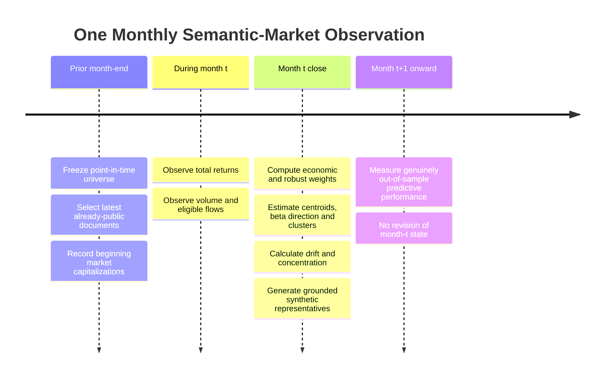
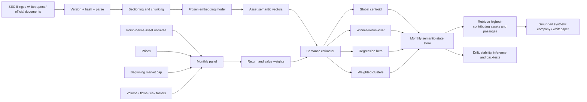

# Market-Implied Semantic Portfolios: A Research Design for Inferring What Markets Reward

## Executive summary

The proposed idea is technically coherent and, after reviewing the closest academic literature, recent working papers, commercial thematic systems, crypto-whitepaper research, and a targeted patent landscape through **October 1, 2026**, appears to occupy a genuinely interesting gap. The individual ingredients are not new: firms have been located in textual product spaces using 10-K descriptions; returns have been propagated across textually similar firms; stock embeddings have been refined with returns; narratives have been converted into equity exposures; portfolio holdings have been converted into asset embeddings; and crypto-whitepaper claims have been compared with realized market structure. citeturn16search0turn16search1turn15academia39turn14search0turn16search2turn14search19 What I did **not** find is the complete inversion proposed here:

\[
\boxed{
\text{point-in-time asset documents}
\rightarrow
\text{asset embeddings}
\rightarrow
\text{return/value weights}
\rightarrow
\text{monthly market semantic state}
\rightarrow
\text{synthetic representative asset}
}
\]

The important conceptual inversion is that most finance-NLP research asks **“Can text predict returns?”** This project asks **“Given the returns that actually occurred, what semantic characteristics did the market reward?”** Hoberg and Phillips construct text-defined economic neighborhoods from firms' product descriptions and then show return propagation among textually related firms; THEME jointly uses textual thematic representations and stock returns; Narrative Factor begins with identifiable narratives and estimates company exposure to them. Your construction instead lets the cross-section of market outcomes determine the semantic direction ex post. citeturn9search0turn10view4turn15academia39turn14search0

I recommend formalizing the core object as a **Market-Implied Semantic Portfolio**, with two primary versions reported side by side. The first should be an economically transparent **Value-Creation Semantic State**, using beginning-of-period market capitalization times total return. The second should be a **Robust Semantic State**, using a concave capitalization transform, bounded return transformation, sector/liquidity controls, and a per-asset contribution cap. Reporting both is preferable to choosing between them: the first answers *where market value was created*, whereas the second answers *which ideas were broadly rewarded without allowing a handful of mega-assets to define the answer*.

The synthetic “fake company” or “fake whitepaper” should **not** be generated by attempting to decode the centroid vector directly. A vector does not uniquely identify an underlying document. Instead, the state vector should act as a retrieval key: identify the assets and source passages making the largest contribution to the state, diversify those passages across firms/sectors, and ask a language model to synthesize a fictional representative asset using only the retrieved evidence. This makes the prose an **interpretation layer over an auditable quantitative state**, rather than the statistical object itself.

The strongest design is also **not one synthetic asset per month by default**. Markets commonly reward several economically unrelated themes simultaneously. A single centroid could turn “AI infrastructure + obesity drugs + uranium + banks” into a meaningless conglomerate. The preferred system should therefore produce both a global state and, where the data support it, approximately **three to eight weighted semantic clusters**, each yielding its own representative synthetic asset.

The project should initially be treated as a **measurement project, not a trading strategy**. Only after the state construction is frozen should predictive tests ask whether semantic direction, persistence, acceleration, or proximity forecasts subsequent returns. That distinction is crucial because using month \(t\)'s return to construct month \(t\)'s semantic state makes same-month explanatory results descriptive by construction. Predictive evidence begins only at \(t+1\), under genuinely point-in-time data and out-of-sample evaluation.

My overall assessment is:

| Dimension | Assessment |
|---|---|
| Conceptual coherence | **High** |
| Component-level novelty | **Low to moderate** — many ingredients have precedents |
| System-level novelty | **High enough to merit research** |
| Empirical feasibility | **High for U.S. equities; moderate for crypto** |
| Primary methodological risk | Semantic state being dominated by size, sectors, or a few extreme returns |
| Primary data risk | Point-in-time document/version and dead-asset reconstruction |
| Primary interpretability risk | Generating a plausible story that is not actually supported by contributors |
| Best first application | U.S. equities using historical 10-K business descriptions |
| Best second application | Crypto using versioned whitepapers plus “living” project documentation |
| Potential academic contribution | A new measurement object: **revealed semantic preference of markets** |
| Patent position | Potentially interesting at the **specific integrated workflow** level, but far too early to assert patentability or freedom to operate |

A paper-quality implementation is realistic with a small team. My planning estimate is **roughly 12–18 calendar weeks for a strong research prototype** and **16–24 weeks for publication-grade robustness**, assuming one quantitative researcher and one ML/data engineer working substantially in parallel. The first useful U.S.-equity results could be reached much earlier.

## Prior art, novelty, and the economic object

The closest intellectual ancestor is the Hoberg–Phillips text-based industry literature. Their Journal of Political Economy work represents firms according to similarities in product descriptions, producing time-varying economic neighborhoods rather than imposing fixed SIC-style industries. Their subsequent *Text-Based Industry Momentum* paper links the returns of these textually defined peers to subsequent stock returns. citeturn16search0turn16search1 This establishes two important precedents: corporate language can define economically meaningful geometry, and return information can propagate through that geometry.

**THEME**, introduced in 2025, comes closer computationally. It builds rich textual stock/theme profiles, learns embeddings through hierarchical contrastive learning, and subsequently performs temporal refinement using individual-stock returns; its objective is improved retrieval of stocks that are thematically aligned and exhibit strong return potential. citeturn15academia39turn10view1 That is highly relevant prior art, but the direction remains different: THEME starts from themes and learns better asset representations, whereas the proposed system uses realized outcomes to infer a market-wide semantic preference state.

The 2026 **Narrative Factor** working paper likewise shows that market narratives can be represented systematically. It builds company-level exposure to a collection of macro narratives and studies the resulting equity factor. citeturn14search0 A broader literature on narrative asset pricing maps news narratives into systematic risk factors; for example, Bybee and coauthors estimate narrative factors from news text. citeturn14search9 Again, those approaches generally begin with narratives or textual attention and ask how assets load on them. The proposed construction reverses the conditioning operation.

**Asset Embeddings** by Gabaix, Koijen, Richmond and Yogo is another important neighbor. It learns representations of firms from the structure of investor portfolio holdings—the analogy being that portfolios play the role documents play in word embeddings—and uses firm-level textual information to give economic meaning to asset neighborhoods. citeturn16search2turn16search3 This demonstrates that a financial universe itself can be embedded and economically interpreted, but the embedding signal there is portfolio co-holding rather than asset documents weighted by realized market rewards.

For crypto, Farzulla's 2026 whitepaper study is unusually close to the conceptual motivation: it constructs a textual claim space from crypto whitepapers and explicitly compares that representation with market-statistical and latent-factor spaces. Its central result is weak alignment rather than strong correspondence between stated whitepaper narratives and realized market structure. citeturn14search1turn14search19 That result makes this project more, not less, interesting: a return-weighted semantic representation asks which **whitepaper characteristics the market rewarded**, rather than assuming whitepaper claims explain market behavior.

Commercial systems demonstrate that semantic thematic classification is already valuable. MSCI's Thematic Exposure Standard reports company-level thematic exposures over a very broad global security universe, and MSCI has publicly described the evolution of its thematic systems from NLP/keyword methods toward language-model-assisted classification. citeturn19search1turn19search3 FTSE Russell's new MarketPsych Thematic Index Series is particularly timely: it was announced on **September 29, 2026**, two days before the date of this report, and combines AI/NLP analysis of company/business information, revenues, transcripts, news and other market information to construct explainable thematic exposures and indices. citeturn19search9turn19search33 These commercial systems still fundamentally answer **“How exposed is this company to an identified theme?”**, not **“What theme is implied by the cross-section of value creation this month?”**

The gap can therefore be summarized precisely:

| Precedent | Text representation | Market information | Output | Missing relative to proposed system |
|---|---|---|---|---|
| Hoberg–Phillips | 10-K product text | Peer returns | Text-based industries / momentum | No monthly market semantic aggregate or generated representative asset. citeturn16search0turn16search1 |
| THEME | Stock/theme profiles | Stock returns used in representation refinement | Theme-aligned stock retrieval | Starts with theme structure; no inverse monthly “market preference” document. citeturn15academia39 |
| Narrative Factor | Public-discourse narratives | Equity returns | Narrative exposure factor | Narratives specified/extracted first, rather than inferred from reward-weighted asset documents. citeturn14search0 |
| Asset Embeddings | Firm interpretation text | Portfolio holdings | Latent asset geometry | Holdings, not return-weighted document vectors; no monthly synthetic asset. citeturn16search2 |
| Farzulla | Crypto whitepaper claims | Market statistics and latent factors | Alignment test | No return/value-weighted market semantic state. citeturn14search19 |
| MSCI thematic systems | Business descriptions and related data | Primarily exposure/classification inputs | Company-to-theme exposures | Predefined/researched themes rather than return-discovered themes. citeturn19search1turn19search3 |
| FTSE MarketPsych | Descriptions, revenues, transcripts, news, financial data | Multiple market/business signals | Explainable thematic indices | Still company-to-theme mapping rather than return-weighted inverse semantic synthesis. citeturn19search9turn19search33 |

The cleanest mathematical definition starts with a point-in-time document \(D_{i,\tau}\) and normalized semantic vector:

\[
z_{i,t}
=
\frac{E(D_{i,\tau(i,t)})}
{\|E(D_{i,\tau(i,t)})\|_2},
\]

where \(\tau(i,t)\) is the most recent document version that was publicly available **before the return measurement period**.

Let \(r_{i,t}\) be asset \(i\)'s total return during month \(t\), and \(C_{i,t-1}\) its beginning-of-month investable market capitalization. Define a generic reward score:

\[
q_{i,t}
=
g(C_{i,t-1})
\,
\psi(r_{i,t})
\,
a_{i,t},
\]

where \(g\) controls size weighting, \(\psi\) controls how extreme returns enter, and \(a\) optionally captures attention, liquidity or flows.

The signed semantic state is then:

\[
s_t
=
\frac{
\sum_{i\in U_t} q_{i,t}z_{i,t}
}{
\sum_{i\in U_t}|q_{i,t}|
}.
\]

Its normalized direction,

\[
u_t=\frac{s_t}{\|s_t\|_2},
\]

is the month's **semantic market direction**. The norm,

\[
I_t=\|s_t\|_2,
\]

is also informative: conditional on unit asset vectors, a large value indicates that weighted contributions point relatively coherently in semantic space; a small value means market rewards are semantically dispersed or opposing.

I would additionally make the positive and negative states first-class objects:

\[
m_t^+
=
\frac{\sum_i g(C_{i,t-1})\max(r_{i,t},0)z_{i,t}}
{\sum_i g(C_{i,t-1})\max(r_{i,t},0)},
\]

\[
m_t^-
=
\frac{\sum_i g(C_{i,t-1})\max(-r_{i,t},0)z_{i,t}}
{\sum_i g(C_{i,t-1})\max(-r_{i,t},0)}.
\]

Then

\[
d_t=
\frac{m_t^+-m_t^-}
{\|m_t^+-m_t^-\|_2}
\]

answers the particularly attractive question:

> **What semantic direction distinguished what the market rewarded from what the market punished this month?**

That is potentially a stronger research object than the positive centroid alone.

My novelty judgment is therefore **system-level rather than ingredient-level**. In the literature and commercial material reviewed, I did not find the exact pipeline of point-in-time asset documents → realized return/value weighting → aggregate semantic market state → monthly multi-cluster state tracking → grounded generation of a hypothetical representative asset. That conclusion is an inference from the sources located, not a claim of worldwide legal novelty. citeturn16search0turn15academia39turn14search0turn16search2turn14search19turn19search9

## Data design and point-in-time market universe

The first empirical study should use **U.S. public equities**, not crypto. The reason is methodological: SEC filings provide a comparatively standardized, timestamped textual corpus, while a research-quality security master can reconstruct firms that subsequently disappeared. EDGAR provides searchable filing history and APIs for company submissions and XBRL facts, while SEC full-text electronic filing search extends back to 2001. citeturn18search3turn13search17 Crypto should be the second study because its documents are arguably closer to a project's founding “idea,” but historical document provenance, token migrations, dead coins, circulating-supply reconstruction and venue quality make the panel substantially harder.

A sensible default design is:

| Component | Equity study | Crypto study |
|---|---|---|
| Initial period | **Jan. 2004–Sep. 2026** | **Jan. 2017–Sep. 2026** |
| Frequency | Monthly | Monthly |
| Primary text | 10-K business/product description | Official whitepaper / technical paper |
| Secondary text | Product/segment descriptions; optionally earnings materials | Technical docs, governance docs, official project documentation |
| Market data | Point-in-time total return, beginning cap, volume, corporate actions, delisting return | Point-in-time price, circulating cap, volume, venue coverage, supply history |
| Universe | U.S. common operating equities existing in that historical month | Liquid non-stablecoin cryptoassets existing in that historical month |
| Document update | On each new public filing | On each versioned document update |
| Semantic-state update | Monthly | Monthly |
| Final available month at report date | September 2026 | September 2026 |

The 2004 equity start is a proposed design choice rather than a data limitation: EDGAR full-text electronic history extends to 2001, so 2004 gives a useful initial buffer while retaining more than two decades of observations. citeturn13search17 The study should stop at **September 30, 2026** for now because October 2026 is incomplete as of this report.

For equities, I recommend making the **10-K business description the canonical document**. Risk factors, accounting notes and boilerplate are informative for other questions but can dominate textual length without describing what the company economically does. A secondary experiment can progressively add product/segment descriptions, Item 1A risk language, earnings-call text and news. This staged design is important because FTSE MarketPsych and MSCI already show the value of combining richer sources such as business descriptions, revenue information, transcripts and news; the research question here is whether a simpler, economically stable corporate-description corpus is sufficient. citeturn19search3turn19search33

Each document record should preserve at least:

```text
asset_id
security_id / token_id
document_id
document_type
published_at
filed_at
first_seen_at
effective_asof
source
language
content_hash
parser_version
raw_text_hash
normalized_text_hash
embedding_model_revision
```

The decisive field is `first_seen_at` or equivalent. An amended filing discovered later must never silently overwrite what the model could have seen historically.

The **historical security master** should be generated month by month. The universe for June 2011 must be whatever existed and satisfied the rules in June 2011—not the 2026 company list projected backward. Delisted companies must remain in the database, and terminal/delisting returns should be incorporated where available. Otherwise, failed business models disappear from the negative semantic state and the system will systematically overstate the historical attractiveness of characteristics possessed by survivors.

For a baseline equity universe, I would include ordinary operating-company equity and exclude ETFs, closed-end funds, preferred shares, warrants, blank-check vehicles and other securities whose text describes an investment wrapper rather than the underlying operating business. ADRs can be either excluded initially to avoid duplicated foreign-company economics or included later in a global extension. These are design rules and should be frozen before analysis.

For crypto, Coin Metrics provides both historical/real-time market feeds spanning centralized and decentralized venues and structured asset/profile information; its market-data framework harmonizes venue formats, while its asset profiles describe such attributes as an asset's purpose, builders, supply and networks. citeturn20search20turn20search32turn20search16 It is therefore a plausible core market-data/reference source, supplemented by official project repositories and archived project websites for whitepaper provenance.

I would impose stricter crypto eligibility rules. A reasonable starting specification is:

- at least **90 calendar days** of observable trading history before inclusion;
- median daily dollar volume over the preceding month above a fixed ex-ante threshold, initially \$1 million;
- circulating market capitalization above an ex-ante threshold, initially \$25 million;
- a provenance-verified project document available before the month;
- stablecoins, wrapped representations and liquid-staking representations excluded from the baseline because their return-generating mechanisms differ from ordinary project tokens.

Those thresholds are proposed hyperparameters, not universal truths; they belong in the ablation study.

The crypto security master needs explicit handling of **ticker reuse, token contract migrations, forks, redenominations, delistings and project deaths**. “BTC,” for example, is a persistent economic entity; many smaller tickers are not. Asset identity should therefore be based on stable project/network identifiers rather than symbols.

Whitepapers create a special issue: they are often **static founding documents**. In that case,

\[
z_{i,t}=z_i
\]

for years at a time, and only the market weights move monthly. That is not a flaw—it means the experiment is cleanly measuring whether the market changes the value assigned to persistent project characteristics. Farzulla's work supports treating whitepaper claim space and market-behavior space as distinct objects rather than assuming they coincide. citeturn14search19 A second “living narrative” crypto specification should use continuously updated official docs, governance material, developer documentation and project descriptions.

This distinction gives two complementary experiments:

\[
\text{Founding thesis}_i
\quad \text{versus} \quad
\text{current self-description}_{i,t}.
\]

The former asks **what foundational project ideas get rewarded over time**. The latter asks **what contemporary narratives are being rewarded**.

## Embeddings, pooling, and market weighting

The principal embedding model should be **open and frozen**, because reproducibility is more important here than squeezing out a few benchmark points. BGE-M3 is a strong baseline: its published design supports more than 100 languages, inputs up to 8,192 tokens, and dense, sparse and multi-vector retrieval modes. citeturn18search0turn18search4 Multilingual E5 is an excellent independent robustness model; its training used contrastive pretraining over roughly one billion multilingual text pairs followed by supervised fine-tuning. citeturn18search1 OpenAI's `text-embedding-3-large`, which produces vectors of up to 3,072 dimensions and supports English and non-English tasks, can serve as a proprietary external benchmark rather than the sole research dependency. citeturn18search2turn18search10

The recommended initial embedding specification is:

| Hyperparameter | Primary setting | Ablations |
|---|---:|---|
| Model | BGE-M3, frozen revision | multilingual-E5-large; `text-embedding-3-large` |
| Dense vector size | Native model dimension | PCA 64, 128, 256 for regressions |
| Chunk size | 768 tokens | 512, 1,024, long-context |
| Chunk overlap | 128 tokens | 0, 64, 256 |
| Chunk normalization | L2 | Raw vectors |
| Document pooling | Capped length-weighted chunk mean | Uniform mean; section-weighted; SIF/IDF |
| Final document normalization | L2 | Centered/whitened variant |
| Language handling | Native multilingual encoding | Translate-to-English comparison |
| Return-aware fine-tuning | **No in core representation** | Separate THEME-like return-aware ablation |
| Semantic fine-tuning | Optional after baseline | LoRA/contrastive industry and theme pairs |

For long corporate filings, embedding the entire filing as one object is unattractive even when a model accepts long contexts. BGE-M3's long-input capability helps, but the research output also needs passage-level provenance. citeturn18search0 I recommend section parsing followed by overlapping chunks, producing:

\[
e_{ijk}=E(\text{chunk}_{ijk}),
\]

then

\[
z_{i,t}
=
\operatorname{normalize}
\left(
\frac{\sum_k \omega_{ik}\operatorname{normalize}(e_{ik})}
{\sum_k\omega_{ik}}
\right).
\]

A good default is capped token-length weighting,

\[
\omega_k=\min(L_k,768)^{1/2},
\]

rather than giving a very long chunk linearly more influence. The square-root rule is a proposed robustness device, not something the study should treat as theoretically privileged.

I would **not use returns to fine-tune the core semantic model initially**. THEME demonstrates that temporal stock-return information can be useful in refining thematic representations. citeturn15academia39 But here, allowing the embedding function itself to learn from the target variable makes interpretation harder: one can no longer distinguish “semantic content of the document” from “representation engineered to match returns.” Instead, freeze a market-agnostic semantic space and let the weighting/regression stage introduce market information. A return-aware representation should then be a named ablation.

For global equities and crypto, multilinguality should be tested rather than assumed. BGE-M3 and multilingual E5 were explicitly designed for multilingual/cross-lingual use. citeturn18search4turn18search1 The clean experiment is to encode original-language documents natively and separately compare the result with professionally or machine-translated English text. Known bilingual issuer documents can provide an empirical cross-lingual consistency benchmark.

The weighting question is more consequential than the choice between competent modern embedding models.

| Weight | Formula, schematically | Economic interpretation | Main weakness |
|---|---|---|---|
| Equal winner | \(1[r_i>0]\) | Breadth of rewarded ideas | Ignores economic magnitude |
| Return | \(r_i\) | Momentum/reward intensity | Tiny assets can dominate |
| **Value creation** | \(C_{i,t-1}r_{i,t}\) | Approximate price-related dollar value creation | Mega-cap domination |
| Square-root cap | \(\sqrt C\,r\) | Compromise between value and breadth | Less direct economic meaning |
| Log cap | \(\log(1+C/C_0)r\) | Strongly diversified size adjustment | Scale \(C_0\) arbitrary |
| Volume-attention | \(\log(1+ADV_i)r_i\) | Reward weighted by trading attention | High volume may reflect disagreement/speculation |
| Flow | \(\text{net flow}_i\) or flow × semantic vector | Direct capital allocation | Hard to observe comprehensively at security level |
| Momentum | \(g(C_i)R_{i,t-k:t}\) | Persistent rewarded semantics | Blurs timing |
| Risk-adjusted | \(g(C_i)\epsilon_{i,t}/\sigma_i\) | Semantics rewarded beyond common risk factors | Model-dependent residuals |

For the economic state, use:

\[
q^{VC}_{i,t}=C_{i,t-1}r_{i,t}.
\]

Beginning capitalization is preferable to directly weighting by the change in market capitalization because issuance, repurchases, token minting/burning and changes in circulating supply can alter market cap without representing price appreciation. The approximation \(C_{t-1}r_t\) more cleanly isolates the value change associated with the asset return.

For the robust headline state, I recommend:

\[
q^{R}_{i,t}
=
\sqrt{C_{i,t-1}}
\,
\tanh
\left(
\frac{\epsilon_{i,t}}{s_t}
\right),
\]

where \(\epsilon_{i,t}\) is either raw return or a market/sector-residual return and \(s_t\) is a cross-sectional robust scale estimate. Then cap each asset's absolute normalized contribution at approximately **2.5% for equities** and **5% for crypto** in the initial specification. Those thresholds should explicitly be ablated.

This gives an important dual-reporting convention every month:

**Economic state**

\[
M_t^{\$} =
\text{semantic direction of total value creation}.
\]

**Breadth-robust state**

\[
M_t^{R} =
\text{semantic direction broadly rewarded across investable assets}.
\]

If those two vectors are close,

\[
\cos(M_t^\$,M_t^R)\approx1,
\]

the narrative is broad and economically important. If they diverge sharply, the “market story” is probably being driven by a small set of very large assets.

Volume and inflow variants should be treated as conceptually distinct rather than casually mixed with the return index. A return-weighted state answers **what became more valuable**; a genuine flow state answers **where investors directed new capital**. Those are not equivalent. The system should therefore maintain separate semantic series whenever reliable flow information is available.

## Estimators, normalization, and bias controls

A simple weighted centroid should be the baseline precisely because it is transparent. It should not, however, be the only estimator.

| Estimator | Object estimated | Strength | Failure mode | Priority |
|---|---|---|---|---|
| Weighted centroid | “What do winners look like?” | Simple, stable, auditable | Averages incompatible themes | **Primary** |
| Winner-minus-loser | “What distinguishes rewarded from rejected?” | Strong economic interpretation | Sensitive to both tails | **Primary** |
| Ridge \(\beta\) direction | “Which semantic coordinates explain returns?” | Separates winners from losers statistically | High-dimensional/noisy | **Primary alternative** |
| PCA of monthly states | Persistent axes of semantic rotation | Reveals long-run market regimes | Unsupervised axes may be opaque | Secondary |
| Huber/geometric median | Robust rewarded center | Resistant to extreme assets | Harder economic weighting | Secondary |
| Sparse regression/dictionary | Interpretable semantic characteristics | Easier naming | Depends on dictionary/basis | Secondary |
| Weighted clustering | Multiple simultaneously rewarded themes | Avoids “chimera company” | Cluster instability over time | **Primary alternative** |

For regression, define a reduced semantic vector \(x_{i,t}=P^\top z_{i,t}\), where \(P\) is a PCA basis estimated only from admissible historical/training data, then estimate:

\[
r_{i,t}
=
\alpha_t
+
x_{i,t}^{\top}\beta_t
+
X_{i,t}^{\top}\gamma_t
+
\epsilon_{i,t}.
\]

\(X\) can include size, sector and conventional return controls.

The direction

\[
P\beta_t
\]

answers a different question from the centroid:

> **Which semantic characteristics distinguished high-return from low-return assets, controlling for known characteristics?**

Because a full 1,024- or 3,072-dimensional regression can be ill-conditioned relative to a monthly cross-section, the recommended first version reduces embeddings to **128 historical PCs** and uses ridge regression. Choose ridge \(\lambda\) by rolling training-only cross-validation over a logarithmic grid such as \(10^{-4},\ldots,10^4\). Elastic net and partial least squares belong in the ablation set.

Clustering is especially important. Use **weighted spherical k-means** over positive-contribution assets, initially allowing \(K=3\) to \(8\). Require a cluster to contain at least 10 assets and at least 5% of total positive semantic-economic weight before generating a synthetic representative asset. Align clusters between adjacent months using maximum cosine similarity/Hungarian assignment. That allows a theme to be followed through time even as its constituent companies change.

The bias-control layer should be unusually strict:

| Bias/problem | Required control |
|---|---|
| Look-ahead in documents | Only documents publicly available before the return interval; immutable historical versions |
| Look-ahead in universe | Point-in-time security master |
| Survivorship | Include subsequently delisted, bankrupt, acquired and failed entities |
| Return timing | Beginning-of-month cap; month-\(t\) return only after month closes |
| Mega-cap domination | Raw-cap series **plus** concave/capped robust series |
| Extreme crypto returns | Bounded return transform and liquidity filter |
| Sector concentration | Report raw and sector-neutral states |
| Market beta | Raw-return and market-residual versions |
| Size factor | Raw and size-residualized versions |
| Liquidity | Minimum ADV; explicit liquidity controls; contribution cap |
| Boilerplate | Section parser and boilerplate removal |
| Document length | Chunk normalization and bounded pooling weights |
| Document age | Record age explicitly; test stale-document sensitivity |
| Model updates | Freeze embedding revision and hash |
| Semantic anisotropy | L2 baseline; centered/whitened ablation |
| Corporate actions | Total-return series, historical shares/cap and delisting treatment |
| Token supply change | Use start-period circulating cap rather than raw cap change |
| Theme concentration | HHI/effective number of contributors |
| Generated-text hallucination | Retrieval-grounded generation plus sentence-level source provenance |

Two diagnostics should accompany every monthly narrative.

The **effective contributor count** is

\[
N_{\text{eff},t}
=
\frac{1}{\sum_i \pi_{i,t}^2},
\qquad
\pi_{i,t}
=
\frac{|q_{i,t}|}{\sum_j|q_{j,t}|}.
\]

A synthetic market narrative derived from an effective universe of six firms should be interpreted very differently from one supported by hundreds.

The **sector concentration** can analogously be computed after summing absolute contribution by sector. If a month's “market semantic shift” disappears after sector-neutralization, the honest interpretation is not that the market discovered a new cross-sector semantic factor; it is that capital rotated into a sector whose firms share language.

One further bias deserves explicit treatment: **semantic leakage from contemporary embedding models**. A 2026 embedding model applied to a 2007 filing has learned language relationships using information generated after 2007. That does not create document or return look-ahead in the conventional sense, but it means the exercise is a *retrospective semantic reconstruction using a fixed contemporary measurement instrument*, not a strategy literally implementable in 2007. The paper should state that distinction directly. A trading interpretation requires a stronger historical-availability argument than a descriptive measurement interpretation.

## Evaluation, ablations, and visualization

The first evaluation question is not “does it make money?” It is **whether the semantic state is stable, interpretable and genuinely driven by the intended economic signal**.

The principal drift statistic is:

\[
\operatorname{Drift}_t
=
1-\cos(u_t,u_{t-1}).
\]

A second useful statistic is winner/loser semantic separation:

\[
\operatorname{Separation}_t
=
1-\cos(m_t^+,m_t^-).
\]

A third is semantic coherence:

\[
\operatorname{Coherence}_t
=
\left\|
\frac{\sum_i w_{i,t}z_{i,t}}
{\sum_i w_{i,t}}
\right\|_2.
\]

These should be accompanied by contributor concentration, sector concentration, and cluster entropy. A large drift with low effective \(N\) and one dominant industry should be labelled a **concentrated rotation**, not a market-wide narrative regime change.

Stability should be assessed using asset bootstrap resampling, stratified by sector and size; deletion of the largest contributor and largest 5/10 contributors; alternative embedding models; alternative pooling rules; raw versus capped weights; and perturbation of the liquidity threshold. A useful state is one whose broad interpretation survives reasonable choices even though exact coordinates change.

Embedding-model robustness can be evaluated through pairwise cosine correlations of monthly-state distances, nearest-contributor overlap, and Procrustes/representation-alignment diagnostics. Farzulla's crypto work itself uses explicit representational alignment tests between textual and market spaces, reinforcing the importance of testing whether apparent semantic relationships exceed a null rather than simply visualizing them. citeturn14search1turn14search19

For inference, construct permutation nulls:

\[
H_0:
r_{i,t}\perp z_{i,t}
\mid
\text{month, sector, size bucket}.
\]

Within each month, shuffle returns **within sector × size groups**, preserve capitalization and document vectors, reconstruct the entire semantic state, and compare observed drift, winner/loser separation and regression fit with the null distribution. This is more persuasive than a naïve random permutation that destroys obvious market structure.

Predictive testing must use:

\[
\mathcal{I}_t
=
\{\text{all information available by end of month }t\}
\]

to predict only \(t+1\) and later. Candidate asset-level signals include:

\[
S_{i,t}
=
\cos(z_{i,t},u_t),
\]

\[
S^\Delta_{i,t}
=
z_{i,t}^{\top}(u_t-u_{t-1}),
\]

and regression exposure

\[
S^\beta_{i,t}
=
z_{i,t}^{\top}\hat{\beta}_t.
\]

Evaluate Spearman information coefficient, top-minus-bottom decile returns, factor-adjusted alpha, turnover, maximum drawdown and post-cost Sharpe. Use expanding or rolling out-of-sample estimation, and never use the final test interval for hyperparameter choice. Financial factor research has a documented multiple-testing problem; Harvey, Liu and Zhu explicitly argue that conventional significance thresholds become inadequate when many candidate factors are tried. citeturn22search0turn22search1 Consequently, every attempted model variant should be logged, and false-discovery/multiple-testing corrections should accompany headline predictive results.

A practical preregistered partition for the equity experiment would be:

| Period | Role |
|---|---|
| 2004–2014 | Representation calibration / methodological development |
| 2015–2019 | Hyperparameter validation |
| 2020–September 2026 | Locked final test |

This is a methodological split, not a claim that a 2026 embedding model historically existed in those periods.

The ablation program should be staged rather than an uncontrolled factorial search:

| Ablation family | Primary | Alternatives | What it tests |
|---|---|---|---|
| Text | 10-K business description | full 10-K; short vendor description; text + transcript | Information source |
| Embedding | BGE-M3 | mE5; OpenAI 3-large | Representation dependence |
| Pooling | chunk mean, capped-length weights | uniform; section weighting | Long-document sensitivity |
| Weight | cap × return and robust sqrt-cap | equal; log-cap; volume; flow; momentum | Meaning of “market reward” |
| Returns | raw | sector residual; factor residual; volatility-adjusted | Common-factor contamination |
| Estimator | centroid | signed spread; ridge \(\beta\); robust mean | Statistical construction |
| Themes | single global state | \(K=3\!-\!8\) clusters | Multi-modality |
| Generation | evidence-grounded RAG | centroid-only prompt | Faithfulness of prose |
| Crypto document | original whitepaper | living docs | Founding thesis vs evolving narrative |

Only a small number of combinations should be designated **primary hypotheses**. Everything else should be reported as robustness analysis. That directly reduces the backtest-selection problem highlighted in the asset-pricing literature. citeturn22search1turn22search4

The monthly timing should be explicit:



The two essential empirical charts should be generated directly from the immutable monthly output table. Because the dataset has not yet been constructed, putting numerical values into such charts here would fabricate empirical results. The required figures are nevertheless precisely defined:

| Chart | X-axis | Y-axis / encoding | Required overlays |
|---|---|---|---|
| **Semantic drift through time** | Month | \(1-\cos(u_t,u_{t-1})\) | bootstrap 95% interval; raw-cap and robust states; labelled largest rotations |
| **Rewarded-theme composition** | Month | Cluster share of positive reward | stacked areas; persistent cluster identities; “other” for sub-threshold clusters |
| Value vs breadth divergence | Month | \(1-\cos(M_t^\$,M_t^R)\) | effective contributor count |
| Winner vs loser separation | Month | \(1-\cos(m_t^+,m_t^-)\) | sector-neutral comparison |
| State coherence | Month | \(\|m_t^+\|\) | effective \(N\) |
| Semantic map | 2-D UMAP/PCA for display only | Asset/cluster location | contribution size; sector marker |

The corresponding plotting logic should remain almost trivial:

```python
# outputs/state_monthly.parquet:
# month, state_type, vector, effective_n, coherence, ...

drift[t] = 1.0 - cosine(state[t], state[t - 1])

# outputs/cluster_monthly.parquet:
# month, persistent_cluster_id, positive_weight_share
cluster_weights = (
    clusters
    .pivot(index="month",
           columns="persistent_cluster_id",
           values="positive_weight_share")
    .fillna(0.0)
)

# Plot 1: line chart of drift by month.
# Plot 2: stacked area chart of cluster_weights by month.
```

Those charts should be treated as scientific outputs, not decorative illustrations: major narrative claims in the generated text should be traceable to changes visible in the quantitative series.

## Implementation, reproducibility, and generation of the synthetic asset

The production architecture can remain comparatively simple. SEC's APIs make programmatic filing histories and structured company facts available, while crypto market providers already expose harmonized market/reference information, so the technically difficult part is primarily **point-in-time reconciliation and provenance**, not raw model inference. citeturn18search3turn20search20



A minimal implementation looks like this:

```python
for month in calendar:

    # Point-in-time inputs only.
    universe = security_master.asof(month.start)
    docs = documents.latest_available(
        assets=universe,
        before=month.start
    )

    # Recompute only when the content hash changes.
    Z = embedding_store.get_or_encode(
        docs=docs,
        model_id=FROZEN_MODEL_ID,
        chunk_tokens=768,
        overlap_tokens=128,
        pooling="sqrt_length_mean_l2",
    )

    panel = market_data.for_month(
        universe=universe,
        month=month,
        beginning_cap=True,
        include_delisting_returns=True,
    )

    # Transparent economic state.
    q_value = panel.cap_start * panel.total_return

    # More diversified robustness state.
    q_robust = (
        np.sqrt(panel.cap_start)
        * np.tanh(panel.residual_return / panel.robust_scale)
    )
    q_robust = cap_normalized_contributions(q_robust, max_abs_share=0.025)

    states = {
        "value": weighted_state(Z, q_value),
        "robust": weighted_state(Z, q_robust),
        "positive": weighted_state(Z, np.maximum(q_value, 0)),
        "negative": weighted_state(Z, np.maximum(-q_value, 0)),
    }

    clusters = weighted_spherical_clusters(
        Z[q_value > 0],
        weights=q_value[q_value > 0],
        k_range=range(3, 9),
    )

    evidence = retrieve_contributors_and_chunks(
        states=states,
        clusters=clusters,
        diversify_by_asset=True,
        diversify_by_sector=True,
    )

    synthetic_docs = generate_grounded_representatives(evidence)

    persist(month, states, clusters, evidence, synthetic_docs)
```

There is no reason to repeat identical annual embeddings every month. Suppose the equity universe averages 5,000 companies and each company produces one document vector per year. Twenty-three annual vintages at 1,024 dimensions in float32 require only about **0.47 GB** for document-level vectors. Even 10,000 entities would remain under roughly **1 GB** at the document-vector level. Passage-level embeddings will be larger but still manageable on a conventional research server. Replicating 10,000 1,024-dimensional vectors over 276 monthly observations would use roughly 11.3 GB before metadata, illustrating why version-based storage is cleaner than month-by-month duplication.

I recommend the following storage layout:

```text
/raw_documents/
    immutable original HTML/PDF/text

/document_versions.parquet
    asset, source, timestamps, hashes, language

/chunks.parquet
    document_id, chunk_id, section, offsets, text_hash

/embeddings/
    model_revision/
        document_vectors.parquet
        chunk_vectors.parquet

/security_master.parquet
/market_monthly.parquet

/states/
    monthly_state_vectors.parquet
    monthly_contributions.parquet
    monthly_clusters.parquet

/generation/
    retrieved_evidence.parquet
    synthetic_profiles.jsonl
    synthetic_documents.jsonl

/manifests/
    run_id.json
```

Every run manifest should contain the Git commit, package-lock/environment hash, parser version, embedding-model identifier and revision, market-data snapshot ID, universe rules, weighting specification, random seeds, prompt version and generation-model revision. This converts every monthly narrative into an auditable research artifact.

The most important architectural decision concerns **how the synthetic document is created**. It should not be:

\[
u_t \rightarrow \text{LLM prompt: “decode this vector.”}
\]

Instead use:

\[
u_t
\rightarrow
\text{rank contributors}
\rightarrow
\text{rank source passages}
\rightarrow
\text{diversified evidence set}
\rightarrow
\text{structured semantic profile}
\rightarrow
\text{synthetic document}.
\]

For asset \(i\), an intuitive evidence-contribution score is:

\[
c_{i,t}
=
q_{i,t}\,
\cos(z_{i,t},u_t).
\]

Retrieve, for example, the highest-contributing **30 assets and approximately 80 passages**, allowing no more than two or three passages from any single asset. Apply diversification so that one sector or issuer cannot dominate all textual evidence simply through repetition.

The first generation stage should produce structured output:

```json
{
  "core_business_model": [],
  "technologies_or_capabilities": [],
  "target_customers": [],
  "revenue_or_token_utility_logic": [],
  "infrastructure_requirements": [],
  "geographies": [],
  "risks_or_rejected_characteristics": [],
  "evidence_ids": [],
  "support_weight": {}
}
```

Only then should prose be generated.

For equities, the result might be called:

> **Synthetic Market-Rewarded Company — September 2026**

For crypto:

> **Synthetic Market-Rewarded Protocol — September 2026**

“Fake whitepaper” is intuitive shorthand, but **synthetic representative asset** is the better research term. It avoids implying that the goal is deception and accurately describes the object.

Each generated sentence should ideally have internal provenance back to the retrieved passages. Generated claims unsupported by retrieved evidence should be prohibited. Proper names should be removed unless the output is explicitly presenting its contributing assets. Numbers should not be invented. A sentence-overlap check against the input corpus should flag unusually close copying.

The most informative monthly output is therefore not only prose. It is a package:

```text
September 2026 Market Semantic State

Economic semantic vector
Robust semantic vector
Positive state
Negative state
Winner-minus-loser direction

Semantic drift from August
Value-vs-breadth divergence
Effective contributor count
Sector concentration
State coherence

Cluster A: 31% of rewarded semantic weight
Synthetic representative A
Top evidence contributors

Cluster B: 24%
Synthetic representative B
Top evidence contributors

Cluster C: 18%
...

Global synthetic representative
Rejected synthetic representative
```

This is much more defensible than a standalone LLM-generated paragraph.

## IP, ethics, patent landscape, and research roadmap

The patent landscape requires caution. A targeted search identified substantial adjacent prior art: an early patent family titled **“Stock market prediction using natural language processing”** has priority dating to 2001 and describes extracting information from natural-language sources for market prediction; more recent patent material addresses NLP-based latent-topic materiality and general semantic/document representations. citeturn21search2turn21search1turn21search3 These show that broad claims such as “use NLP on financial text to analyze markets” would encounter extensive prior art.

The academic work creates additional non-patent prior art because patent novelty is assessed against more than earlier patents alone. USPTO guidance identifies issued patents, published patent applications and non-patent printed publications among the relevant categories of prior art, and the USPTO specifically provides Patent Public Search for prior-art investigation. citeturn20search2turn20search30 Hoberg–Phillips, THEME, Narrative Factor, Asset Embeddings, Farzulla and commercial thematic systems therefore matter when assessing how narrowly any potential invention would need to be drawn. citeturn16search0turn15academia39turn14search0turn16search2turn14search19turn19search9

What may be more distinctive is a tightly specified integrated process involving, for example:

\[
\begin{aligned}
&\text{point-in-time asset document vectors}\\
&+\text{return/value-derived signed semantic aggregation}\\
&+\text{temporal state-transition measurement}\\
&+\text{weighted multi-modal semantic decomposition}\\
&+\text{evidence-constrained synthetic representative generation}.
\end{aligned}
\]

That is **not a patentability conclusion**. My targeted search did not reveal that exact combination, but a real patentability or freedom-to-operate opinion requires claim-level searches across patent families, continuations, international applications, classifications and non-patent literature. The USPTO itself characterizes patent search as a substantive prior-art exercise rather than something established by a simple keyword query. citeturn20search2turn20search34

Commercially, the newly launched FTSE MarketPsych product raises the bar for broad claims about “AI-powered thematic indices.” Its system explicitly combines business descriptions, revenues, transcripts, news and other information into auditable thematic exposure scores and rules-based indices. citeturn19search9turn19search33 The project's differentiation should therefore remain centered on **reverse inference from realized market reward into semantic state**, not generic thematic classification.

Copyright also matters. The U.S. Copyright Office has an ongoing multi-part AI/copyright program covering both copyrightability of AI-assisted outputs and the use of copyrighted works in generative-AI training. citeturn20search5turn20search17 Consequently, public availability should not be casually equated with unrestricted copyright status. For research, store source provenance and licensing metadata, avoid publishing large source passages, generate at a higher semantic level rather than closely imitating individual documents, and run overlap checks before disseminating synthetic whitepapers or company descriptions.

The generation layer also creates a financial-communication risk: a realistic fictional company could be mistaken for an actual issuer, recommendation or investment product. The output should therefore be unambiguously labelled synthetic; use no real ticker; make no fabricated historical performance claims; and clearly separate **descriptive market-semantic measurement** from investment advice. More generally, the Financial Stability Board has highlighted interpretability, auditability and biased-data risks in financial machine-learning applications, which reinforces the case for transparent contributor tables rather than opaque generated narratives alone. citeturn13search28

The research roadmap should proceed in this order:

| Milestone | Deliverable | Planning effort | Resources |
|---|---|---:|---|
| **Specification and prior-art freeze** | Formal estimands; data contract; primary hypotheses; patent/literature memo | 1–2 weeks | Quant researcher + ML lead |
| **Equity point-in-time corpus** | Historical security master; 10-K extraction; versioned document store; total-return panel | 2–4 weeks | Data/ML engineer; researcher review |
| **Equity semantic MVP** | Frozen BGE-M3 vectors; raw value state; robust state; positive/negative states; drift dashboard | 2–3 weeks | One ML engineer + one researcher |
| **Multi-state estimators** | Ridge-\(\beta\), robust centroid, clusters and month-to-month alignment | 2–3 weeks | Quant/ML |
| **Grounded synthetic asset** | Evidence retrieval; structured semantic profile; synthetic-company generator; attribution audit | 1–2 weeks | ML engineer/researcher |
| **Robustness and statistical inference** | Null permutations, bootstrap CIs, sector/size/liquidity controls, locked OOS test | 3–5 weeks | Quant researcher |
| **Crypto extension** | Historical asset master; whitepaper provenance; static vs living-document comparison | 3–5 weeks | Data engineer + crypto research support |
| **Publication-grade ablations** | Preregistered ablation matrix, multiple-testing controls, reproducibility package | 3–5 weeks | Research team |
| **IP/legal checkpoint** | Professional claim-level prior-art and copyright/data-license review | Parallel, 1–3 weeks elapsed | Patent/data counsel |

Several tracks overlap, so these should not be summed linearly. A **12–18 week** research prototype is a reasonable planning target for two strong full-time contributors; **16–24 weeks** is more realistic for a paper-quality equity-plus-crypto study with robustness, documentation and IP review.

A practical research workstation does not need a large distributed cluster. One modern **24–48 GB GPU**, 64–128 GB system RAM and roughly 1–2 TB of working storage should comfortably support the initial embedding and retrieval workload; the corpus itself is modest relative to contemporary large-model training. The research should use a locally reproducible open embedding model for the primary specification, while hosted embeddings and larger generative models can be external robustness/generation layers.

The prioritized scientific questions should be resolved in this sequence:

**First, does the object exist robustly?** Does the monthly semantic state survive alternative embeddings, weighting schemes and removal of dominant firms?

**Second, is it economically meaningful?** Can independent reviewers look at retrieved evidence and correctly characterize why a month moved in semantic space?

**Third, is it more informative than sectors?** Does semantic movement remain after sector, size, beta and liquidity neutralization?

**Fourth, is the market unimodal or multimodal?** Are clusters persistent enough to justify multiple synthetic companies?

**Fifth, does the representation lead prices or merely describe them?** Only here should \(t+1\) predictive tests begin.

**Sixth, does it generalize across asset classes?** Compare the equity implementation with the crypto whitepaper implementation.

**Seventh, is there additional information in cross-market semantic alignment?** For example,

\[
A_t
=
\cos(
u_t^{\text{equity}},
u_t^{\text{crypto}}
)
\]

could reveal whether public equities and crypto are rewarding semantically similar economic ideas at the same time. That becomes particularly interesting around technology, infrastructure, payments, AI, energy and decentralized-computing narratives.

The strongest eventual paper would therefore not be titled around “generating fake companies.” Its core contribution is more fundamental:

> **Markets can be represented as a time-varying semantic portfolio in which asset documents define the basis and realized economic rewards determine the weights.**

The generated company or whitepaper is then simply a human-readable projection of that latent state.

The research objective can be stated compactly as:

\[
\boxed{
\text{What did the market reward?}
\neq
\text{Which stocks went up?}
}
\]

Instead, the proposed framework estimates:

\[
\boxed{
\text{Which economically described characteristics became more valuable,}
\newline
\text{how concentrated was that preference, and how did it change over time?}
}
\]

That distinction is where the project appears to have the most substantive novelty. Hoberg–Phillips show that corporate language defines economically meaningful relationships; THEME shows that semantic representations and returns can be jointly informative; Narrative Factor shows that narrative exposures can be quantified; Asset Embeddings demonstrates that financial markets admit meaningful latent representations; Farzulla directly tests crypto-whitepaper semantics against market structure; and MSCI/FTSE demonstrate commercial demand for systematic thematic classification. citeturn16search0turn16search1turn15academia39turn14search0turn16search2turn14search19turn19search1turn19search9 The proposed **return/value-weighted inverse semantic market state**, especially with winner-versus-loser decomposition, longitudinal drift, multiple rewarded clusters and evidence-grounded synthetic representatives, is the part of the design that remains most distinct in the prior art reviewed through October 1, 2026.