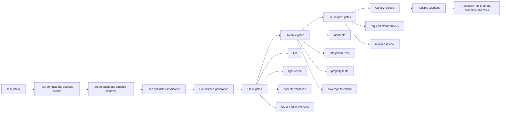

# Failure Modes of LLMs in Coding and the Engineering Controls That Actually Help

## Executive summary

Large language models are now capable enough to solve a meaningful fraction of real software tasks, but the failure surface is much broader than “hallucination.” Modern coding failures cluster into at least fourteen recurring problem types: goal misunderstanding, hallucinated facts or APIs, context mismanagement, weak reasoning, wrong architecture choices, correctness bugs, integration breakage, inadequate testing, insecure code, inefficient code, maintainability debt, brittle refactoring, malformed outputs, and agentic tool-use errors. Benchmarks such as SWE-bench were created precisely because repository-level software engineering stresses long context, multi-file coordination, execution, and reasoning beyond standard code completion. Even so, benchmark scores can overstate real usefulness: recent maintainer-review studies found that many test-passing PRs would still not be merged, and recent benchmark audits found leakage and weak-test issues in parts of SWE-bench-style evaluation. citeturn19view6turn18view2turn29view0turn30view0

The strongest overall conclusion from the literature and tool documentation is that **no single layer removes all coding failures**. Better prompting helps, but it is not sufficient. Long repository context helps, but context files can also hurt if they are verbose or impose unnecessary requirements. Test execution helps, but passing tests is not the same as maintainable, mergeable, or secure code. Static analysis helps, but it misses product intent and domain semantics. Runtime telemetry helps, but only after partial deployment. Human review remains indispensable for architecture, trade-offs, and ambiguous requirements. citeturn17view0turn26view2turn22view0turn23view1turn29view0turn32view1

The practical answer is a **layered enforcement stack**:

1. **Documents** that specify objective, scope, invariants, non-goals, and acceptable abstention conditions.
2. **Machine-checkable schemas** for task contracts, change manifests, outputs, and acceptance criteria.
3. A **repository graph** and targeted retrieval layer rather than dumping the whole repo or a long prose file into context.
4. A **verification harness** that combines linting, type checking, unit tests, integration tests, branch coverage, property-based testing, and security scanning.
5. **CI/CD gates** with required status checks and required review.
6. **Runtime controls** such as canaries and telemetry.
7. **Human review** at architectural and risk boundaries. citeturn15view0turn16view0turn18view0turn24view0turn23view2turn23view3turn23view5turn23view6turn23view1turn23view10turn23view7turn25view0

The strongest individual mitigations, ranked by real-world leverage, are: **clear success criteria plus a “no-change-needed” path; reproduction before patching; repository-structured context retrieval; machine-checked output contracts; static analysis and type systems; execution feedback and tests; mandatory security scanning; protected-branch gates; and progressive rollout with telemetry.** Anthropic’s coding guidance, SWE-agent’s ACI design notes, OpenAI’s structured-output and eval tooling, and recent academic work on self-debugging, AlphaCodium, RepoCoder, AGENTS.md, CodeTaste, and efficiency/security benchmarks all point in the same direction: coding reliability comes mostly from **feedback loops and external checks**, not from “smarter prompting” alone. citeturn17view0turn21view1turn18view0turn18view1turn20view4turn20view6turn19view2turn26view2turn33search0turn28view0turn32view1

## Evidence base

This report prioritizes primary or near-primary sources: benchmark papers and benchmark-owner documentation; official tool documentation from Anthropic, OpenAI, GitHub, CodeQL, mypy, Pydantic, JSON Schema, OpenTelemetry, Argo Rollouts, coverage.py, and Hypothesis; and relevant repository/tool docs such as SWE-agent, aider, and the EquationCode repository. The evidence is strongest for repository-level bug fixing, structured output enforcement, agent/tool orchestration, testing, security scanning, and context-handling limitations. It is weaker for some higher-level product design judgments and domain-specific enterprise constraints, where the best available evidence is still emerging. citeturn19view6turn18view2turn17view0turn18view0turn23view1turn23view2turn23view3turn24view0turn25view0turn21view1turn22view0turn15view0turn16view0

A critical caveat is that even benchmarked evaluation is noisy. SWE-bench Verified was introduced because the original dataset included underspecified issues, problematic tests, and setup failures; OpenAI’s work with human annotators filtered 500 tasks to improve solvability and evaluation fidelity. Separate work later argued that leakage and weak tests still remain in parts of the family of SWE-bench-style datasets, and METR showed that benchmark-passing PRs can still lag far behind maintainer mergeability. That does **not** make benchmarks useless; it means they should be treated as one layer of evidence, not as a direct proxy for production readiness. citeturn18view2turn30view0turn29view0

The EquationCode repository is relevant here because it pushes in the right direction on specification rigor. EQC defines explicit objective semantics, reproducibility contracts, numeric policy, operator manifests, invariants, lint rules, golden traces, and refactoring-equivalence levels. Its companion bridge specification goes further by proposing deterministic artifact registries, document↔implementation bindings, dependency graphs, clean-room sandboxing, content-addressed inputs, and change classification. Those are strong governance primitives, but the academic and tooling evidence suggests they still need to be embedded in a larger verification stack to address context-window degradation, security, execution correctness, and agent tool-use faults. citeturn15view0turn16view0turn20view2turn23view1turn32view1

## Taxonomy of coding failure modes

The table below covers the main failure types requested, with concrete examples, root causes, measurable indicators, typical failure modes, and the highest-priority mitigations. The mitigation ordering is a synthesis based on the cited evidence.

| Problem type | Concrete example | Root causes | Measurable indicators | Typical failure modes | Highest-priority mitigations |
|---|---|---|---|---|---|
| Goal and requirement failures | The model “fixes” a symptom, edits the wrong module, or patches code that is already correct. | Underspecified prompts, no explicit abstention path, premature coding before exploration, and reward dynamics that bias toward producing a patch instead of concluding “no change needed.” citeturn17view0turn7view0 | Reproduction-first rate, abstention accuracy on already-fixed issues, rollback rate, rate of touching files outside intended scope. | Solving the wrong problem, unnecessary edits, stale-issue patching, local fixes that violate business intent. | Require a task contract; enforce “explore → plan → implement”; require issue reproduction or explicit failure to reproduce; permit and reward `NO_CHANGE` outcomes. citeturn17view0turn7view0 |
| Hallucination and factual failures | Invented APIs, wrong library behavior, nonexistent config flags, fabricated file paths, or plausible but invalid code. | Code hallucination is a documented phenomenon; models can produce syntactically or semantically plausible but incorrect outputs, including security-relevant defects. citeturn19view0turn19view1 | Compile errors, import errors, undefined symbol rate, schema-invalid outputs, unsupported enum values. | Broken builds, runtime crashes, phantom dependencies, fabricated migrations or settings. | Use machine-checkable output schemas, type checking, import resolution, retrieval of exact docs/symbols, and static validation before merge. Structured outputs reduce invalid format and enum hallucinations but do not guarantee semantic truth. citeturn18view0turn24view0turn23view2 |
| Context failures | The right function exists in the repo, but the model does not find or use it, or forgets earlier constraints in a long session. | Long-context models still suffer “lost in the middle”; performance degrades when relevant information sits in the middle of long inputs. Claude Code documentation also states performance degrades as context fills. Repo-level retrieval methods improve over in-file baselines. citeturn20view2turn17view0turn19view2turn22view0 | Tokens consumed per task, retrieval hit rate, files read before successful patch, instruction-loss incidents, context-compaction frequency. | Duplicate implementations, missed utilities, violating earlier constraints, reintroducing reverted ideas. | Prefer repo graph plus targeted retrieval over whole-repo dumps; aggressively reset or compact stale context; keep project guidance minimal and high-signal. citeturn22view0turn17view0turn26view2 |
| Architecture failures | A patch works but puts logic in the wrong layer, leaks domain rules into handlers, or bypasses existing abstractions. | Architecture choice requires high-level decomposition and long-horizon reasoning; agent frameworks work best when simple and composable, and over-complex abstractions can obscure debugging. Refactoring research shows models align better when structure is proposed before implementation. citeturn21view0turn33search0 | Number of architectural rule violations, dependency-layer violations, new cycles in repo graph, proportion of code placed outside allowed module boundaries. | Architecture drift, broken layering, duplicated domains, bypassing service boundaries. | Add repository graph and dependency rules; encode allowed paths and ownership; require “proposal first” for multi-file work; architecture review for medium/high-risk changes. citeturn16view0turn22view0turn33search0 |
| Correctness failures | Code compiles and even passes some tests, but the algorithm is wrong on edge cases or hidden cases. | Real software tasks require multi-file reasoning and execution beyond basic code generation; tests can be incomplete; self-debugging and iterative flows measurably improve correctness. citeturn19view6turn18view2turn20view4turn20view6 | Compile/lint/type-check pass rate, unit/integration failure rate, property-test failure rate, fail-to-pass success, mutation score if used. | Off-by-one logic, wrong invariants, incorrect error handling, regression bugs, passing visible tests but failing hidden cases. | Executable acceptance tests; self-debug loops with execution feedback; multi-stage generation; stronger test generators; golden traces for critical flows. citeturn20view4turn20view6turn18view2 |
| Integration failures | The code works in isolation but breaks when connected to framework, build system, schema, or repository conventions. | Repository-level context is often essential; in-file coding is insufficient for multi-file and API usage scenarios. Models need exact local symbol and dependency context. citeturn19view2turn22view0turn17view0 | Integration-test pass rate, dependency-resolution failures, API contract violations, “works locally but not in CI” frequency. | Wrong framework hooks, broken dependency injection, mismatched config names, schema mismatches, incorrect migration order. | Contract tests, environment manifests, repo graph retrieval, dependency pinning, typed schemas for IO boundaries, CI matrices across supported versions/platforms. citeturn16view0turn23view11turn23view3turn24view0 |
| Testing failures | The agent writes code without adding tests, or writes narrow tests that only prove the happy path. | Coding systems perform much better when they can verify their own work. Tests remain incomplete unless explicitly required and varied. Property-based testing helps surface edge cases humans miss. citeturn17view0turn23view6turn23view5 | Test-addition rate, branch coverage, property-test failure rate, defect escape rate after merge. | False confidence from low-value tests, hidden branch gaps, regressions missed by happy-path checks. | Require runnable verification criteria in the task; track branch coverage; add property-based tests for parsers/stateful logic; reject changes without appropriate tests unless justified. citeturn17view0turn23view5turn23view6 |
| Security failures | The code is functionally correct but introduces XSS, log injection, insecure crypto choices, or unsafe data handling. | Vendor-scale measurement studies found security pass rates far below syntax correctness and roughly flat over time without explicit security guidance. Static analysis and human security review remain necessary. citeturn32view0turn32view1turn23view1 | SAST findings, CWE-specific secure-pass rate, secret-leak rate, authz/authn review findings. | Input validation gaps, unsafe defaults, hard-coded secrets, insecure serialization, incorrect authorization checks. | Treat AI output as untrusted; mandatory SAST/CodeQL; security-focused prompts or subagents; protected-branch review for auth, crypto, and dataflow-sensitive code. citeturn23view1turn17view0turn23view10 |
| Performance and efficiency failures | The implementation is correct but O(n²) instead of O(n log n), does redundant work, or ignores batching. | Efficiency is systematically under-measured by correctness-only benchmarks; ENAMEL shows LLMs fall short of expert-level efficient code and struggle with advanced algorithms and implementation optimization. A recent taxonomy also found logic and performance inefficiencies to be common and co-occurring. citeturn28view0turn28view1 | Runtime budget violations, memory growth, asymptotic regressions, `eff@k`, benchmark delta vs baseline. | Slow endpoints, expensive queries, needless allocations, timeouts only seen at scale. | Add explicit performance budgets; benchmark hotspots in CI; require complexity notes for nontrivial code; prefer retrieval of known optimized patterns; canary performance telemetry before full rollout. citeturn28view0turn23view7turn25view0 |
| Maintainability failures | The patch works but is verbose, duplicated, defensive to a fault, or inconsistent with project style. | Research on inefficiencies in LLM-generated code identifies readability and maintainability categories alongside logic/performance issues. Recent refactoring work notes that model solutions often accumulate complexity and duplication. citeturn28view1turn33search0 | Cyclomatic complexity, duplication, lint violations, diff size, unrelated-file touches, reviewer code-quality rejections. | “Agent slop,” too many abstractions, inconsistent naming, dead code, boilerplate accumulation. | Enforce lint/style/type gates; set patch minimality limits; require explanation of touched files; run maintainability-focused review before merge. citeturn23view2turn23view10turn29view0 |
| Refactoring failures | The model changes behavior while “cleaning up” code, or chooses a refactor that humans would not want. | CodeTaste shows a gap between models and human refactoring choices; performance improves when refactoring is specified in detail and when a propose-then-implement decomposition is used. citeturn33search0 | Behavior-preservation failures, static-pattern checks, snapshot diffs, unrelated semantic changes during refactor. | Hidden behavior drift, over-refactoring, large hard-to-review diffs, breakage despite passing narrow tests. | Separate refactor proposals from implementation; require equivalence tests, snapshots, and static pattern checks; gate large refactors behind human review. citeturn33search0turn15view0 |
| Reasoning failures | The model skips reproduction, misses a necessary chain of implications, or plans only one step ahead. | ReAct shows value from interleaving reasoning and acting; planning-guided and self-debugging methods improve performance, especially on harder tasks. SRI’s fixed-code study found many agents patch before even checking whether a bug still exists. citeturn21view2turn20view7turn9search5turn7view0 | Reproduction-before-edit rate, number of plan revisions, rate of failed first patch later corrected by feedback. | Wrong intermediate assumptions, brittle one-shot patches, blind editing, poor exception handling. | Require explicit plan objects for nontrivial work; verify before patching; add reflection/self-debug loops with execution feedback. citeturn17view0turn20view7turn7view0 |
| Output failures | The agent emits malformed JSON, incomplete manifests, invalid patch envelopes, or missing required keys. | Absent structure, models can omit keys or emit invalid enum values; structured outputs enforce schema adherence better than plain JSON mode. Pydantic-style validation catches type and constraint violations in parsed outputs. citeturn18view0turn23view3turn23view4 | Schema-validity rate, parse success, missing-required-field rate, patch-apply success rate. | CI orchestration failures, broken automation, silent defaulting, half-written manifests. | Make outputs schema-first; validate every generation; reject and retry invalid outputs automatically; keep response contracts narrow and typed. citeturn18view0turn24view0turn23view3 |
| Agentic and tool-use failures | The model chooses the wrong tool, reads too much, issues malformed commands, or gets stuck in high-cost loops. | Tool interface design matters. Anthropic advises simple composable patterns and warns that frameworks can obscure prompts/responses. SWE-agent documents that ACI design, linter checks, constrained file viewing, and search tools materially affect results. citeturn21view0turn21view1 | Tool-call success rate, command failure rate, average steps per solved task, token/tool cost per accepted patch. | Infinite exploration, malformed edits, bad shell commands, permission escalation, state desynchronization. | Keep tool surfaces small and explicit; provide syntax-safe editors and search; restrict permissions; log tool traces; tune tool affordances before adding more autonomy. citeturn21view1turn17view0 |

## Metrics, indicators, and failure detection

A useful reliability program needs **leading indicators** as well as outcome metrics. Outcome metrics are obvious: benchmark pass rate, incident rate, escaped defects, and security findings. Leading indicators are more operationally useful because they tell you *why* the agent is failing and what control to strengthen. The best-supported cross-cutting indicators in the literature and docs are: reproduction-before-edit rate, task-contract completeness, schema-valid output rate, compile/lint/type-check pass rate, unit/integration/branch/property-test pass rate, SAST finding rate, efficient-code metrics such as `eff@k`, test-passing-vs-mergeable gap, and tool-step cost per accepted change. citeturn7view0turn18view0turn23view2turn23view5turn23view6turn28view0turn29view0

The “test-passing-vs-mergeable” gap deserves special emphasis. SWE-bench and SWE-bench Verified score patches using fail-to-pass and pass-to-pass tests. That is necessary, but not sufficient. METR’s 2026 maintainer-review study found that roughly half of test-passing SWE-bench Verified PRs from mid-2024 to mid/late-2025 agents would not be merged into main, with maintainers commonly citing core-functionality issues, breakage, or code-quality problems. This means any coding-agent program that optimizes only for “tests green” is likely to overestimate real engineering value. citeturn18view2turn29view0

There is also a distinct **context-quality metric** that most teams under-measure. Lost-in-the-middle results show that longer context is not automatically better; what matters is whether the right context is retrieved and placed accessibly. Claude Code documentation similarly warns that context windows fill quickly and degrade performance. This implies that teams should measure retrieval precision, number of files read before success, and the share of task-critical symbols actually provided to the model, not just token count. citeturn20view2turn17view0turn22view0

A practical scorecard looks like this:

| Metric family | Example metric | Why it matters | Typical gate |
|---|---|---|---|
| Intent | Reproduction-first rate | Detects “patch first, think later” behavior | Must reproduce or explicitly justify why reproduction is impossible |
| Structure | Schema-valid output rate | Prevents orchestration failures | 100% required for automation-facing outputs |
| Static correctness | Lint/type-check success | Cheap early bug filter | Required |
| Dynamic correctness | Unit + integration + branch coverage | Catches behavior regressions | Required, with branch thresholds for critical modules |
| Generalization | Property-test pass rate | Finds edge cases human tests miss | Required for parsers, state machines, and transformations |
| Security | SAST/CWE finding count | Catches common vulnerability classes | Zero high-severity findings |
| Performance | Benchmark delta / runtime budget / `eff@k` | Prevents slow but correct code | Required on hot paths |
| Reviewability | Diff size, unrelated-file touch count | Controls maintainability debt | Escalate large or broad diffs to review |
| Real usefulness | Test-pass vs review-accept delta | Prevents benchmark gaming | Track continuously over time |
| Autonomy cost | Tool steps, tokens, wall-clock | Detects inefficient agent loops | Budget caps and anomaly alerts |

The exact thresholds are team-specific, but the measurement pattern is stable across stacks. Official tools already expose most primitives needed to implement this scorecard: coverage.py reports branch metrics, Hypothesis expands input-space exploration, GitHub Actions supports matrix testing, CodeQL provides code scanning for vulnerabilities and errors, protected branches enforce passing checks and review, Argo Rollouts enables staged canaries, and OpenTelemetry provides traces, metrics, and logs to correlate deployment behavior with generated changes. citeturn23view5turn23view6turn23view11turn23view1turn23view10turn23view7turn23view8turn25view0

## Mitigation patterns and comparative trade-offs

The comparative table below focuses on commonly proposed controls and their likely effect, cost, and residual risk. The effectiveness ratings are an analytical synthesis grounded in the cited evidence, not a universal law.

| Control | Best against | Effectiveness | Cost and complexity | Residual risk | Representative evidence |
|---|---|---:|---:|---:|---|
| Tight task contract with success criteria and abstention path | Goal drift, unnecessary patches, malformed outputs | High | Low to medium | Still depends on model following instructions; ambiguous business context remains | Anthropic recommends explicit verification and plan separation; SRI shows “fix-or-abstain” prompting sharply improves abstention on already-fixed issues. citeturn17view0turn7view0 |
| Repository graph plus targeted retrieval | Context failures, integration errors, wrong-file edits | High | Medium | Retrieval can miss non-obvious semantics; stale docs still mislead | RepoCoder improves over in-file and vanilla retrieval baselines; aider’s repo map exposes files, symbols, and dependency ranking. citeturn19view2turn22view0 |
| Long prose context files | Repo conventions and setup knowledge | Low to mixed | Low | Can reduce success and increase cost if verbose or overly prescriptive | AGENTS.md study found task success often dropped while inference cost rose by over 20%; authors recommend minimal requirements only. citeturn26view2turn26view3 |
| Structured outputs with JSON Schema and typed validation | Output failures, orchestration bugs | High | Low | Schema-valid does not imply semantically correct | OpenAI structured outputs guarantee schema adherence better than JSON mode; JSON Schema and Pydantic provide concrete validation primitives. citeturn18view0turn24view0turn23view3turn23view4 |
| Static analysis and type systems | Hallucinated APIs, obvious logic/type mistakes, some security flaws | High | Low to medium | Misses business semantics and some dynamic defects | mypy catches type misuse without running code; CodeQL finds vulnerabilities and errors via code scanning. citeturn23view2turn23view1 |
| Execution feedback and self-debugging loops | Correctness and reasoning failures | High | Medium | Can still overfit to visible tests; expensive on slow suites | Self-Debugging improves benchmark accuracy by up to 12%; execution-guided or iterative code flows improve hard-task performance. citeturn20view4turn20view7turn20view6 |
| Multi-stage code flows with planning and proposal selection | Architecture, refactoring, complex correctness | High | Medium to high | More latency and orchestration; can still choose wrong plan | AlphaCodium improves pass@5 from 19% to 44% in its setting; CodeTaste reports propose-then-implement improves alignment. citeturn20view6turn33search0 |
| Unit, integration, branch, and property-based tests | Correctness, regressions, edge cases | Very high | Medium | Incomplete test design still leaves blind spots | Claude docs call verification the single highest-leverage action; coverage.py and Hypothesis directly support branch and property testing. citeturn17view0turn23view5turn23view6 |
| Security scanning and specialized security review | Security failures | Very high | Medium | SAST coverage is imperfect; complex authz/dataflow still needs humans | Veracode reports a persistent gap between syntax and security; CodeQL provides automated code scanning for vulnerabilities and errors. citeturn32view1turn23view1 |
| Protected branches with required checks and reviews | Low-quality merges, unreviewed regressions | High | Low | Review throughput can bottleneck; approval quality varies | GitHub protected branches can require passing checks and approving review before merge. citeturn23view10turn23view9 |
| Canary deployment and runtime telemetry | Performance, integration, and production-only failures | High for post-merge containment | Medium to high | Problems are caught late, after partial release | Argo Rollouts supports weighted canaries and pauses; OpenTelemetry traces form end-to-end execution paths with spans and attributes. citeturn23view7turn25view0 |
| Human architecture/repo-owner review | Architecture, maintainability, ambiguous requirements | Very high | High | Review capacity does not scale linearly | METR shows benchmark-passing code still often fails maintainer review. citeturn29view0 |
| Formal governance artifacts such as EQC and EQC-SIB | Hidden semantics, reproducibility drift, binding docs↔code | High for governance and auditability | Medium to high | Does not itself solve model reasoning, security, or long-context limits | EQC defines explicit semantics, manifests, tests, and equivalence; EQC-SIB adds bindings, registries, graphs, and sandbox contracts. citeturn15view0turn16view0 |

A useful way to interpret this table is: **controls that generate external evidence** tend to outperform controls that merely ask the model to behave better. In other words, tests, schemas, type checks, SAST, protected branches, canaries, and telemetry usually beat “better instructions” when reliability matters. Prompting and repository guidance still matter, but mostly as *upstream reducers of wasted attempts*, not as a replacement for machine checks. citeturn17view0turn18view0turn23view1turn23view10turn25view0

## Recommended enforcement stack

A robust coding-agent setup is best thought of as **specification + retrieval + verification + containment + review**. The stack below shows the recommended flow.



This recommended stack maps closely to the strongest available evidence:

- **Documents** should be concise and normative. EQC is a useful model here because it makes objective semantics, reproducibility, invariants, operator manifests, observability, and equivalence explicit. Its bridge layer extends the idea to bind docs, pseudocode, code, traces, dependency graphs, and deterministic change classification. citeturn15view0turn16view0
- **Machine-checkable schemas** should define task contracts, outputs, manifests, and trace records. OpenAI structured outputs, JSON Schema, and Pydantic are directly aligned with this layer. citeturn18view0turn24view0turn23view3turn23view4
- **Repository graph and retrieval** should replace “stuff the repo into context.” RepoCoder and aider’s repo map both support this conclusion. citeturn19view2turn22view0
- **Static gates** should run before expensive execution, because type checking and code scanning catch a large class of cheap failures early. citeturn23view2turn23view1
- **Dynamic gates** should escalate from unit to integration to property-based tests, with branch coverage on critical areas. citeturn17view0turn23view5turn23view6
- **Pull-request gates** should be mandatory for protected branches, because test-passing alone is not enough. citeturn23view10turn29view0
- **Canary and telemetry** are the containment layer for failures that escape pre-merge checks, especially performance and environment-specific integration defects. citeturn23view7turn25view0

A practical minimum stack, by maturity level, looks like this:

| Layer | Minimum artifact | What it catches well | What it will not catch by itself |
|---|---|---|---|
| Documents | `TASK.md` or concise task spec | Goal clarity, non-goals, allowed abstention | Semantic correctness, hidden runtime issues |
| Machine checks | JSON Schema / typed models | Malformed outputs, missing fields, invalid enums | Semantic truth |
| Repo structure | Symbol index / repo map / dependency graph | Wrong-file edits, missed local APIs | Product intent, undocumented behavior |
| Static gates | Lint, type checker, SAST | Cheap syntax/type/security defects | Most business-logic bugs |
| Dynamic gates | Unit + integration + property tests + coverage | Correctness and regressions | Unknown unknowns, incomplete specs |
| Merge gates | Protected branch + required checks/review | Low-quality merges | Reviewer blind spots |
| Runtime controls | Canary + traces/metrics/logs | Production-only integration/perf issues | Pre-merge architecture flaws |
| Governance | Registry/bindings/traces/equivalence rules | Auditability, reproducibility, change control | Intrinsic model limits |

The important design choice is **narrow interfaces between layers**. Documents should tell the agent what success means; schemas should define the exact machine-readable form; retrieval should expose only high-signal repo state; gates should produce crisp pass/fail evidence; and telemetry should tie runtime failures back to specific generated changes. That is the shortest path from “LLM coding assistant” to “governed engineering subsystem.” citeturn15view0turn16view0turn18view0turn22view0turn25view0

## Implementation roadmap and sample artifacts

The roadmap below assumes an organization starting from ad hoc prompting and aiming for a production-grade coding-agent workflow. Effort is given as a **relative author estimate** because exact staffing varies too much by codebase size, compliance requirements, language mix, and CI maturity.

| Milestone | Main objective | Required artifacts | Primary gates | Relative effort |
|---|---|---|---|---|
| Foundation | Stop obvious drift and malformed outputs | Task contract template, output schemas, minimal repo instructions, lint/type config | Schema validation, lint, type check | Low |
| Verification | Make code prove itself | Unit/integration harness, coverage config, property-test seeds for critical modules, benchmark scripts | Tests + branch coverage + property tests | Medium |
| Governance | Bind docs, code, and change intent | Change manifest, touched-path allowlist, ownership map, repo graph, equivalence policy | Manifest validation, dependency/layer checks, reviewer routing | Medium |
| Security | Treat AI code as untrusted | SAST/CodeQL config, secret scan config, high-risk path classification | Zero critical findings; mandatory security review in sensitive modules | Medium |
| Release containment | Reduce blast radius in production | Canary config, telemetry schema, alert rules, rollback playbook | Weighted rollout, runtime SLOs, trace correlation | Medium to high |
| Continuous improvement | Learn from failures | Failure taxonomy log, eval set, maintainer-review delta tracking, prompt/rule changelog | Regression suite and periodic eval review | Medium |

### Sample task contract

The point of a task contract is not bureaucracy. It is to eliminate ambiguity *before* the model writes code.

```yaml
task_id: AUTH-217
title: Fix session refresh failure after token expiry
objective:
  kind: bugfix
  success_criterion:
    - "Reproduce the failure in an automated test"
    - "Refresh succeeds after token expiry"
    - "No regression in existing auth tests"
non_goals:
  - "Do not redesign session storage"
  - "Do not change public API routes"
allowed_paths:
  - "src/auth/**"
  - "tests/auth/**"
require_reproduction: true
allow_no_change: true
abstain_when:
  - "Issue cannot be reproduced after verification"
  - "Current code already satisfies acceptance tests"
required_checks:
  - "pytest tests/auth -q"
  - "mypy src/auth"
  - "codeql/security"
risk_level: medium
reviewers:
  - "auth-owner"
```

A schema-backed form like this lets the orchestrator reject underspecified work and route risky work differently. That aligns with structured output tooling and with the evidence that clearer verification criteria and abstention handling materially improve coding behavior. citeturn18view0turn17view0turn7view0

### Sample change manifest schema fragment

This kind of manifest prevents “wandering edits” and provides auditable intent.

```json
{
  "$schema": "https://json-schema.org/draft/2020-12/schema",
  "title": "ChangeManifest",
  "type": "object",
  "required": ["task_id", "summary", "touched_files", "checks_run", "status"],
  "properties": {
    "task_id": { "type": "string" },
    "summary": { "type": "string", "minLength": 20 },
    "touched_files": {
      "type": "array",
      "items": { "type": "string" },
      "minItems": 1
    },
    "checks_run": {
      "type": "array",
      "items": {
        "type": "string",
        "enum": ["lint", "typecheck", "unit", "integration", "property", "sast"]
      }
    },
    "status": {
      "type": "string",
      "enum": ["implemented", "no_change", "blocked"]
    }
  },
  "additionalProperties": false
}
```

This uses standard JSON Schema patterns such as `required` and `enum`, and is a good fit for strict structured outputs or a Pydantic model in the orchestrator. citeturn24view0turn18view0turn23view3

### Sample repository graph record

This is the minimum viable repository graph for coding agents: ownership, allowed dependencies, and stable symbols.

```yaml
module: src/auth/session.py
exports:
  - SessionManager.refresh_token
  - SessionManager.invalidate
depends_on:
  - src/auth/token.py
  - src/storage/cache.py
owned_by: auth-owner
layer: service
allowed_inbound_from:
  - src/api/**
forbidden_inbound_from:
  - src/ui/**
high_risk: true
tests:
  - tests/auth/test_session_refresh.py
```

This kind of artifact is simpler than a full EQC-SIB graph, but it follows the same philosophy: make relationships explicit, checkable, and stable across refactors. citeturn16view0turn22view0

### Example LLM implementation contract

For nontrivial tasks, the most reliable contract is usually something like this:

```text
You are working in a governed coding workflow.

Required procedure:
1. Inspect only repo-map targets and task-allowed paths first.
2. Reproduce the issue with an executable command or explain why reproduction is impossible.
3. If the issue is already resolved, return status=NO_CHANGE with evidence and do not modify code.
4. If a fix is needed, produce:
   - a brief plan,
   - the minimal file set to touch,
   - the tests you will run.
5. Implement only after the plan is consistent with the task contract.
6. Run required checks.
7. Return a structured ChangeManifest that conforms to the provided schema.

Hard constraints:
- Do not edit files outside allowed_paths.
- Do not bypass failing checks by deleting or weakening tests.
- Do not invent APIs or config keys; read the exact definitions first.
- Prefer existing repository abstractions over new ones.
```

This contract deliberately encodes the strongest evidence-backed practices: verify first, allow abstention, keep the touched-file set narrow, and force structured evidence on exit. citeturn17view0turn7view0turn18view0

### How EquationCode fits

EQC is especially useful if the codebase contains mathematically dense algorithms, simulation logic, stochastic procedures, or cross-implementation reproducibility requirements. Its strengths are explicit operator semantics, reproducibility contracts, numeric policy, observability, golden traces, and equivalence levels for refactors. EQC-SIB extends that with artifact registries, bindings, graphs, and deterministic validation contracts. In other words, EQC can serve as the **document and governance spine** of the stack. It should then be paired with the rest of the enforcement layers: schema-validated outputs, repo-graph retrieval, lint/type/SAST gates, execution tests, branch protections, canarying, and telemetry. citeturn15view0turn16view0turn23view1turn23view10turn23view7turn25view0

## Sources and limitations

The strongest evidence in this area is still concentrated in benchmarked bug-fixing, code generation, and tooling-vendor evaluations. Some important limitations remain. First, benchmark performance does not transfer cleanly to enterprise repositories with private dependencies, organizational process constraints, or long-lived product context. Second, evidence around maintainability, architecture, and refactoring is improving, but these areas are harder to score than test-passing correctness. Third, some security measurements here come from an official vendor research program rather than a peer-reviewed academic benchmark; they are still useful because they are large-scale and methodologically explicit, but they should be read as operational evidence rather than final theory. Fourth, AGENTS.md-style repository instructions show mixed results: context is helpful, but extra prose can reduce success and increase cost. citeturn29view0turn33search0turn32view1turn26view2

Selected sources cited inline:

- SWE-bench, OpenReview. citeturn19view6
- OpenAI, *Introducing SWE-bench Verified*. citeturn18view2
- Aleithan et al., *SWE-Bench+: Enhanced Coding Benchmark for LLMs*. citeturn30view0
- METR, *Many SWE-bench-Passing PRs Would Not Be Merged into Main*. citeturn29view0
- Agarwal et al., *CodeMirage: Hallucinations in Code Generated by Large Language Models*. citeturn19view0
- Rahman and Kundu, *Code Hallucination*. citeturn19view1
- Liu et al., *Lost in the Middle*. citeturn20view2
- Zhang et al., *RepoCoder*. citeturn19view2
- Chen et al., *Teaching Large Language Models to Self-Debug*. citeturn20view4
- Ridnik et al., *AlphaCodium*. citeturn20view6
- Gloaguen et al., *Evaluating AGENTS.md*. citeturn26view2
- Thillen et al., *CodeTaste: Can LLMs Generate Human-Level Code Refactorings?* citeturn33search0
- Qiu et al., *How Efficient is LLM-Generated Code?* citeturn28view0
- Abbassi et al., *A Taxonomy of Inefficiencies in LLM-Generated Python Code*. citeturn28view1
- Anthropic, *Best practices for Claude Code*. citeturn17view0
- Anthropic, *Building effective agents*. citeturn21view0
- SWE-agent documentation on the Agent-Computer Interface. citeturn21view1
- aider documentation on repository maps. citeturn22view0
- OpenAI, *Structured model outputs* and Evals cookbook. citeturn18view0turn18view1
- GitHub CodeQL documentation and GitHub branch protection documentation. citeturn23view1turn23view10
- mypy, Pydantic, JSON Schema, coverage.py, Hypothesis, GitHub Actions, Argo Rollouts, OpenTelemetry. citeturn23view2turn23view3turn23view4turn24view0turn23view5turn23view6turn23view11turn23view7turn25view0
- EquationCode EQC and EQC-SIB repository documents. citeturn15view0turn16view0